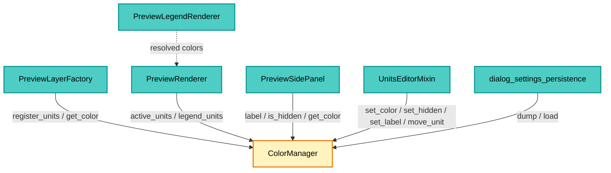
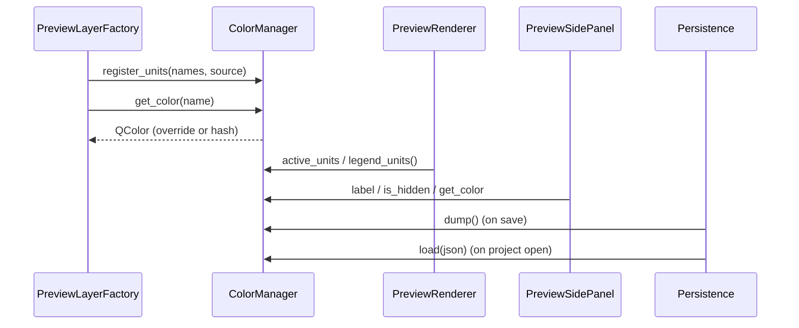

---
tags:
  - secinterp
  - code-walkthrough
  - gui
  - renderers
aliases:
  - color_manager.py
  - ColorManager
cssclass: secinterp-note
---

# `gui/renderers/color_manager.py`

> [!abstract] One-line summary
> Registry of geological and drillhole units that assigns each name a deterministic
> color, stores the user's overrides (color, visibility, alias and order) and serializes
> that state so it can be persisted in the project.

**Path**: `gui/renderers/color_manager.py` (173 lines)
**Main class**: `ColorManager`
**Layer**: GUI (Present · Symbology state)
**Tags**: #secinterp #gui #renderers

---

## 🎯 Why does this file exist?

A preview can hold dozens of units; if every render picked colors "at random", the same
unit would change color between previews and between the canvas and the legend. The
`ColorManager` centralizes that decision and, on top of that, stores what the user
customizes.

| Problem | Solution |
|---------|----------|
| A unit's color must be stable across renders | Hash of the name → index into `GEOLOGY_COLORS` |
| The user wants to recolor a unit | `_overrides` (name → `QColor`) |
| They want to hide units without deleting data | `_hidden` (`set[str]`) |
| They want to rename (alias) without touching the data | `_labels` (name → text) |
| They want to reorder the legend | `_order` (list of names) + `ordered_units()` |
| The state must survive the session | `dump()` / `load()` → JSON in the project |
| Geology and drillholes share names | `_sources` separates both sets |

> [!important] Architectural note
> It is a **pure state object** (no QWidget, no signals, no QgsLayer): it only depends on
> `QColor`. That makes it testable without QGIS and shareable between the panel, the
> settings editor, the renderer and persistence. The UI never mutates colors directly: it
> always goes through this manager.

---

## 🧬 Relationship diagram



> [!tip] How to read
> All consumers share **the same instance** (the dialog creates it and injects it). That is
> why a color change in the panel shows up in the canvas and in the PNG without copying
> state. `dump`/`load` are the only door to disk (via the project JSON).

---

## 📦 Imports — architectural reading

```python
from __future__ import annotations

from collections.abc import Iterable
from typing import Any, ClassVar

from qgis.PyQt.QtGui import QColor
```

| # | Observation |
|---|-------------|
| ① | Only `QColor`: no `qgis.core`, no widgets, no signals. |
| ② | `Iterable` to accept lists, sets or generators in `register_units`/`set_order`. |
| ③ | `ClassVar` marks the palette as a class constant (shared, not per instance). |
| ④ | `Any` only in `dump`/`load` (JSON payload with no fixed schema). |
| ⑤ | No logger: the operations are deterministic and do not fail. |

---

## 🏗️ Structure inventory

**Class:** `ColorManager` — 16 methods, 6 state structures.

| Attribute | Type | Role |
|---|---|---|
| `_active_units` | `dict[str, QColor]` | Cache of already computed colors |
| `_overrides` | `dict[str, QColor]` | Colors chosen by the user |
| `_hidden` | `set[str]` | Hidden units |
| `_known_units` | `set[str]` | All units ever seen |
| `_labels` | `dict[str, str]` | Display aliases |
| `_order` | `list[str]` | Custom order |
| `_sources` | `dict[str, set[str]]` | `{"geology": {...}, "drillholes": {...}}` |

**Palette:** `GEOLOGY_COLORS` — 16 `QColor`s (red, blue, green, purple, yellow, orange,
turquoise, gray…).

---

## 📁 Files in the package

| File | Role relative to the manager |
|---|---|
| `gui/preview_layer_factory.py` | Registers units and asks for colors when creating layers (see [[preview_layer_factory]]) |
| `gui/preview_renderer.py` | Exposes `active_units`/`legend_units()` (see [[preview_renderer]]) |
| `gui/preview_side_panel.py` | Legend rows with color/visibility (see [[preview_side_panel]]) |
| `gui/ui/pages/settings/symbology_units.py` | Alias/order/color editor (see [[symbology_units]]) |
| `gui/preview_legend_renderer.py` | Paints the resolved colors (see [[preview_legend_renderer]]) |
| `gui/dialog_settings_persistence.py` | `dump`/`load` as project JSON (see [[dialog_settings_persistence]]) |
| `gui/main_dialog.py` | Creates and injects the instance (see [[main_dialog]]) |
| `tests/gui/test_color_manager.py` | Manager suite (97 lines) |

---

## 📖 Method-by-method walkthrough

### `register_units(names, source="geology")` — unit census

```python
bucket = self._sources.setdefault(source, set())
for name in names:
    if name:
        key = str(name)
        self._known_units.add(key)
        bucket.add(key)
```

Registering does **not** assign color or order: it only records that the unit exists and
which family it belongs to. It is called on every preview with the units present, so that
`known_units()` also includes the ones currently hidden (needed for the "Reset unit
styles" button).

### `units_for_source(source)` — separating geology from drillholes

```python
bucket = self._sources.get(source, set())
return [name for name in self.ordered_units() if name in bucket]
```

Returns the units of one family **in the current order**. This is what lets the panel
paint two sections (*Geology* / *Drillhole lithologies*) without mixing homonymous names.

### `known_units()` — sorted census

```python
return sorted(self._known_units)
```

Alphabetical order independent of the custom order; used to reset the whole unit state
(including units that are not visible).

### `get_color(name)` — deterministic color

```python
if not name:
    return QColor(100, 100, 100)
key = str(name)
if key in self._overrides:
    color = self._overrides[key]
    self._active_units[key] = color
    return color
if key in self._active_units:
    return self._active_units[key]
color = self.GEOLOGY_COLORS[sum(ord(c) for c in key) % len(self.GEOLOGY_COLORS)]
self._active_units[key] = color
return color
```

Three levels of precedence:

| Priority | Source | When |
|---:|---|---|
| 1 | `_overrides[key]` | The user chose a color |
| 2 | `_active_units[key]` | Already computed in this session |
| 3 | Hash `sum(ord(c)) % 16` | First time the unit is seen |

The hash is **stable across sessions and platforms** (it does not use `hash()`, which
changes with `PYTHONHASHSEED`). An empty name returns neutral gray.

### `set_color(name, color)` — override

```python
key = str(name)
self._overrides[key] = color
self._active_units[key] = color
```

Writes to both maps: the override wins in `get_color` and the cache avoids recomputing. It
does not validate the `QColor` (the UI already does that with `isValid()`).

### `set_hidden` / `is_hidden` / `hidden_units`

```python
if hidden:
    self._hidden.add(key)
else:
    self._hidden.discard(key)
```

Set operations; `hidden_units()` returns a **copy** so the caller cannot mutate the
internal state.

### `overrides()` — defensive copy

```python
return dict(self._overrides)
```

Used to serialize without exposing the live dictionary.

### `label(name)` / `set_label(name, text)` / `labels()`

```python
key = str(name)
value = (text or "").strip()
if not value or value == key:
    self._labels.pop(key, None)
else:
    self._labels[str(name)] = value
```

Alias rules:

| Input | Result |
|---|---|
| `""` or only whitespace | The alias is deleted |
| Equal to the original name | The alias is deleted (not a real change) |
| Any other text | Stored as an alias |

`label(name)` returns the alias or the original name when there is none.

### `ordered_units()` — custom order + alphabetical remainder

```python
known = self._known_units
ordered = [name for name in self._order if name in known]
seen = set(ordered)
ordered.extend(sorted(name for name in known if name not in seen))
return ordered
```

The user's order wins for the units they know; new ones (appearing later) are appended
alphabetically at the end. A unit is never lost because of a stale order.

### `set_order(names)` / `move_unit(name, delta)`

```python
order = self.ordered_units()
key = str(name)
if key not in order:
    return
index = order.index(key)
target = index + delta
if target < 0 or target >= len(order):
    return
order[index], order[target] = order[target], order[index]
self._order = order
```

`move_unit` materializes the current order and **swaps** with the neighbor; the extremes
are no-ops (they do not raise). After the swap it stores the full list as the new order.

### `dump()` — serialize

```python
{
    "overrides": {name: color.name() for name, color in self._overrides.items()},
    "hidden": sorted(self._hidden),
    "labels": dict(self._labels),
    "order": list(self._order),
}
```

Only **customization** is serialized, not `_known_units` or `_active_units` (they are
rebuilt on the next preview). Colors are stored as `#rrggbb` (`QColor.name()`).

### `load(data)` — restore

```python
if not data:
    return
for name, hex_color in (data.get("overrides") or {}).items():
    color = QColor(str(hex_color))
    if color.isValid():
        self._overrides[str(name)] = color
        self._active_units[str(name)] = color
```

Tolerant of partial or corrupted payloads: it ignores invalid colors and missing keys.
The order is filtered to drop empty entries.

---

## 🔄 Data flow



1. Every preview registers the units present (geology and drillholes separately).
2. The factory asks for colors and creates the memory layers.
3. The panel and the legend query alias/visibility/color.
4. On close (or settings change) `dump` goes to the project JSON; on open, `load` restores it.

---

## 🏛️ Design patterns present

| Pattern | Where | Why |
|---|---|---|
| **Registry** | `_known_units`, `_sources` | Census units without duplicating |
| **Override map** | `_overrides` | Customization on top of the default |
| **Deterministic hashing** | `get_color` | Stable color with no external state |
| **Copy-on-read** | `hidden_units`, `overrides`, `labels` | Avoid accidental mutations |
| **Stable ordering** | `ordered_units` | Blend user order + remainder |
| **DTO serialization** | `dump` / `load` | Tolerant JSON persistence |

---

## 🧾 API summary

| Method | Input | Output / effect |
|---|---|---|
| `register_units` | names, source | Records known units |
| `units_for_source` | source | Ordered list of that family |
| `known_units` | — | All of them, alphabetical |
| `get_color` | name | `QColor` (override → cache → hash) |
| `set_color` | name, color | Override + cache |
| `set_hidden` | name, bool | Adds/removes from `_hidden` |
| `is_hidden` | name | bool |
| `hidden_units` | — | Copy of the set |
| `overrides` | — | Copy of the dict |
| `label` | name | Alias or name |
| `set_label` | name, text | Alias (empty = delete) |
| `labels` | — | Copy of the dict |
| `ordered_units` | — | Custom order + remainder |
| `set_order` | names | Fixes the order |
| `move_unit` | name, delta | Moves one position up/down |
| `dump` | — | JSON-serializable |
| `load` | data | Restores (tolerant) |

---

## 🛡️ Error handling

- **Empty name**: `get_color("")` returns gray; `set_color("")` does nothing.
- **Unknown unit**: `move_unit` returns without changing anything.
- **Order extremes**: `move_unit` on the first/last is a no-op.
- **Partial JSON**: `load` uses `or {}` / `or []` on each field.
- **Invalid persisted color**: ignored (`isValid()`), the hash still wins.
- **Empty alias**: interpreted as "no alias" and deleted.

---

## 🧪 Associated tests

| Test | What it covers |
|---|---|
| `tests/gui/test_color_manager.py` | Deterministic hash, overrides, hidden, labels, order, dump/load |
| `tests/gui/test_preview_side_panel.py` | Consumption of `label`/`is_hidden`/`get_color` |
| `tests/gui/test_symbology_tab.py` | Alias/order/color editing through the mixin |
| `tests/gui/test_renderers.py` | Colors applied to the preview layers |

---

## 👀 Observations and notes

1. **The hash can collide**: two names with the same sum of `ord` share a color. That is
   acceptable for a 16-color palette; the user can override it.
2. **`_active_units` is not serialized**: it is a session cache; on the next preview it is
   recomputed from overrides + hash.
3. **Geology and drillholes can repeat a name**: `_sources` prevents a drillhole lithology
   from "stealing" the color of a geological unit in the legend.
4. **`known_units` grows with the session**: a unit that disappears from the preview is
   still known until the project is closed; useful for resetting all of them.
5. **`set_label` normalizes**: surrounding whitespace is trimmed and an alias equal to the
   name is discarded.
6. **No signals**: the manager does not announce changes; whoever mutates it (panel/tab)
   emits its own signal and requests a re-render.

---

## 🎨 Assignment example

```text
Granodiorita  -> sum(ord) % 16 = 3  -> QColor(155, 89, 182)   # Purple
Esquisto      -> sum(ord) % 16 = 9  -> QColor(211, 84, 0)     # Pumpkin
Lutita        -> sum(ord) % 16 = 1  -> QColor(52, 152, 219)   # Blue
(override)    -> #ff8800            -> wins over the hash
```

The same table is used on the canvas, the side panel and the exported PNG.

---

## 🔗 Related notes

- [[Index]] — vault index
- [[preview_layer_factory]] — registers units and asks for colors
- [[preview_renderer]] — `active_units` / `legend_units()`
- [[preview_side_panel]] — editable legend rows
- [[symbology_units]] — alias/order/color editor
- [[preview_legend_renderer]] — paints the resolved colors
- [[dialog_settings_persistence]] — `dump`/`load` in the project
- [[main_dialog]] — creates and injects the instance
- [[gui_renderers]] — hub of the `renderers/` package

---

*Note of the SecInterp Code Walkthrough v2 vault — v3.11.0*
