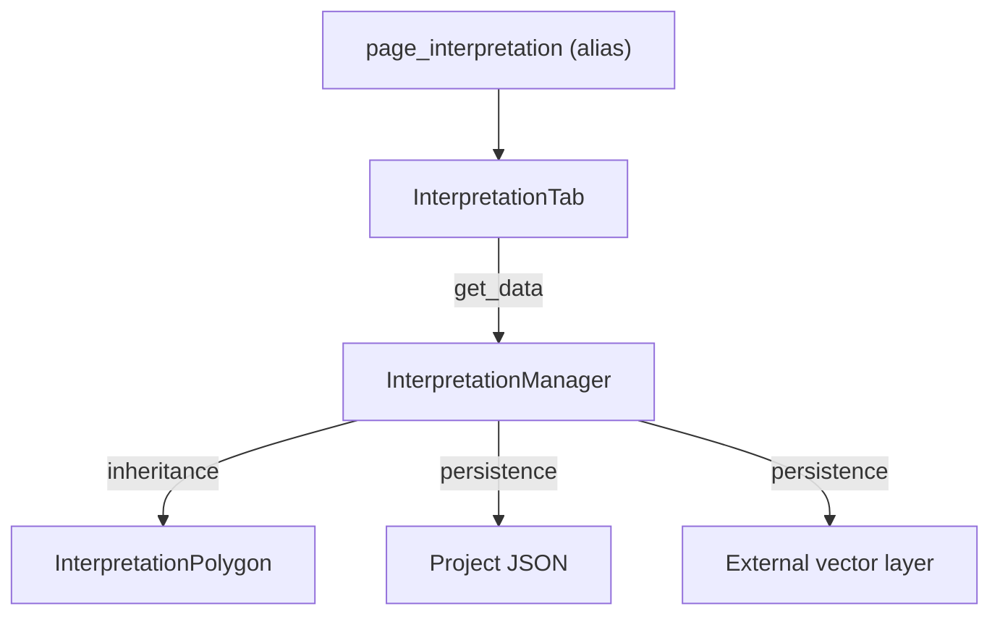

---
tags:
  - secinterp
  - code-walkthrough
  - gui
  - ui-pages
  - settings
  - interpretation
aliases:
  - interpretation_tab.py
  - InterpretationTab
cssclass: secinterp-note
---

# `gui/ui/pages/settings/interpretation_tab.py`

> [!abstract] One-line summary
> **Settings** tab for interpretation storage, custom fields and attribute
> inheritance from geology and drillholes.

**Path**: `gui/ui/pages/settings/interpretation_tab.py`
**Main class**: `InterpretationTab`
**Layer**: GUI · Settings
**Tags**: #secinterp #gui #ui-pages #settings #interpretation

---

## 🎯 Why it exists

The old `InterpretationPage` occupied a sidebar entry, but its content is not a
workflow: it is configuration that is set once.

| Need | Implementation |
|---|---|
| Choose storage | `Project (Internal JSON)` or `Vector Layer (External)` |
| Sync with the layer | `Auto-Sync on layer edits` |
| Custom attribute fields | `fields_table` (name/type/default) |
| Inherit geology/drillholes | `chk_inherit_geol`, `chk_inherit_drill` |
| Keep consumers working | `MainWindow.page_interpretation` alias |

`InterpretationTab` lives inside `SettingsPage`:
`Default | Advanced | Symbology | Interpretation | Plugin Information`.

---

## 🔄 Data flow

`dump()` persists `interp_inherit_geol`, `interp_inherit_drill` and
`interp_custom_fields`; `load()` restores them. The keys are unchanged from the
old page, so no project migration is required.

---

## ⚙️ API

| Method | Responsibility |
|---|---|
| `get_data()` | source, target layer, auto-sync, custom fields, inheritance |
| `dump()` / `load()` | project-persisted state |
| `reset()` | default inheritance and empty table |
| `validate()` | empty or duplicate names |
| `connect_signals()` / `disconnect_signals()` | buttons and source changes |

---

## 🔗 Related notes

- [[settings_page]] — tab container.
- [[gui_ui_pages_settings]] — Settings hub.
- [[dialog_interpretation_manager]] — `get_data()` consumer.
- [[interpretation_persistence_mixin]] — dual persistence.
- [[interpretation_inheritance_mixin]] — attribute inheritance.
