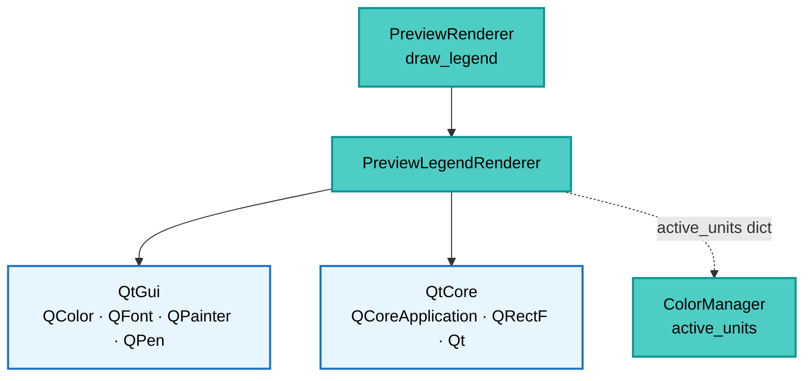

---
tags:
  - secinterp
  - code-walkthrough
  - gui
  - renderers
aliases:
  - preview_legend_renderer.py
  - PreviewLegendRenderer
cssclass: secinterp-note
---

# `gui/preview_legend_renderer.py`

> [!abstract] One-line summary
> Draws the preview legend on a `QPainter`: it builds typed rows (layer, unit,
> header or interpretation), measures them, places them in one of four corners and paints
> them with a configurable font size and item cap.

**Path**: `gui/preview_legend_renderer.py` (279 lines)
**Main class**: `PreviewLegendRenderer`
**Layer**: GUI (Present · Legend Renderer)
**Tags**: #secinterp #gui #renderers

---

## 🎯 Why does this file exist?

The canvas shows temporary layers outside the project legend (they are registered with
`addMapLayer(layer, False)`), so the preview needs its own painted legend:

| Problem | Solution |
|---------|----------|
| Temporaries never appear in the QGIS legend | Hand-painted legend with `QPainter` over the canvas |
| Unit count varies per preview | `_measure` measures each string with `fontMetrics` |
| Topography and structures are optional | `has_topography` / `has_structures` flags with early exit when all empty |
| Literals must be translated | `QCoreApplication.translate("PreviewLegendRenderer", ...)` |
| Painting must not leak into the canvas | `painter.save()` / `restore()`: font and pens restored |

> [!important] Architectural note
> **Stateless immediate renderer.** All `staticmethod`, no constructor, no state: in go
> `painter + rect + units + flags`, out go pixels. [[preview_renderer]] only forwards.

---

## 🧬 Relationship diagram



> [!tip] How to read
> Solid arrow = calls/imports; dashed = the `active_units` dict (name →
> `QColor`) produced in the `ColorManager` and traveling via factory and renderer.

---

## 📦 Imports — architectural reading

```python
# gui/preview_legend_renderer.py
from typing import Any

from qgis.PyQt.QtCore import QCoreApplication, QRectF, Qt
from qgis.PyQt.QtGui import QColor, QFont, QPainter, QPen

from sec_interp.logger_config import get_logger
```

| # | Observation |
|---|-------------|
| ① | Zero `qgis.core`: the legend touches no layers or geometries, only Qt pixels. |
| ② | `QPainter` only as a type: the canvas creates the painter, the renderer just paints. |
| ③ | `QCoreApplication.translate` for "Topography"/"Structures" (real i18n). |
| ④ | `Qt.PenStyle / Qt.BrushStyle / Qt.AlignmentFlag` with namespaced enums (QGIS 4/Qt6 style). |
| ⑤ | `Any` only in the layout `config: dict[str, Any]`. |
| ⑥ | `logger` defined but never called: painting stays silent (paint hot path). |

---

## 🏗️ Structure inventory

**Class:** `class PreviewLegendRenderer` — 10 `staticmethods`

- `draw_legend(painter, rect, active_units, has_topography=False, ..., layout=None, layer_colors=None)` — high-level entry
- `_build_rows(...)` — composes every row
- `_layer_rows(...)` / `_unit_rows(...)` / `_interpretation_rows(...)` — rows per family
- `draw_rows(painter, rect, rows, layout=None)` — layout + painting
- `_position(rect, size, position, margin)` → `(x, y)`
- `_measure(painter, rows, config)` → `(QRectF, max_text_width)`
- `_draw_row(painter, x, y, kind, label, color, max_width, config)` → next `y`
- `_draw_legend_background(painter, x, y, width, height)`

**Module helpers:** `_translator()`, `_interpretation_label(interp)`,
`_interpretation_color(interp)`.

**Row types:** `_LINE` (line), `_SWATCH` (square), `_HEADER` (bold header).

**Layout** (optional dict):
- `font_size` (6–16, default 8), `position` (`top-right`, `top-left`, `bottom-right`, `bottom-left`), `max_items` (0 = all)
- derived `config`: `padding = 6`, `item_height = max(12, font_size + 6)`, `symbol_size = max(8, font_size + 2)`, `line_width = 2`, `margin = 20`

---

## 📁 Files in the package

| File | Role relative to the legend |
|---|---|
| `gui/preview_renderer.py` | `draw_legend(painter, rect)` forwards units + flags |
| `gui/preview_layer_factory.py` | `active_units` (via `ColorManager`) feeds geological rows |
| `gui/renderers/color_manager.py` | Produces the per-unit `QColor`s |
| `gui/ui/pages/preview_page.py` | Page/canvas triggering the paint (see [[preview_page]]) |

---

## 📖 Method-by-method walkthrough

### `draw_legend` — build rows and delegate

```python
rows = PreviewLegendRenderer._build_rows(
    active_units=active_units, has_topography=has_topography,
    has_structures=has_structures, has_drillholes=has_drillholes,
    labels=labels or {}, drill_units=drill_units or {},
    interpretations=interpretations or [], layer_colors=layer_colors or {},
)
PreviewLegendRenderer.draw_rows(painter, rect, rows, layout)
```

The public entry no longer paints: it normalizes the optionals (`or {}` / `or []`) and
delegates to `_build_rows` + `draw_rows`. That makes row composition testable without a
`QPainter`.

### `_build_rows` — composition by families

```python
rows.extend(self._layer_rows(has_topography, has_structures, has_drillholes,
                             layer_colors, tr))
rows.extend(self._unit_rows(active_units, drill_units, labels, tr))
rows.extend(self._interpretation_rows(interpretations, tr))
```

| Family | Helper | Rows |
|---|---|---|
| Layers | `_layer_rows` | Topography, Structures, Drillhole traces |
| Units | `_unit_rows` | *Geology* + swatches, *Drillhole lithologies* + swatches |
| Interpretations | `_interpretation_rows` | *Interpretations* + one row per interpretation |

Each row is a `(kind, label, color)` tuple with `kind` in `{_LINE, _SWATCH, _HEADER}`.

### `_layer_rows` — the three optional layers

```python
if has_topography:
    color = layer_colors.get("topography") or QColor(0, 102, 204)
    rows.append((_LINE, tr("Topography"), color))
```

| Layer | Default color |
|---|---|
| Topography | `#0066cc` |
| Structures | `#cc0000` |
| Drillhole traces | `#323232` |

`layer_colors` comes from the Symbology style, so the legend uses the same color as the
layers (and whatever color the user picked).

### `_unit_rows` — geology vs drillhole lithologies

```python
if not drill_units:
    return swatches
rows = [(_HEADER, tr("Geology"), None)]
rows.extend(swatches)
rows.append((_HEADER, tr("Drillhole lithologies"), None))
rows.extend(...)
```

Without drillholes no header is added: the geology list goes straight in. With drillholes
they are split into two header sections so the user can tell both families apart. Aliases
come from `labels.get(name, name)`.

### `_interpretation_rows` — interpretations

```python
if not interpretations:
    return []
rows = [(_HEADER, tr("Interpretations"), None)]
for interp in interpretations:
    rows.append((_SWATCH, _interpretation_label(interp), _interpretation_color(interp)))
```

`_interpretation_label` uses `name`, then `type`, then `"?"`; `_interpretation_color` falls
back to `#FF0000` when the color is invalid. Hidden interpretations have already been
filtered by the caller (`hidden_interp_ids`).

### `draw_rows` — layout and painting

```python
font_size = int(layout.get("font_size") or 8)
position = layout.get("position") or "top-right"
if position not in _VALID_POSITIONS:
    position = "top-right"
max_items = int(layout.get("max_items") or 0)
```

Steps:

1. **Normalize layout**: font 6–16, valid position (fallback `top-right`), item cap.
2. **Truncate**: if `max_items > 0` and there are more rows, the first ones are kept and
   `(_HEADER, "+N more", None)` is appended.
3. **Measure** with the font already applied (`_measure`).
4. **Position** in the requested corner (`_position`).
5. **Background** white alpha 200 + gray border (`_draw_legend_background`).
6. **Paint** row by row with `_draw_row`, which returns the next `y`.

`save()`/`restore()` wrap the whole paint: the canvas font and pen never leak.

### `_position` — four corners

```python
x = rect.width() - size.width() - margin if position.endswith("right") else margin
y = rect.height() - size.height() - margin if position.startswith("bottom") else margin
```

Derives the corner from the string (`top-left`, `bottom-right`, …) without a four-branch
`match`: `endswith("right")` and `startswith("bottom")` cover all four combinations.

### `_measure` — measure before painting

```python
for _kind, label, _color in rows:
    max_text_width = max(max_text_width, fm.boundingRect(label).width())
width = max_text_width + config["symbol_size"] + config["padding"] * 3
height = len(rows) * config["item_height"] + config["padding"] * 2
```

Measures with the font already set so the width is real, including translated strings
(longer in ES/FR than in EN). The `QRectF` comes back with origin `(0, 0)`.

### `_draw_row` — three row types

| `kind` | Drawing | Advance |
|---|---|---|
| `_HEADER` | Bold text (temporary font) | `+ item_height` |
| `_LINE` | `drawLine` of `symbol_size` with the color | `+ item_height` |
| `_SWATCH` | `symbol_size × symbol_size` square | `+ item_height` |

Text is black, left-aligned + vertically centered, within `max_text_width`.
Bold is turned on and off in the same call so it does not contaminate the following rows.

### `_draw_legend_background` — translucent box with border

```python
painter.setBrush(QColor(255, 255, 255, 200))
painter.setPen(Qt.PenStyle.NoPen)
painter.drawRect(rect)
painter.setBrush(Qt.BrushStyle.NoBrush)
painter.setPen(QColor(100, 100, 100))
painter.drawRect(rect)
```

Two passes: alpha-200 white fill without border + `(100,100,100)` gray border without
fill. The alpha lets the profile show through under the box.

---

## 🔄 Data flow

| Phase | Input | Transformation | Output |
|------|---------|----------------|--------|
| Guard | rows | empty list → `return` | no painting |
| Layout | `layout` | font, position and `max_items` | normalized config |
| Truncation | rows + `max_items` | prefix + `"+N more"` | visible rows |
| Measurement | strings + `fontMetrics` | bounding rects | `(size, max_text_width)` |
| Background | size + position | double `drawRect` | box in the chosen corner |
| Rows | `(kind, label, color)` | `_draw_row` | 0–N rows |
| Restore | `painter.restore()` | original font/pens | canvas untouched |

---

## 🏛️ Design patterns present

| Pattern | Where | Purpose |
|--------|-------|-----------|
| **Immediate-mode rendering** | all `staticmethod` | Paint without scene or items |
| **Row model** | `_build_rows` → `(kind, label, color)` tuples | Composable/testable without a painter |
| **Measure-then-layout** | `_measure` + `_position` | Exact box in any corner |
| **Save/restore (pictorial RAII)** | `save()`/`restore()` | Never leak painter state |
| **Canonical colors** | topo blue / struct red | Stable visual convention |

---

## 🧾 API summary

| Symbol | Signature | Typical use |
|---------|-------|------------|
| `PreviewLegendRenderer` | stateless | `PreviewRenderer.draw_legend` delegates |
| `draw_legend` | `(painter, rect, active_units, has_*, labels, drill_units, interpretations, layout, layer_colors)` | High-level entry |
| `_build_rows` | `(...)` → `list[tuple]` | Row composition |
| `draw_rows` | `(painter, rect, rows, layout)` | Layout + painting |
| `_position` | `(rect, size, position, margin)` → `(x, y)` | Corner |
| `_measure` | `(painter, rows, config)` → `(QRectF, width)` | Measurement |
| `_draw_row` | `(painter, x, y, kind, label, color, max_width, config)` | One row |
| `_draw_legend_background` | `(painter, x, y, width, height)` | Box |

---

## 🛡️ Error handling

| Situation | Behavior |
|-----------|----------------|
| Empty legend (`rows == []`) | early return, painter untouched |
| Empty `active_units` but with flags | layer rows only |
| False flags with units | unit rows only |
| Unknown `position` | fallback `top-right` |
| `max_items` larger than the rows | no truncation |
| Foreign painter | `save/restore` guarantees font and pen unchanged |

---

## 🧪 Associated tests

- `tests/gui/test_preview_legend_renderer.py` — `TestPreviewLegendRenderer`: empty early exit, box and rows with mocked `painter` and stubbed `fontMetrics`.
- `tests/gui/test_preview_components.py` — `active_units` as the factory→legend bridge.
- `tests/gui/renderers/test_renderers.py` — `ColorManager` colors mirrored by the legend.

---

## 👀 Observations and notes

> [!success] Strengths
> - No `qgis.core`: testable with a mocked `QPainter`, no canvas needed.
> - Real measurement with the final font: no clipped text in other locales.
> - Disciplined `save/restore` on a paint hot path.

> [!warning] Points of attention
> - Hardcoded font family (`Arial`): the size is configurable (6–16), the family is not.
> - The position is chosen among 4 corners, but it does not detect collisions with the profile.
> - `logger` imported but never used (refactor leftover).
> - `max_items` truncates and summarizes (`+N more`), but does not paginate: the rest is not visible.

> [!question] Open questions
> - Font from `QgsSettings`/theme instead of a fixed `Arial`?
> - Allow multiple columns when the item count exceeds the height?

---

## 🎨 Visual anatomy

With topo + struct + two units (`Sandstone`, `Shale`), the box looks like this:

```text
┌────────────────────────────┐
│ ── Topography               │
│ ── Structures               │
│ ── Drillhole traces         │
│ Geology                     │
│ ■■ Sandstone                │
│ ■■ Shale                    │
│ Drillhole lithologies       │
│ ■■ Limestone                │
│ Interpretations             │
│ ■■ Inferred fault           │
└────────────────────────────┘
```

| Piece | Geometry | Color |
|-------|-----------|-------|
| Box | `legend_size + margin`, corner from `layout["position"]` | alpha-200 white fill |
| Border | same `QRectF`, second pass | gray `(100,100,100)` |
| Topo line | `drawLine(x+p, y+ih/2, ...)`, width 2 | blue `(0,102,204)` |
| Struct line | identical, other color | red `(204,0,0)` |
| Swatch | `symbol_size` (10 with font 8) | `ColorManager`'s `QColor` |
| Text | `max_text_width × ih`, black | `AlignLeft + AlignVCenter` |

---

## 📏 Sizing example

`fontMetrics` with `Arial 8` (default layout) measures: "Topography" → 62 px, "Structures" → 58 px,
"Sandstone" → 48 px, "Playa Larga Formation" → 118 px:

| Step | Computation | Value |
|------|-------------|-------|
| `max_text_width` | `max(62, 58, 48, 118)` | `118` |
| Width | `118 + 10 + 6×3` | `146` |
| Height (4 rows) | `4×16 + 6×2` | `76` |
| X position | `rect.width() − 146 − 20` | canvas-dependent |
| Y position | `margin` | `20` |

> [!tip] The long name rules
> A single long-named unit widens the whole box: the text column is shared
> (`max_text_width`) to align every row.

---

## 🌐 Internationalization and long cases

| Aspect | Detail |
|---------|---------|
| UI literals | "Topography"/"Structures" via `translate` (measured translated) |
| Data | unit names untranslated (they are layer data) |
| Elastic box | grows per locale: ES usually wider than EN |
| Truncation | `max_items` keeps the first N and summarizes the rest as `+N more` |

---

## 🧩 Legend in the pipeline

| Question | Answer |
|----------|-----------|
| Who calls it? | `PreviewRenderer.draw_legend(painter, rect)` after `render` |
| Where do units come from? | `layer_factory.active_units` (`ColorManager` registry) |
| Where do flags come from? | renderer's `has_topography` / `has_structures` / `has_drillholes` |
| When is it reset? | `_cleanup_layers` empties `active_units` and the flags |
| Does it paint over layers? | Yes: canvas painter, after `refresh`, in the configured corner |

> [!note] Painting, not a layer
> The legend is no `QgsVectorLayer`: it never enters extent, Z-order or cleanup. It
> lives only for the milliseconds of the paint.

---

## 🔗 Related notes

- [[Index]] — vault index
- [[preview_renderer]] — `draw_legend` delegating here
- [[preview_layer_factory]] — provides `active_units`
- [[preview_page]] — canvas being painted
- [[gui_renderers]] — `ColorManager` and symbology
- [[dialog_preview_manager]] — renderer owner

---

*Note of the SecInterp Code Walkthrough v2 vault — v3.11.0*
