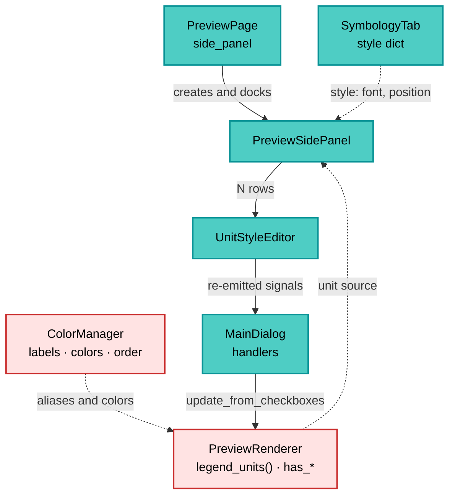
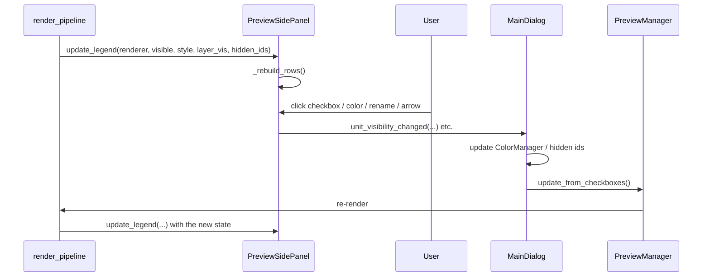

---
tags:
  - secinterp
  - code-walkthrough
  - gui
  - widgets
aliases:
  - preview_side_panel.py
  - PreviewSidePanel
  - UnitStyleEditor
cssclass: secinterp-note
---

# `gui/preview_side_panel.py`

> [!abstract] One-line summary
> Preview side panel: a scrollable list of rows (layers, geological units, drillhole
> lithologies and interpretations) where each row can hide, recolor or rename its item,
> and which re-emits every gesture as a signal so the dialog can rebuild the preview.

**Path**: `gui/preview_side_panel.py` (341 lines)
**Main classes**: `PreviewSidePanel`, `UnitStyleEditor`
**Layer**: GUI (Present · Legend widget)
**Tags**: #secinterp #gui #widgets

---

## 🎯 Why does this file exist?

The legend stopped being painted as an overlay on the canvas: it covered the profile and
did not allow interacting with units. This module turns it into a panel docked beside the
canvas (inside a `QSplitter`) with genuinely editable rows.

| Problem | Solution |
|---------|----------|
| The overlay legend covered part of the profile | Panel docked in a `QSplitter` (canvas 4 : panel 1) |
| A unit could not be hidden/recolored | `UnitStyleEditor` per row with checkbox + color button |
| Units and drillhole lithologies were mixed | Two sections with a header: *Geology* and *Drillhole lithologies* |
| Interpretations did not appear in the legend | `update_interpretations()` + *Interpretations* section |
| Rebuilding rows left orphan windows | `removeWidget()` + `deleteLater()` in `_clear_legend_rows()` |
| The panel had to honor the legend font size | `font-size: Npt` applied to the container in `_rebuild_rows()` |

> [!important] Architectural note
> **Composite widget with no business logic.** The panel computes neither colors nor
> geometries: it receives an already-built `renderer` (`PreviewRenderer`) and a `style`
> (dict from the Symbology tab), paints rows and re-emits signals. `MainDialog` is the one
> that decides, listening and triggering `preview_manager.update_from_checkboxes()`.

---

## 🧬 Relationship diagram



> [!tip] How to read
> Solid = builds/owns; dashed = injected data. `PreviewRenderer` is the source of truth for
> *what* is in the preview; the panel only represents it and lets the user edit it. Signals
> travel back to the dialog, never directly to the renderer.

---

## 📦 Imports — architectural reading

```python
from __future__ import annotations

from typing import Any

from qgis.PyQt.QtCore import pyqtSignal
from qgis.PyQt.QtGui import QColor
from qgis.PyQt.QtWidgets import (
    QCheckBox, QGroupBox, QHBoxLayout, QLabel, QLineEdit,
    QScrollArea, QToolButton, QVBoxLayout, QWidget,
)

from sec_interp.logger_config import get_logger
```

| # | Observation |
|---|-------------|
| ① | Zero `qgis.core`: the panel touches no layers or geometries, only Qt widgets. |
| ② | `pyqtSignal` in both classes: the panel is a **relay** of row signals. |
| ③ | `QScrollArea` + `QGroupBox`: the list grows without pushing the dialog size. |
| ④ | `QLineEdit` is only instantiated when `with_rename=True` (unit editor). |
| ⑤ | `QToolButton` of 14×14 px as a clickable color swatch. |
| ⑥ | `logger` is declared but unused: the panel does not log (pure UI). |
| ⑦ | `Any` appears only in `renderer` and `style`: the panel does not import the renderer (avoids a cycle). |

---

## 🏗️ Structure inventory

**Classes:** `UnitStyleEditor` (4 signals, 2 methods), `PreviewSidePanel` (6 signals, 14 methods)
**Constants:** `_SWATCH_STYLE = "border: 1px solid #888;"`
**Helper function:** `_swatch_stylesheet(color)` → swatch stylesheet

### `UnitStyleEditor` — one row

| Signal | Signature | When |
|---|---|---|
| `visibility_changed` | `(str, bool)` | The checkbox is checked/unchecked |
| `color_requested` | `(str)` | The color swatch is clicked |
| `label_changed` | `(str, str)` | Name edition finishes (`editingFinished`) |
| `move_requested` | `(str, int)` | ▲ (-1) or ▼ (+1) is clicked |

Construction flags: `interactive`, `with_visibility`, `with_color`, `with_rename`,
`with_reorder`. The panel uses the row in "view/hide/color only" mode; the Symbology tab
uses it with rename and reorder.

### `PreviewSidePanel` — the panel

| Signal | Signature | Origin |
|---|---|---|
| `unit_visibility_changed` | `(str, bool)` | Unit rows |
| `unit_color_requested` | `(str)` | Unit rows |
| `layer_visibility_changed` | `(str, bool)` | topography/structures/drillholes rows |
| `layer_color_requested` | `(str)` | Layer rows |
| `interpretation_visibility_changed` | `(str, bool)` | Interpretation rows |
| `interpretation_color_requested` | `(str)` | Interpretation rows |

Internal state: `_legend_rows` (live widgets), `_interpretations`, `_renderer`,
`_legend_style`, `_legend_visible`, `_layer_visibility`, `_hidden_interp_ids`.

---

## 📁 Files in the package

| File | Role relative to the panel |
|---|---|
| `gui/ui/pages/preview_page.py` | Creates the panel and puts it in the `QSplitter` (see [[preview_page]]) |
| `gui/preview_renderer.py` | Exposes `legend_units()` and the `has_*` flags (see [[preview_renderer]]) |
| `gui/renderers/color_manager.py` | Source of aliases, colors, order and visibility (see [[color_manager]]) |
| `gui/ui/pages/settings/symbology_tab.py` | Reuses `UnitStyleEditor` for the per-unit editor (see [[symbology_tab]]) |
| `gui/main_dialog.py` | Connects the panel signals and updates the preview (see [[main_dialog]]) |
| `plugin/render_pipeline.py` | Calls `side_panel.update_legend(...)` after rendering (see [[render_pipeline]]) |
| `tests/gui/test_preview_side_panel.py` | Panel-specific suite (165 lines) |

---

## 📖 Method-by-method walkthrough

### `UnitStyleEditor.__init__` — building the row

```python
self.unit_name = name
display = label or name
layout = QHBoxLayout(self)
```

The visual order is fixed: **visibility → color → reorder → name**. Every block is
optional and activated by a flag, which allows reusing the same row in two contexts:

1. **Preview panel**: `interactive=True, with_visibility=True, with_color=True`,
   without rename or reorder.
2. **Settings editor**: `interactive=True` + `with_rename=True, with_reorder=True`.

When `interactive=False` the row is read-only: it shows a 12×12 `QLabel` as a swatch and a
label, with no checkbox or button.

Important detail: the `lambda`s capture `self.unit_name`, not the widget text. Thus a
renamed row still emits the **original key** (`name`), which is the one the `ColorManager`
understands.

### `UnitStyleEditor._reorder_button` — ▲ / ▼

Creates an 18 px wide `QToolButton` and connects `clicked` to
`move_requested.emit(self.unit_name, delta)`. The delta is `-1` to move up and `+1` to move
down; the row does not reorder anything by itself (it does not know the full list).

### `PreviewSidePanel.__init__` — state and construction

Initializes the state *before* building the UI and calls `_setup_ui()`. Order matters:
`_rebuild_rows()` assumes `legend_layout` already exists.

```python
self._legend_rows: list[QWidget] = []
self._interpretations: list = []
self._renderer: Any = None
self._legend_style: dict = {}
self._legend_visible = True
self._layer_visibility: dict[str, bool] = {}
self._hidden_interp_ids: set[str] = set()
```

### `PreviewSidePanel._setup_ui` — group + scroll

```python
self.legend_group = QGroupBox(self.tr("Legend"))
self.legend_scroll = QScrollArea()
self.legend_scroll.setWidgetResizable(True)
self.legend_container = QWidget()
self.legend_layout = QVBoxLayout(self.legend_container)
```

The `QGroupBox` is what gets hidden with `set_legend_visible()`; the `QScrollArea` is what
keeps a list of 40 units from stretching the dialog. A `stretch` is added at the end so the
rows stay at the top.

### `PreviewSidePanel.update_legend` — main entry point

```python
def update_legend(self, renderer, visible=True, style=None,
                  layer_visibility=None, hidden_interp_ids=None) -> None:
```

It is the only entry point from `render_pipeline`. It stores the renderer and the style,
applies visibility and rebuilds. The last two parameters are *optional with memory*: if
`None` is passed the previous state is kept (so a re-render does not lose what the user had
hidden).

### `PreviewSidePanel.update_interpretations` — live list

Called from `MainDialog.__init__` (after `load_interpretations`) and from
`dialog_interpretation_manager` every time an interpretation is added/removed. If there is
no renderer yet, it only stores the list; the rebuild will happen on the first
`update_legend`.

### `PreviewSidePanel._rebuild_rows` — composition

```python
self._clear_legend_rows()
if not self._legend_visible or renderer is None:
    return
font_size = int(style.get("legend_font_size") or 0)
self.legend_container.setStyleSheet(f"font-size: {font_size}pt;" if font_size else "")
```

Then it adds, in order: layers (if `has_*`), *Geology*, *Drillhole lithologies* and
*Interpretations*. Every block omits itself when empty, so a preview without drillholes
does not show an orphan header.

### `PreviewSidePanel._topo_color` — color by mode

| `color_mode` | Returned color |
|---|---|
| `"single"` | `style["single_color_hex"]` or `#1f77b4` |
| any other | `#0066cc` (cold end of the gradient) |

It is a deliberate approximation: in gradient mode the row cannot show the full gradient,
so it uses the renderer's reference blue.

### `PreviewSidePanel._add_unit_group` — section with a header

Receives a list of tuples `(name, label, color, hidden, source)` and, if empty, returns
without painting the header. For each unit it creates an interactive row with its alias as
the label.

### `PreviewSidePanel._add_interpretation_group` — editable interpretations

```python
iid = str(getattr(interp, "id", "") or getattr(interp, "name", ""))
name = getattr(interp, "name", "") or getattr(interp, "type", "")
label = str(name) if name else self.tr("(unnamed)")
color = QColor(str(getattr(interp, "color", "") or "#FF0000"))
```

The identifier used as key is `id` (or `name` when there is no id); the color falls back to
red if the interpretation does not carry a valid one. The *hidden* state lives in
`_hidden_interp_ids`, a `set` that the dialog maintains and re-injects.

### `PreviewSidePanel._unit_entries` — tolerant adapter

```python
if hasattr(renderer, "legend_units"):
    return list(renderer.legend_units())
units = getattr(renderer, "active_units", None) or {}
```

`legend_units()` returns the five columns (name, alias, color, hidden, source). If the
renderer is old or a mock without that method, it degrades to `active_units` as geology
(no order or alias). This is the point that allows testing the panel with simple doubles.

### `PreviewSidePanel._add_row` — wiring by kind

```python
if kind == "layer":
    row.visibility_changed.connect(self.layer_visibility_changed.emit)
elif kind == "interpretation":
    row.visibility_changed.connect(self.interpretation_visibility_changed.emit)
elif interactive:
    row.visibility_changed.connect(self.unit_visibility_changed.emit)
```

The row does not know which "family" it belongs to; the panel decides which panel signal to
re-emit it on. Insertion uses `insertWidget(len(self._legend_rows), row)` to respect the
order and keep the headers in place.

### `PreviewSidePanel._clear_legend_rows` — the detail that prevents leaks

```python
for row in self._legend_rows:
    self.legend_layout.removeWidget(row)
    row.deleteLater()
self._legend_rows = []
```

`removeWidget` does **not** destroy the widget: it leaves it parentless and Qt promotes it
to a top-level window. Without `deleteLater()` every re-render would leave an orphan window
visible (the bug documented by the code comment).

### `PreviewSidePanel.set_legend_visible` — hide the whole group

`self.legend_group.setVisible(bool(visible))`. It is used at startup (the preview checkbox
no longer exists) and when the render pipeline reports `show_legend=False`.

---

## 🔄 Data flow



1. The pipeline delivers the renderer and the style after every preview.
2. The user interacts with a row.
3. The row emits its signal; the panel re-emits it with the correct family.
4. `MainDialog` translates the gesture into a state change (`ColorManager`, `_hidden_interp_ids`,
   layer checkbox) and requests a re-render.
5. The pipeline calls `update_legend` again, which rebuilds the rows.

The loop is intentionally **unidirectional**: the panel never mutates the renderer or the
`ColorManager`; it only describes what it sees and notifies.

---

## 🏛️ Design patterns present

| Pattern | Where | Purpose |
|---|---|---|
| **Composite widget** | `PreviewSidePanel` contains `UnitStyleEditor` | One row reused in panel and settings |
| **Signal relay** | 6 panel signals | The consumer does not know the concrete rows |
| **Lazy rebuild** | `_rebuild_rows` | Rebuild only when there is a visible renderer |
| **State injection** | `update_legend(...)` | State (visibility, hidden ids) lives in the dialog |
| **Graceful degradation** | `_unit_entries` | Compatibility with renderers/mocks lacking `legend_units()` |
| **Deterministic teardown** | `deleteLater()` in `_clear_legend_rows` | Prevents orphan windows |

> [!note] No business logic
> There are no geological or style computations here: colors arrive already resolved by the
> `ColorManager`/renderer and the style by the Symbology tab. It honors the
> Extract-then-Compute separation: the panel is pure Present.

---

## 🧾 API summary

| Method | Input | Effect |
|---|---|---|
| `update_legend` | renderer, visible, style, layer_visibility, hidden_interp_ids | Stores state and rebuilds rows |
| `update_interpretations` | list of interpretations | Replaces the list and rebuilds if a renderer exists |
| `set_legend_visible` | bool | Hides/shows the whole group |
| `_rebuild_rows` | — | Composes all sections |
| `_topo_color` | style | Color of the topography row |
| `_add_unit_group` | title, units | Header + rows for one section |
| `_add_interpretation_group` | — | Header + interpretation rows |
| `_unit_entries` | renderer | Normalized unit tuples |
| `_add_row` | name, color, hidden, interactive, label, kind | Creates and wires a row |
| `_add_section_label` | text | Bold header |
| `_clear_legend_rows` | — | Destroys rows (`deleteLater`) |
| `UnitStyleEditor.__init__` | name, color, hidden, label, flags | Builds a row |
| `UnitStyleEditor._reorder_button` | text, delta | ▲/▼ button |

---

## 🛡️ Error handling

- **Missing renderer**: `_rebuild_rows` returns after clearing; nothing is painted.
- **Empty interpretation list**: the *Interpretations* header is not added.
- **Unit without alias**: `labels.get(name, name)` falls back to the original name.
- **Invalid color**: `QColor(str(...))` produces an invalid color; Qt paints it black, it does
  not raise.
- **Already destroyed widgets**: the panel keeps only live references in `_legend_rows` and
  empties it after `deleteLater()`.
- **Signals during rebuild**: new rows are created after clearing, so there are no double
  connections on the same row.

---

## 🧪 Associated tests

| Test | What it covers |
|---|---|
| `tests/gui/test_preview_side_panel.py` | Construction, rows per section, signals, `deleteLater`, non-interactive mode |
| `tests/gui/test_preview_legend_renderer.py` | `draw_rows`, layout, "+N more" and colors |
| `tests/gui/test_color_manager.py` | Aliases, order, visibility and colors consumed by the panel |
| `tests/gui/test_preview_page.py` | The panel sits in the preview `QSplitter` |

The `QCheckBox`/`QToolButton` mocks live in `tests/mocks/qt_mocks.py`; the panel is tested
without real QGIS (Mock-First).

---

## 👀 Observations and notes

1. **The panel persists nothing.** State (aliases, colors, order, hidden) lives in the
   `ColorManager` and in the dialog; persistence is done by
   `dialog_settings_persistence` inside the project.
2. **Legend font**: `legend_font_size` is applied as a stylesheet to the container, not to
   the `QPainter`. The renderer uses the same value for the exported PNG.
3. **Two consumers of `UnitStyleEditor`**: the panel (quick interaction) and the settings
   editor (rename/reorder). Keeping the flags avoids two nearly identical widgets.
4. **`_hidden_interp_ids` is a `set` of strings**: the dialog maintains it so a re-render
   does not "revive" hidden interpretations.
5. **Performance**: rebuilding N rows on every preview is cheap (dozens of widgets); if the
   number of units grew a lot, it would have to move to a model/view.
6. **Accessibility**: the tooltips (`Show/hide this layer`, `Change this color`, `Rename this
   unit`) are the only labels of the controls; they are translated with `self.tr`.

---

## 🎨 Visual anatomy

```text
┌─ Legend ────────────────────────────┐
│ ☑ ■ Topography                     │
│ ☑ ■ Structures                     │
│ ☑ ■ Drillhole traces               │
│ Geology                            │
│ ☑ ■ Granodiorita                   │
│ ☑ ■ Esquisto                       │
│ Drillhole lithologies              │
│ ☑ ■ Lutita                         │
│ Interpretations                    │
│ ☑ ■ Falla inferida                 │
└─────────────────────────────────────┘
```

Each row is `☑ (checkbox) + ■ (14×14 swatch) + label`; in the settings editor a `▲ ▼` pair
and a `QLineEdit` for the alias are inserted as well.

---

## 🌐 Internationalization

Visible texts go through `self.tr(...)` (`QWidget` context, the widget class). Unit names
and aliases are **not** translated: they are user/geology data. The *Geology*, *Drillhole
lithologies* and *Interpretations* headers are.

---

## 🔗 Related notes

- [[Index]] — vault index
- [[preview_page]] — creates the panel and docks it to the canvas
- [[preview_renderer]] — source of `legend_units()` and `has_*`
- [[preview_legend_renderer]] — paints the same legend in the exported PNG
- [[color_manager]] — aliases, colors, order and visibility
- [[symbology_tab]] — reuses `UnitStyleEditor` to rename/reorder
- [[main_dialog]] — connects the signals and re-renders
- [[render_pipeline]] — calls `update_legend` after every preview

---

*Note of the SecInterp Code Walkthrough v2 vault — v3.11.0*
