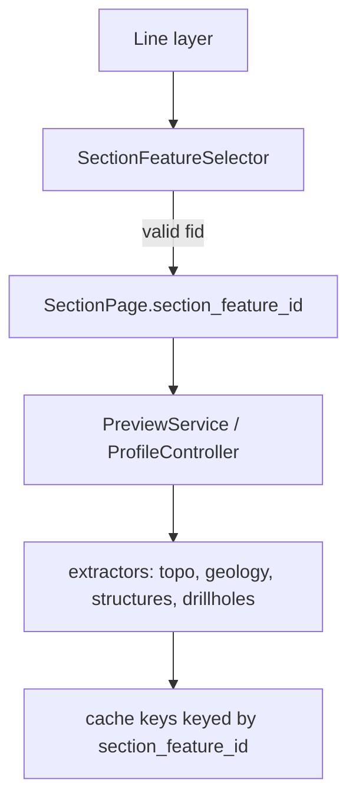

---
tags:
  - secinterp
  - code-walkthrough
  - gui
  - ui-pages
  - section
aliases:
  - section_feature_selector.py
  - SectionFeatureSelector
cssclass: secinterp-note
---

# `gui/ui/pages/section_feature_selector.py`

> [!abstract] One-line summary
> Section-feature picker for multi-feature layers: lists only single-part lines
> with **exactly two vertices** as `fid — label` and lets the user choose the
> label field.

**Path**: `gui/ui/pages/section_feature_selector.py`
**Main class**: `SectionFeatureSelector`
**Layer**: GUI · page widget
**Tags**: #secinterp #gui #ui-pages #section

---

## 🎯 Why it exists

`SectionPage` only had a layer combo. `section_feature_id` existed in
`PreviewParams` and in the cache keys, but there was no way to choose a specific
line or forward its id to the extractors.

| Problem | Solution |
|---|---|
| Multi-feature section layer | `fid — label` combo |
| 3+ vertex lines are not valid sections | exactly-2-vertex filter |
| The user cannot tell which line is selected | `fid` plus a field label (`Auto` or attribute) |
| Ambiguous labels when values repeat | the `fid` is always present |
| Persistence across projects | `section_feature_id` + `section_feature_label_field` |

---

## ⚙️ Behavior

- Multipart with more than one part: discarded.
- `vertices == 2`: included.
- `vertices >= 3` or `< 2`: discarded.
- One valid feature: selected and the feature combo disabled.
- No valid features: both combos empty/disabled; `SectionPage.validate()` fails.
- `Auto` uses `displayExpression`, `displayField` or the `fid`, in that order.
- A selected field uses its value; null/empty falls back to `fid`.
- Changing only the label field does not change `section_feature_id`, the hash or
  the cache.
- Safety cap: 500 valid features.

---

## 🔄 Data flow

`SectionPage` repopulates the selector when the layer changes and emits
`dataChanged` only when the feature changes. The label field is persisted with the
project.

---

## 🧪 Tests

- `tests/gui/test_section_feature_selector.py`: 2 vs 3+ vertices, labels, null
  field, invalid `select_feature`, signals.
- `tests/gui/test_section_feature_page.py`: persistence, fallback and
  `dataChanged`.
- `tests/core/test_profile_feature_id.py`: forwarding to the four processors.

---

## 🔗 Related notes

- [[section_page]] — integration and validation.
- [[preview_service]] — preview LOD and topography.
- [[profile_extractor]] — DEM sampling by `feature_id`.
- [[layer_gui_ui_pages]] — page hub.
