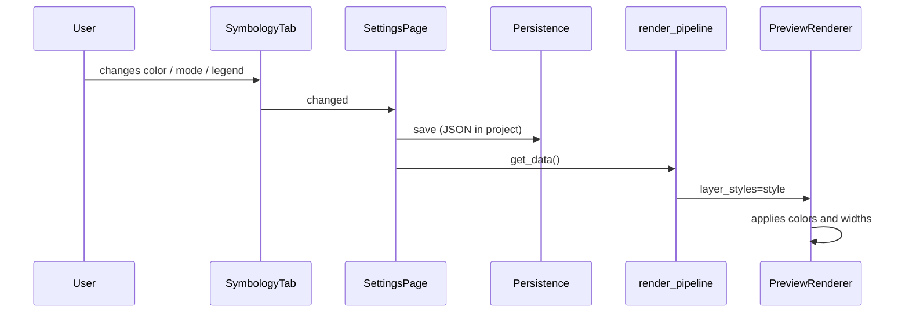

---
tags:
  - secinterp
  - code-walkthrough
  - gui
  - settings
aliases:
  - symbology_tab.py
  - SymbologyTab
cssclass: secinterp-note
---

# `gui/ui/pages/settings/symbology_tab.py`

> [!abstract] One-line summary
> **Symbology** tab of Settings: a scrollable form with collapsible sections that edit the
> preview styles (topography, structures, drillholes, interpretations), the legend options
> and the per-unit editor, and that exposes everything as a single `dict` persisted in the
> project.

**Path**: `gui/ui/pages/settings/symbology_tab.py` (354 lines)
**Main class**: `SymbologyTab` (inherits from `UnitsEditorMixin` and `QWidget`)
**Layer**: GUI (Settings · Form)
**Tags**: #secinterp #gui #settings

---

## 🎯 Why does this file exist?

Previously, the color mode and width of the topography lived on the *Section Line* page and
the rest of the styles were not configurable: the preview used fixed colors. v3.11.0
concentrates **all** styles in one place, with live preview and per-project persistence.

| Problem | Solution |
|---------|----------|
| Scattered styles (topo in Section, the rest fixed) | A single tab with 6 sections |
| The dialog grew when opening Settings | Content in a `QScrollArea` + collapsible groups |
| Colors could not be changed | `QgsColorButton` per layer + `QgsColorRampButton` for the gradient |
| The legend was not configurable | *Legend* section: export, position, size and max items |
| Units could not be renamed/reordered | `UnitsEditorMixin` (sibling module) |
| Changes had to be visible instantly | `changed` signal → save + preview re-render |

> [!important] Architectural note
> The tab does **not** apply styles to QGIS directly: it only produces a configuration
> `dict`. `plugin/render_pipeline.py` injects it into `PreviewParams.layer_styles` and
> `PreviewRenderer`/`PreviewLegendRenderer` consume it. It is the GUI's *Extract* pattern:
> gather the user's intent into primitive types.

---

## 🧬 Relationship diagram

```mermaid
graph TD
    SP["SettingsPage<br/>get_data / load"]
    ST["SymbologyTab"]
    UM["UnitsEditorMixin<br/>symbology_units.py"]
    USE["UnitStyleEditor<br/>(preview_side_panel.py)"]
    RP["render_pipeline.py"]
    PR["PreviewRenderer"]
    PLR["PreviewLegendRenderer"]
    CM["ColorManager"]
    DSP["dialog_settings_persistence<br/>JSON in project"]

    SP -->|creates and embeds| ST
    ST -->|inherits| UM
    UM -->|creates rows| USE
    ST -->|changed| SP
    SP -->|get_data()| DSP
    SP -->|style dict| RP
    RP --> PR
    RP --> PLR
    ST -->|set_unit_manager| CM

    classDef gui fill:#4ecdc4,stroke:#0a9396,stroke-width:2px,color:#000
    class SP,ST,UM,USE,DSP gui
    classDef core fill:#ffe3e3,stroke:#c92a2a,stroke-width:2px,color:#000
    class RP,PR,PLR,CM core
```

> [!tip] How to read
> The tab is the **entry** of the style; the `ColorManager` is the source of the units
> (that is why the mixin receives the manager already built with `set_unit_manager`). The
> pipeline is the only one that reads the `dict` and turns it into real colors/ramps.

---

## 📦 Imports — architectural reading

```python
import contextlib
from typing import Any

from qgis.gui import (
    QgsCollapsibleGroupBox, QgsColorButton, QgsColorRampButton, QgsDoubleSpinBox,
)
from qgis.PyQt.QtCore import QCoreApplication, pyqtSignal
from qgis.PyQt.QtGui import QColor
from qgis.PyQt.QtWidgets import (
    QCheckBox, QComboBox, QGridLayout, QHBoxLayout, QLabel,
    QRadioButton, QScrollArea, QSizePolicy, QSpinBox, QVBoxLayout, QWidget,
)

from sec_interp.gui.main_dialog_config import DialogDefaults
from sec_interp.gui.preview_side_panel import UnitStyleEditor
from sec_interp.gui.ui.pages.settings.symbology_units import UnitsEditorMixin
from sec_interp.logger_config import get_logger
```

| # | Observation |
|---|-------------|
| ① | `qgis.gui` contributes the native QGIS controls: color, ramp and collapsible group. |
| ② | `QgsCollapsibleGroupBox` is the piece that keeps the dialog small: sections closed by default. |
| ③ | `pyqtSignal()` with no arguments: `changed` is a simple "something changed". |
| ④ | `contextlib` only for `suppress` in `disconnect_signals`. |
| ⑤ | `DialogDefaults` centralizes the ramp and the default color (no duplicated literals). |
| ⑥ | `UnitStyleEditor` is imported from the preview panel: **a single row** for two contexts. |
| ⑦ | `_LEGEND_POSITIONS` is declared **before** the app imports (intentional order of the original code). |

---

## 🏗️ Structure inventory

**Class:** `SymbologyTab(UnitsEditorMixin, QWidget)` — `changed` signal, 15 own methods.

### UI groups

| Group | Controls | Keys it produces |
|---|---|---|
| *Topography* | Gradient/Simple radios, ramp, simple color, width | `color_mode`, `ramp_name`, `single_color_hex`, `topo_line_width` |
| *Structures* | color, width | `struct_color`, `struct_width` |
| *Drillholes* | trace color, width, "Show hole labels" | `drill_trace_color`, `drill_trace_width`, `drill_labels` |
| *Interpretations* | default color | `interp_color` |
| *Legend* | export, position, font size, max items | `show_legend`, `legend_pos`, `legend_font_size`, `legend_max_items` |
| *Units* | editable rows + "Reset unit styles" | (delegated to the `ColorManager`) |

### Construction order

```text
_setup_ui()
  └── QScrollArea
        └── QVBoxLayout
              ├── QLabel("<b>Layer Symbology</b>")
              ├── QLabel("<i>Live styles ...</i>")
              ├── _build_topography_group()
              ├── _build_structures_group()
              ├── _build_drillholes_group()
              ├── _build_interpretations_group()
              ├── _build_legend_group()
              ├── _build_units_group()   # comes from the mixin
              └── addStretch()
```

---

## 📁 Files in the package

| File | Role relative to the tab |
|---|---|
| `gui/ui/pages/settings_page.py` | Creates the tab and adds `get_data()`/`load()` (see [[settings_page]]) |
| `gui/ui/pages/settings/symbology_units.py` | Per-unit editor mixin (see [[symbology_units]]) |
| `gui/ui/pages/settings/settings_persistence.py` | Base persistence of the page |
| `gui/preview_side_panel.py` | Provides `UnitStyleEditor` (see [[preview_side_panel]]) |
| `gui/dialog_settings_persistence.py` | Serializes the `dict` as JSON in the project (see [[dialog_settings_persistence]]) |
| `plugin/render_pipeline.py` | Consumes the `dict` on every preview (see [[render_pipeline]]) |
| `gui/main_dialog_config.py` | `DialogDefaults` (default ramp/color) (see [[main_dialog_config]]) |
| `tests/gui/test_symbology_tab.py` | Tab suite (136 lines) |

---

## 📖 Method-by-method walkthrough

### `SymbologyTab.__init__` — minimal state and bounded size

```python
self._unit_manager: Any = None
self._unit_rows: list[UnitStyleEditor] = []
self._unit_signature: list[tuple] | None = None
self.setSizePolicy(QSizePolicy.Policy.Preferred, QSizePolicy.Policy.Preferred)
self._setup_ui()
```

`_unit_manager` is `None` until `MainDialog` injects it with `set_unit_manager(...)`.
`_unit_signature` implements the mixin's *diffing*: it avoids rebuilding rows if nothing
changed. The `QSizePolicy` prevents the content from dictating the dialog size.

### `tr` — own translation context

```python
def tr(self, message: str) -> str:
    return QCoreApplication.translate("SymbologyTab", message)
```

`QWidget.tr` would use the real class name; here the `SymbologyTab` context is forced so
that existing translations (`.ts`/`.qm`) keep resolving even if the class changes
hierarchy (it inherits from a mixin).

### `_setup_ui` — scroll + collapsibles

```python
self.scroll = QScrollArea()
self.scroll.setWidgetResizable(True)
content = QWidget()
layout = QVBoxLayout(content)
```

The scroll is the key to the size fix: the dialog has a maximum height and the tab scrolls.
Groups are created with `_collapsible_group`, which leaves them **closed** by default
(`setCollapsed(True)`), so the initial view is compact.

### `_build_topography_group` — mode and mutually exclusive controls

```python
self.radio_gradient = QRadioButton(self.tr("Gradient"))
self.radio_single = QRadioButton(self.tr("Simple"))
self.radio_gradient.setChecked(True)
```

| Mode | Visible control | Key |
|---|---|---|
| Gradient | `ramp_button` (QgsColorRampButton) | `ramp_name` |
| Simple | `topo_color_button` (QgsColorButton) | `single_color_hex` |

`_on_topo_mode_changed()` is called at the end to leave only the active mode's control
visible. The width (`topo_width_spin`, 0.1–5.0, step 0.1, 1 decimal) is shared by both
modes.

### `_build_structures_group` / `_build_drillholes_group`

Structures: color `#cc0000` + width `0.5`. Drillholes: color `(50, 50, 50)` + width `0.3` +
`Show hole labels` checkbox (enabled by default). The three values feed the renderer of the
corresponding layer (`structure_renderer`, `drillhole_renderer`).

### `_build_interpretations_group`

Just a `QgsColorButton` with `#FF0000`. It is the **default color** of new interpretations;
each interpretation may later override it from the legend or the panel.

### `_build_legend_group` — the four legend decisions

```python
self.chk_export_legend = QCheckBox(self.tr("Show legend in the exported image"))
self.combo_legend_pos = QComboBox()   # 4 positions
self.spin_legend_font = QSpinBox()    # 6–16
self.spin_legend_max = QSpinBox()     # 0–200, 0 = all
```

- `show_legend` affects **only** the exported image: the preview legend lives in the side
  panel (which is why the tooltip makes that clear).
- `legend_pos` is mapped with `_LEGEND_POSITIONS[currentIndex]` → `"top-right"`, `"top-left"`,
  `"bottom-right"`, `"bottom-left"`.
- `legend_font_size` is used both in the panel and in the PNG.
- `legend_max_items > 0` trims rows and adds `"+N more"` in `PreviewLegendRenderer.draw_rows`.

### `_width_spin` — width factory

```python
spin = QgsDoubleSpinBox()
spin.setRange(0.1, 5.0)
spin.setSingleStep(0.1)
spin.setDecimals(1)
```

Reused by topography, structures and drillholes so all three behave the same.

### `_on_topo_mode_changed` — toggling

```python
single = self.radio_single.isChecked()
self.ramp_button.setVisible(not single)
self.topo_color_button.setVisible(single)
```

It is connected to `toggled` of **both** radios (simpler and more robust than only one), and
it is also invoked when loading data to sync visibility with the persisted mode.

### `get_data` — the output contract

Returns a flat `dict` ready for JSON:

```python
{
  "color_mode": "single" | "gradient",
  "ramp_name": str,
  "single_color_hex": "#rrggbb",
  "topo_line_width": float,
  "struct_color": "#rrggbb", "struct_width": float,
  "drill_trace_color": "#rrggbb", "drill_trace_width": float,
  "drill_labels": bool,
  "interp_color": "#rrggbb",
  "show_legend": bool,
  "legend_pos": "top-right" | ...,
  "legend_font_size": int,
  "legend_max_items": int,
}
```

`SettingsPage.get_data()` does `data.update(self.symbology_tab.get_data())`, so these keys
coexist with those of the other pages without collisions.

### `load` — tolerant restoration

```python
self._load_topography(data)
self._load_layer_styles(data)
self._load_legend(data)
self._on_topo_mode_changed()
```

Each helper checks `is not None` before writing: an old project (without symbology keys)
keeps the default values. `_set_color` only applies if the value is truthy.

### `reset` — back to the defaults

Restores the radios, the ramp (`DialogDefaults.TOPO_RAMP_NAME`), the simple color
(`DialogDefaults.TOPO_SINGLE_COLOR_HEX`), the widths (0.8/0.5/0.3), the labels, the
interpretation color, legend export, position 0, font 8 and max 0.

### `connect_signals` / `disconnect_signals` — idempotence

`connect_signals` connects a `changed.emit` **per** control (tuple of signals) and delegates
to the mixin's `connect_unit_signals()`. `disconnect_signals` disconnects the radios from
`_on_topo_mode_changed` and disconnects `changed` with `contextlib.suppress(TypeError,
RuntimeError)`, because `SignalManager.connect_all()` runs `disconnect_all()` before
reconnecting and a double disconnect would raise.

---

## 🔄 Data flow



1. Any control emits `changed`.
2. `SettingsPage._on_settings_changed` saves (project persistence) and notifies the dialog.
3. On the next preview, `render_pipeline` calls `get_data()` and passes it as
   `PreviewParams.layer_styles`.
4. The renderer and the legend generator apply the keys.

---

## 🏛️ Design patterns present

| Pattern | Where | Purpose |
|---|---|---|
| **Form object / DTO** | `get_data()` | The UI produces a serializable `dict` |
| **Mixin composition** | `UnitsEditorMixin` | Keeps this module under the 400-line limit |
| **Factory methods** | `_collapsible_group`, `_width_spin` | Consistency across sections |
| **Signal aggregation** | tuple of signals → `changed` | A single event for the consumer |
| **Defensive load** | `_load_*` with `is not None` | Compatibility with old projects |
| **Idempotent connect** | `connect/disconnect_signals` | Fits `SignalManager` |

---

## 🧾 API summary

| Method | Effect |
|---|---|
| `tr` | Translates with the `SymbologyTab` context |
| `_setup_ui` | Scroll + 6 sections |
| `_collapsible_group` | Group closed by default |
| `_build_*_group` | Builds each section |
| `_width_spin` | Width spinbox 0.1–5.0 |
| `_on_topo_mode_changed` | Toggles ramp/color |
| `get_data` | Returns the style `dict` |
| `load` | Restores from the project |
| `reset` | Back to defaults |
| `connect_signals` | Wires controls + rows |
| `disconnect_signals` | Disconnects safely |

---

## 🛡️ Error handling

- **Project with no data**: `load({})` leaves the defaults; no helper writes with `None`.
- **Invalid position**: `_load_legend` only applies if `legend_pos` is in
  `_LEGEND_POSITIONS`; otherwise it keeps the current position.
- **Out-of-range values**: the `QSpinBox`/`QgsDoubleSpinBox` clamp to the range.
- **Disconnect when not connected**: `contextlib.suppress(TypeError, RuntimeError)`.
- **Missing unit manager**: the mixin returns without doing anything (`refresh_units`).
- **Invalid color**: `QColor` does not raise; the button keeps the previous color if the new
  one is invalid.

---

## 🧪 Associated tests

| Test | What it covers |
|---|---|
| `tests/gui/test_symbology_tab.py` | Defaults, `get_data`, `load`, `reset`, mode toggling, signals |
| `tests/gui/test_settings_page.py` | The tab integrates into Settings and contributes its keys |
| `tests/gui/test_color_manager.py` | Aliases/order/visibility used by the editor |
| `tests/gui/test_preview_side_panel.py` | Shared `UnitStyleEditor` |

---

## 👀 Observations and notes

1. **One style, two consumers**: preview (`PreviewRenderer`) and exported legend
   (`PreviewLegendRenderer`); that is why `show_legend` is independent of the panel's
   visibility.
2. **Collapsed by default**: six open sections would make the tab enormous; the user opens
   only the one they need.
3. **The dialog does not grow**: `QScrollArea` + `setSizePolicy` + maximum height of the
   units panel (240–340 px) are the three pieces of the fix.
4. **The radios are connected twice**: each one toggles visibility; on load
   `_on_topo_mode_changed` is called manually.
5. **`_LEGEND_POSITIONS` must match** `_VALID_POSITIONS` in
   `preview_legend_renderer.py`; if a position is added, both must be touched.
6. **Persistence**: the whole `dict` is saved as JSON under the `symbology` key in the
   project; there are no loose per-control keys.

---

## 🔗 Related notes

- [[Index]] — vault index
- [[settings_page]] — page that embeds the tab
- [[symbology_units]] — per-unit editor mixin
- [[preview_side_panel]] — shared `UnitStyleEditor`
- [[dialog_settings_persistence]] — persists the JSON in the project
- [[render_pipeline]] — consumes `layer_styles`
- [[preview_renderer]] — applies the styles to the preview
- [[preview_legend_renderer]] — uses position, font and max items
- [[color_manager]] — source of units and aliases

---

*Note of the SecInterp Code Walkthrough v2 vault — v3.11.0*
