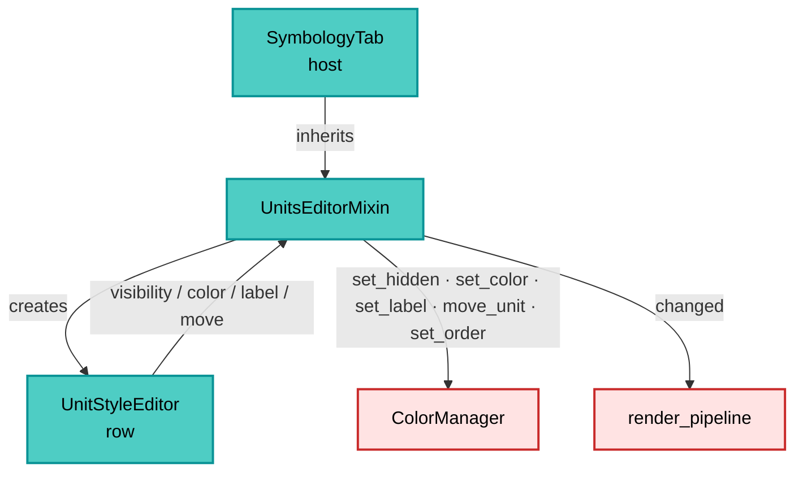
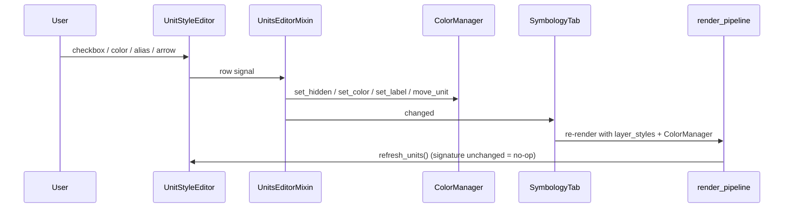

---
tags:
  - secinterp
  - code-walkthrough
  - gui
  - settings
aliases:
  - symbology_units.py
  - UnitsEditorMixin
cssclass: secinterp-note
---

# `gui/ui/pages/settings/symbology_units.py`

> [!abstract] One-line summary
> Per-unit editor mixin: builds the *Units* section of Symbology (a bounded list of rows
> with visibility, color, alias and order arrows) and translates every gesture into an
> operation on the `ColorManager`, emitting `changed` to refresh the preview.

**Path**: `gui/ui/pages/settings/symbology_units.py` (139 lines)
**Main class**: `UnitsEditorMixin`
**Layer**: GUI (Settings · Editor mixin)
**Tags**: #secinterp #gui #settings

---

## 🎯 Why does this file exist?

The per-unit editor was the largest part of the Symbology tab and made
`symbology_tab.py` exceed the 400-line limit of the `module_size_gate`. It was extracted as
a **mixin** to keep the tab below the threshold without duplicating the unit row.

| Problem | Solution |
|---------|----------|
| `symbology_tab.py` > 400 lines | Editor extracted into a 139-line mixin |
| Rename/reorder did not exist | `UnitStyleEditor` with `with_rename` and `with_reorder` |
| The list could grow without bound | `QScrollArea` with a height of 240–340 px |
| Rebuilding rows on every change was expensive | `_unit_signature` avoids a rebuild if nothing changed |
| "Reset" had to clear everything | `reset_units()` walks `known_units()` |
| The editor must not know about QGIS | It only talks to the `ColorManager` (10-method interface) |

> [!important] Architectural note
> It is a **cooperative mixin**: it does not inherit from `QWidget` and assumes a contract
> with the host (`tr`, `changed`, `_collapsible_group`). That implicit dependency is
> deliberate, so the tab can be split without introducing another class with its own state.
> The host is `SymbologyTab`.

---

## 🧬 Relationship diagram



> [!tip] How to read
> The mixin is the **translator** between the row (UI events) and the manager (domain state).
> It stores neither colors nor aliases: it asks for them and writes them to the
> `ColorManager`.

---

## 📦 Imports — architectural reading

```python
from __future__ import annotations

from typing import Any

from qgis.gui import QgsCollapsibleGroupBox
from qgis.PyQt.QtGui import QColor
from qgis.PyQt.QtWidgets import (
    QColorDialog, QHBoxLayout, QLabel, QPushButton,
    QScrollArea, QVBoxLayout, QWidget,
)

from sec_interp.gui.preview_side_panel import UnitStyleEditor
```

| # | Observation |
|---|-------------|
| ① | `QgsCollapsibleGroupBox` is the return type of the group (provided by the host). |
| ② | `QColorDialog` is the only modal dialog in the module. |
| ③ | `UnitStyleEditor` comes from the preview panel: **the same row**, not a copy. |
| ④ | No `qgis.core`: the mixin touches no layers or geometries. |
| ⑤ | `Any` for the manager (the mixin does not import `ColorManager`; avoids coupling layers). |
| ⑥ | No logger: there are no error branches to log. |

---

## 🏗️ Structure inventory

**Class:** `UnitsEditorMixin` — 8 methods, no constructor and no signals of its own.

### Contract with the host (`SymbologyTab`)

| Member it uses | Type | Use |
|---|---|---|
| `self.tr(msg)` | method | Translate the section texts |
| `self.changed` | `pyqtSignal()` | Announce any edition |
| `self._collapsible_group(title)` | method | Create the collapsible group |

### State the mixin expects on the host

| Attribute | Initialized by | Use |
|---|---|---|
| `_unit_manager` | host `__init__` (`None`) | Injected manager |
| `_unit_rows` | host `__init__` (`[]`) | Live rows |
| `_unit_signature` | host `__init__` (`None`) | Change detection |

---

## 📁 Files in the package

| File | Role relative to the mixin |
|---|---|
| `gui/ui/pages/settings/symbology_tab.py` | Host: inherits the mixin and builds it (see [[symbology_tab]]) |
| `gui/preview_side_panel.py` | Provides `UnitStyleEditor` (see [[preview_side_panel]]) |
| `gui/renderers/color_manager.py` | Real state of the units (see [[color_manager]]) |
| `gui/main_dialog.py` | Injects the manager (`set_unit_manager`) (see [[main_dialog]]) |
| `gui/ui/pages/settings_page.py` | Holds the tab and its signal cycle (see [[settings_page]]) |
| `plugin/render_pipeline.py` | Re-renders after `changed` (see [[render_pipeline]]) |
| `tests/gui/test_symbology_tab.py` | Covers the per-unit editor |

---

## 📖 Method-by-method walkthrough

### `_build_units_group` — the bounded section

```python
group = self._collapsible_group(self.tr("Units"))
layout = QVBoxLayout(group)
layout.addWidget(QLabel(self.tr("<i>Hide, recolor, rename or reorder ...</i>")))

self.units_scroll = QScrollArea()
self.units_scroll.setWidgetResizable(True)
self.units_scroll.setMinimumHeight(240)
self.units_scroll.setMaximumHeight(340)
```

The two heights are the key to the dialog size fix: with 40 units the list scrolls inside
240–340 px instead of stretching the window. After the scroll, the `Reset unit styles`
button is added, right-aligned.

### `set_unit_manager` — injection and first refresh

```python
def set_unit_manager(self, manager: Any) -> None:
    self._unit_manager = manager
    self.refresh_units(force=True)
```

`MainDialog` calls it at the end of `__init__` with `self._unit_color_manager()`. The
`force=True` guarantees the rows are painted even if the computed signature matches `None`
(first use).

### `refresh_units` — diffing by signature

```python
entries = [
    (name, manager.label(name), manager.get_color(name).name(), manager.is_hidden(name))
    for name in manager.ordered_units()
]
if not force and entries == self._unit_signature:
    return
self._unit_signature = entries
self._rebuild_unit_rows(manager, entries)
```

The signature is a list of tuples `(name, alias, hex, hidden)`. If the preview re-renders
and nothing changed, widgets are neither destroyed nor created. It is the difference
between a cheap refresh and one that flickers.

### `_rebuild_unit_rows` — editable rows

```python
row = UnitStyleEditor(
    name, QColor(color_hex), hidden=hidden, label=label,
    with_rename=True, with_reorder=True,
)
row.visibility_changed.connect(self._on_unit_visibility)
row.color_requested.connect(self._on_unit_color)
row.label_changed.connect(self._on_unit_label)
row.move_requested.connect(self._on_unit_move)
```

Before creating the new ones, it destroys the previous ones with `removeWidget` +
`deleteLater()` (the same pattern as the panel). Rows are inserted with
`insertWidget(len(self._unit_rows), row)` to respect the manager's current order.

### `_on_unit_visibility` — hide/show

```python
self._unit_manager.set_hidden(name, not visible)
self.changed.emit()
```

The checkbox says "visible"; the manager stores "hidden", hence the negation. It only
emits: the re-render will rebuild the legend and the preview without that unit.

### `_on_unit_color` — modal picker

```python
current = self._unit_manager.get_color(name)
color = QColorDialog.getColor(current, self, self.tr("Select unit color"))
if color is not None and color.isValid():
    self._unit_manager.set_color(name, color)
    self.refresh_units(force=True)
    self.changed.emit()
```

`getColor` returns an invalid `QColor` if the user cancels; the `isValid()` check prevents
writing garbage. The forced refresh updates the row's swatch.

### `_on_unit_label` — alias

```python
self._unit_manager.set_label(name, text)
self.changed.emit()
```

It does not refresh rows: the `QLineEdit` already shows the text. If cleared, the
`ColorManager` interprets "no alias" and the legend falls back to the original name.

### `_on_unit_move` — reorder

```python
self._unit_manager.move_unit(name, delta)
self.refresh_units(force=True)
self.changed.emit()
```

`move_unit(name, -1 | +1)` moves one position; the forced refresh reorders the widgets so
the visual order matches the manager's (and the exported legend's).

### `connect_unit_signals` — idempotent wiring

```python
def connect_unit_signals(self) -> None:
    self.btn_reset_units.clicked.connect(self.reset_units)
```

The host calls this method from its `connect_signals()`. Since `SignalManager.connect_all()`
disconnects everything before reconnecting, the button is rewired on every cycle without
duplicating.

### `reset_units` — clear customization

```python
for name in list(manager.known_units()):
    manager.set_hidden(name, False)
    manager.set_label(name, "")
manager.set_order([])
self.refresh_units(force=True)
self.changed.emit()
```

`known_units()` (not `ordered_units()`) so that hidden units and units no longer present in
the current render are included too. `set_order([])` restores the natural order. It does not
reset colors: the `ColorManager` computes them deterministically from the name.

---

## 🔄 Data flow



1. The row emits the gesture with the unit **key** (never the alias).
2. The mixin writes to the `ColorManager`.
3. `changed` triggers the save and the re-render.
4. On return, `refresh_units` compares signatures and does not rebuild if unnecessary.

---

## 🏛️ Design patterns present

| Pattern | Where | Purpose |
|---|---|---|
| **Mixin** | `UnitsEditorMixin` | Splits the tab without another stateful class |
| **Dependency injection** | `set_unit_manager` | The mixin does not build the manager |
| **Signature diffing** | `_unit_signature` | Avoids unnecessary rebuilds |
| **Command → manager** | `_on_unit_*` | The UI does not mutate its own state |
| **Deterministic teardown** | `deleteLater()` | Avoids orphan widgets |
| **Idempotent wiring** | `connect_unit_signals` | Compatible with `SignalManager` |

> [!note] Implicit contract
> The mixin does not declare a `Protocol`/ABC for the host; it uses `self.tr`, `self.changed`
> and `self._collapsible_group` directly. It works because the only host is `SymbologyTab`
> and both live in the same package. If it were reused in another widget, the contract
> should be formalized.

---

## 🧾 API summary

| Method | Input | Effect |
|---|---|---|
| `_build_units_group` | — | Collapsible group + 240–340 scroll + reset button |
| `set_unit_manager` | manager | Injects and forces a refresh |
| `refresh_units` | `force=False` | Rebuild only if the signature changed |
| `_rebuild_unit_rows` | manager, entries | Destroys and creates editable rows |
| `_on_unit_visibility` | name, visible | `set_hidden(name, not visible)` + `changed` |
| `_on_unit_color` | name | `QColorDialog` + `set_color` + rebuild |
| `_on_unit_label` | name, text | `set_label` + `changed` |
| `_on_unit_move` | name, delta | `move_unit` + rebuild + `changed` |
| `connect_unit_signals` | — | Connects the reset button |
| `reset_units` | — | Clears hidden/alias/order |

---

## 🛡️ Error handling

- **Missing manager**: `refresh_units` and `reset_units` return without doing anything.
- **Cancelling the color dialog**: `QColorDialog.getColor` returns an invalid color;
  `isValid()` prevents applying it.
- **Empty alias**: `set_label(name, "")` is interpreted as "no alias".
- **Unknown unit**: the manager ignores names it does not know.
- **Double reconnection**: the button is connected on every `connect_signals`, but the host
  disconnects first; there are no double emissions.
- **Destroyed rows**: they are removed from the layout before `deleteLater()`.

---

## 🧪 Associated tests

| Test | What it covers |
|---|---|
| `tests/gui/test_symbology_tab.py` | Units section, alias/order/color editing, reset |
| `tests/gui/test_color_manager.py` | `label`, `set_label`, `ordered_units`, `move_unit`, `set_order` |
| `tests/gui/test_preview_side_panel.py` | `UnitStyleEditor` with rename/reorder |

---

## 👀 Observations and notes

1. **Bounded height**: 240 px minimum / 340 px maximum; below 240 eight rows do not fit,
   above 340 the dialog grows again.
2. **Reset does not touch colors**: the color is derived from the name in `ColorManager`;
   only aliases, visibility and order are cleared.
3. **Stable key**: the unit's original name; renaming does not break persistence.
4. **Two refresh modes**: `set_hidden`/`move_unit`/`set_color` rebuild rows; `set_label`
   does not (the `QLineEdit` already reflects the change).
5. **`_unit_rows` is initialized by the host**, not by the mixin; if the mixin is used in
   another widget that attribute must be declared.
6. **Compatibility**: the mixin does not import `ColorManager`; any object with
   `known_units/ordered_units/label/get_color/is_hidden/set_*`/`move_unit` works (useful in
   tests).

---

## 🎨 Visual anatomy of the section

```text
┌─ Units (collapsible, closed by default) ────────────┐
│ Hide, recolor, rename or reorder the units.        │
│ ┌────────────────────────────────────────────────┐ │
│ │ ☑ ■ ▲ ▼ [Granodiorita________]                 │ │
│ │ ☑ ■ ▲ ▼ [Esquisto____________]                 │ │
│ │ ☐ ■ ▲ ▼ [Lutita (hidden)______]                │ │
│ │ ... (scroll 240–340 px)                        │ │
│ └────────────────────────────────────────────────┘ │
│                                 [Reset unit styles] │
└─────────────────────────────────────────────────────┘
```

Each row combines the editor's four controls: visibility (☑), color (■), order (▲ ▼) and
alias (`QLineEdit`). The alias is the only editable text; the rest is applied instantly.

---

## 🔗 Related notes

- [[Index]] — vault index
- [[symbology_tab]] — host of the mixin
- [[preview_side_panel]] — shared `UnitStyleEditor`
- [[color_manager]] — unit state, aliases and order
- [[main_dialog]] — injects the manager
- [[settings_page]] — page lifecycle
- [[render_pipeline]] — re-render after every change

---

*Note of the SecInterp Code Walkthrough v2 vault — v3.11.0*
