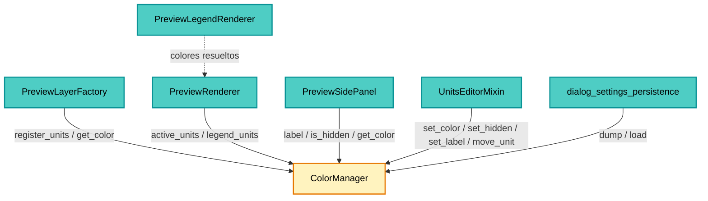
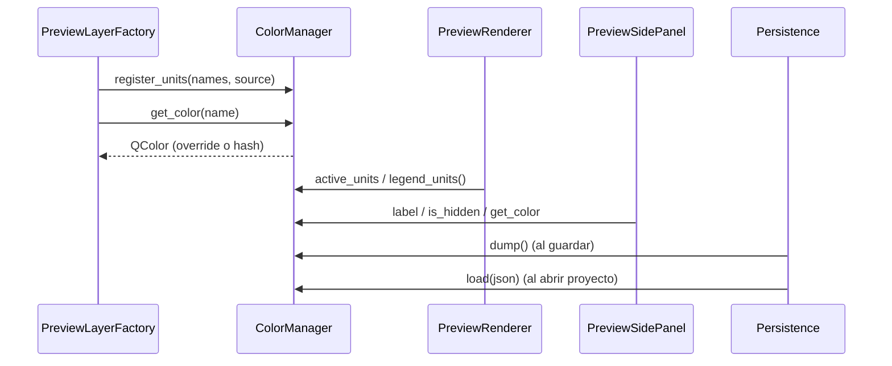

---
tags:
  - secinterp
  - code-walkthrough
  - gui
  - renderers
aliases:
  - color_manager.py
  - ColorManager
cssclass: secinterp-note
---

# `gui/renderers/color_manager.py`

> [!abstract] Resumen en una línea
> Registro de unidades geológicas y de sondeo que asigna a cada nombre un color
> determinista, guarda los overrides del usuario (color, visibilidad, alias y orden) y
> serializa ese estado para persistirlo en el proyecto.

**Ruta**: `gui/renderers/color_manager.py` (173 líneas)
**Clase principal**: `ColorManager`
**Capa**: GUI (Present · Estado de simbología)
**Tags**: #secinterp #gui #renderers

---

## 🎯 ¿Por qué existe este archivo?

Un preview puede tener decenas de unidades; si cada render eligiera colores "al azar", la
misma unidad cambiaría de color entre previews y entre el canvas y la leyenda. El
`ColorManager` centraliza esa decisión y, además, guarda lo que el usuario personaliza.

| Problema | Solución |
|----------|----------|
| El color de una unidad debe ser estable entre renders | Hash del nombre → índice de `GEOLOGY_COLORS` |
| El usuario quiere recolorear una unidad | `_overrides` (nombre → `QColor`) |
| Quiere ocultar unidades sin borrar datos | `_hidden` (`set[str]`) |
| Quiere renombrar (alias) sin tocar el dato | `_labels` (nombre → texto) |
| Quiere reordenar la leyenda | `_order` (lista de nombres) + `ordered_units()` |
| El estado debe sobrevivir a la sesión | `dump()` / `load()` → JSON en el proyecto |
| Geología y sondeos comparten nombres | `_sources` separa ambos conjuntos |

> [!important] Nota arquitectónica
> Es un **objeto de estado puro** (sin QWidget, sin señales, sin QgsLayer): solo depende de
> `QColor`. Eso permite testearlo sin QGIS y compartirlo entre el panel, el editor de
> ajustes, el renderer y la persistencia. La UI nunca muta colores directamente: siempre
> pasa por este manager.

---

## 🧬 Diagrama de relaciones



> [!tip] Cómo leer
> Todos los consumidores comparten **la misma instancia** (la crea el diálogo y la inyecta).
> Por eso un cambio de color en el panel se refleja en el canvas y en el PNG sin copiar
> estado. `dump`/`load` son la única puerta a disco (vía JSON del proyecto).

---

## 📦 Imports — lectura arquitectónica

```python
from __future__ import annotations

from collections.abc import Iterable
from typing import Any, ClassVar

from qgis.PyQt.QtGui import QColor
```

| # | Observación |
|---|-------------|
| ① | Solo `QColor`: ni `qgis.core`, ni widgets, ni señales. |
| ② | `Iterable` para aceptar listas, sets o generadores en `register_units`/`set_order`. |
| ③ | `ClassVar` marca la paleta como constante de clase (compartida, no por instancia). |
| ④ | `Any` solo en `dump`/`load` (payload JSON sin esquema fijo). |
| ⑤ | Sin logger: las operaciones son deterministas y no fallan. |

---

## 🏗️ Inventario de estructura

**Clase:** `ColorManager` — 16 métodos, 6 estructuras de estado.

| Atributo | Tipo | Rol |
|---|---|---|
| `_active_units` | `dict[str, QColor]` | Caché de colores ya calculados |
| `_overrides` | `dict[str, QColor]` | Colores elegidos por el usuario |
| `_hidden` | `set[str]` | Unidades ocultas |
| `_known_units` | `set[str]` | Todas las unidades vistas |
| `_labels` | `dict[str, str]` | Alias de visualización |
| `_order` | `list[str]` | Orden personalizado |
| `_sources` | `dict[str, set[str]]` | `{"geology": {...}, "drillholes": {...}}` |

**Paleta:** `GEOLOGY_COLORS` — 16 `QColor` (rojo, azul, verde, púrpura, amarillo, naranja,
turquesa, gris…).

---

## 📁 Archivos del paquete

| Archivo | Rol respecto al manager |
|---|---|
| `gui/preview_layer_factory.py` | Registra unidades y pide colores al crear capas (ver [[preview_layer_factory]]) |
| `gui/preview_renderer.py` | Expone `active_units`/`legend_units()` (ver [[preview_renderer]]) |
| `gui/preview_side_panel.py` | Filas de leyenda con color/visibilidad (ver [[preview_side_panel]]) |
| `gui/ui/pages/settings/symbology_units.py` | Editor de alias/orden/color (ver [[symbology_units]]) |
| `gui/preview_legend_renderer.py` | Pinta los colores resueltos (ver [[preview_legend_renderer]]) |
| `gui/dialog_settings_persistence.py` | `dump`/`load` como JSON del proyecto (ver [[dialog_settings_persistence]]) |
| `gui/main_dialog.py` | Crea e inyecta la instancia (ver [[main_dialog]]) |
| `tests/gui/test_color_manager.py` | Suite del manager (97 líneas) |

---

## 📖 Recorrido método por método

### `register_units(names, source="geology")` — censo de unidades

```python
bucket = self._sources.setdefault(source, set())
for name in names:
    if name:
        key = str(name)
        self._known_units.add(key)
        bucket.add(key)
```

Registrar **no** asigna color ni orden: solo anota que la unidad existe y a qué familia
pertenece. Se llama en cada preview con las unidades presentes, de modo que `known_units()`
incluya también las que ahora están ocultas (necesario para el botón "Reset unit styles").

### `units_for_source(source)` — separar geología de sondeos

```python
bucket = self._sources.get(source, set())
return [name for name in self.ordered_units() if name in bucket]
```

Devuelve las unidades de una familia **en el orden vigente**. Es lo que permite que el panel
pinte dos secciones (*Geology* / *Drillhole lithologies*) sin mezclar nombres homónimos.

### `known_units()` — censo ordenado

```python
return sorted(self._known_units)
```

Orden alfabético independiente del orden personalizado; se usa para resetear todo el estado
de unidades (incluidas las no visibles).

### `get_color(name)` — color determinista

```python
if not name:
    return QColor(100, 100, 100)
key = str(name)
if key in self._overrides:
    color = self._overrides[key]
    self._active_units[key] = color
    return color
if key in self._active_units:
    return self._active_units[key]
color = self.GEOLOGY_COLORS[sum(ord(c) for c in key) % len(self.GEOLOGY_COLORS)]
self._active_units[key] = color
return color
```

Tres niveles de precedencia:

| Prioridad | Fuente | Cuándo |
|---:|---|---|
| 1 | `_overrides[key]` | El usuario eligió un color |
| 2 | `_active_units[key]` | Ya se calculó en esta sesión |
| 3 | Hash `sum(ord(c)) % 16` | Primera vez que se ve la unidad |

El hash es **estable entre sesiones y plataformas** (no usa `hash()`, que cambia con
`PYTHONHASHSEED`). Un nombre vacío devuelve gris neutro.

### `set_color(name, color)` — override

```python
key = str(name)
self._overrides[key] = color
self._active_units[key] = color
```

Escribe en ambos mapas: el override manda en `get_color` y la caché evita recalcular. No
valida el `QColor` (la UI ya lo hace con `isValid()`).

### `set_hidden` / `is_hidden` / `hidden_units`

```python
if hidden:
    self._hidden.add(key)
else:
    self._hidden.discard(key)
```

Operaciones de conjunto; `hidden_units()` devuelve una **copia** para que el llamador no
mute el estado interno.

### `overrides()` — copia defensiva

```python
return dict(self._overrides)
```

Se usa para serializar sin exponer el diccionario vivo.

### `label(name)` / `set_label(name, text)` / `labels()`

```python
key = str(name)
value = (text or "").strip()
if not value or value == key:
    self._labels.pop(key, None)
else:
    self._labels[str(name)] = value
```

Reglas del alias:

| Entrada | Resultado |
|---|---|
| `""` o solo espacios | Se borra el alias |
| Igual al nombre original | Se borra el alias (no es un cambio real) |
| Cualquier otro texto | Se guarda como alias |

`label(name)` devuelve el alias o el nombre original si no hay.

### `ordered_units()` — orden personalizado + resto alfabético

```python
known = self._known_units
ordered = [name for name in self._order if name in known]
seen = set(ordered)
ordered.extend(sorted(name for name in known if name not in seen))
return ordered
```

El orden del usuario manda para las unidades que conoce; las nuevas (aparecidas después)
se añaden alfabéticamente al final. Nunca se pierde una unidad por un orden obsoleto.

### `set_order(names)` / `move_unit(name, delta)`

```python
order = self.ordered_units()
key = str(name)
if key not in order:
    return
index = order.index(key)
target = index + delta
if target < 0 or target >= len(order):
    return
order[index], order[target] = order[target], order[index]
self._order = order
```

`move_unit` materializa el orden actual y hace un **swap** con el vecino; los extremos son
no-ops (no lanzan). Tras el swap guarda la lista completa como nuevo orden.

### `dump()` — serializar

```python
{
    "overrides": {name: color.name() for name, color in self._overrides.items()},
    "hidden": sorted(self._hidden),
    "labels": dict(self._labels),
    "order": list(self._order),
}
```

Solo serializa **personalización**, no `_known_units` ni `_active_units` (se reconstruyen en
el siguiente preview). Los colores se guardan como `#rrggbb` (`QColor.name()`).

### `load(data)` — restaurar

```python
if not data:
    return
for name, hex_color in (data.get("overrides") or {}).items():
    color = QColor(str(hex_color))
    if color.isValid():
        self._overrides[str(name)] = color
        self._active_units[str(name)] = color
```

Tolerante a payloads parciales o corruptos: ignora colores inválidos y claves ausentes. El
orden se filtra para descartar entradas vacías.

---

## 🔄 Flujo de datos



1. Cada preview registra las unidades presentes (geología y sondeos por separado).
2. La factoría pide colores y crea las capas de memoria.
3. El panel y la leyenda consultan alias/visibilidad/color.
4. Al cerrar (o cambiar ajustes) `dump` va al JSON del proyecto; al abrir, `load` lo restaura.

---

## 🏛️ Patrones de diseño presentes

| Patrón | Dónde | Por qué |
|---|---|---|
| **Registry** | `_known_units`, `_sources` | Censar unidades sin duplicar |
| **Override map** | `_overrides` | Personalización por encima del default |
| **Deterministic hashing** | `get_color` | Color estable sin estado externo |
| **Copy-on-read** | `hidden_units`, `overrides`, `labels` | Evitar mutaciones accidentales |
| **Stable ordering** | `ordered_units` | Mezclar orden del usuario + resto |
| **DTO serialization** | `dump` / `load` | Persistencia JSON tolerante |

---

## 🧾 Resumen de la API

| Método | Entrada | Salida / efecto |
|---|---|---|
| `register_units` | names, source | Anota unidades conocidas |
| `units_for_source` | source | Lista ordenada de esa familia |
| `known_units` | — | Todas, alfabéticas |
| `get_color` | name | `QColor` (override → caché → hash) |
| `set_color` | name, color | Override + caché |
| `set_hidden` | name, bool | Añade/quita de `_hidden` |
| `is_hidden` | name | bool |
| `hidden_units` | — | Copia del set |
| `overrides` | — | Copia del dict |
| `label` | name | Alias o nombre |
| `set_label` | name, text | Alias (vacío = borrar) |
| `labels` | — | Copia del dict |
| `ordered_units` | — | Orden personalizado + resto |
| `set_order` | names | Fija el orden |
| `move_unit` | name, delta | Sube/baja una posición |
| `dump` | — | JSON-serializable |
| `load` | data | Restaura (tolerante) |

---

## 🛡️ Manejo de errores

- **Nombre vacío**: `get_color("")` devuelve gris; `set_color("")` no hace nada.
- **Unidad desconocida**: `move_unit` retorna sin cambiar nada.
- **Extremos del orden**: `move_unit` en el primero/último es no-op.
- **JSON parcial**: `load` usa `or {}` / `or []` en cada campo.
- **Color inválido persistido**: se ignora (`isValid()`), el hash sigue mandando.
- **Alias vacío**: se interpreta como "sin alias" y se borra.

---

## 🧪 Tests asociados

| Test | Qué cubre |
|---|---|
| `tests/gui/test_color_manager.py` | Hash determinista, overrides, hidden, labels, order, dump/load |
| `tests/gui/test_preview_side_panel.py` | Consumo de `label`/`is_hidden`/`get_color` |
| `tests/gui/test_symbology_tab.py` | Edición de alias/orden/color vía el mixin |
| `tests/gui/test_renderers.py` | Colores aplicados a las capas de preview |

---

## 👀 Observaciones y notas

1. **El hash puede colisionar**: dos nombres con la misma suma de `ord` comparten color. Es
   aceptable para una paleta de 16; el usuario puede overridear.
2. **`_active_units` no se serializa**: es una caché de sesión; en el siguiente preview se
   recalcula desde overrides + hash.
3. **Geología y sondeos pueden repetir nombre**: `_sources` evita que una litología de
   sondeo "robe" el color de una unidad geológica en la leyenda.
4. **`known_units` crece con la sesión**: una unidad que desaparece del preview sigue
   conociéndose hasta cerrar el proyecto; útil para resetear todas.
5. **`set_label` normaliza**: espacios sobrantes fuera y alias igual al nombre se descartan.
6. **Sin señales**: el manager no avisa de cambios; quien lo muta (panel/tab) emite su propia
   señal y pide re-render.

---

## 🎨 Ejemplo de asignación

```text
Granodiorita  -> sum(ord) % 16 = 3  -> QColor(155, 89, 182)   # Purple
Esquisto      -> sum(ord) % 16 = 9  -> QColor(211, 84, 0)     # Pumpkin
Lutita        -> sum(ord) % 16 = 1  -> QColor(52, 152, 219)   # Blue
(override)    -> #ff8800            -> manda sobre el hash
```

La misma tabla se usa en el canvas, el panel lateral y el PNG exportado.

---

## 🔗 Notas relacionadas

- [[Index]] — índice de la bóveda
- [[preview_layer_factory]] — registra unidades y pide colores
- [[preview_renderer]] — `active_units` / `legend_units()`
- [[preview_side_panel]] — filas de leyenda editables
- [[symbology_units]] — editor de alias/orden/color
- [[preview_legend_renderer]] — pinta los colores resueltos
- [[dialog_settings_persistence]] — `dump`/`load` en el proyecto
- [[main_dialog]] — crea e inyecta la instancia
- [[gui_renderers]] — hub del paquete `renderers/`

---

*Nota de la bóveda SecInterp Code Walkthrough v2 — v3.11.0*
