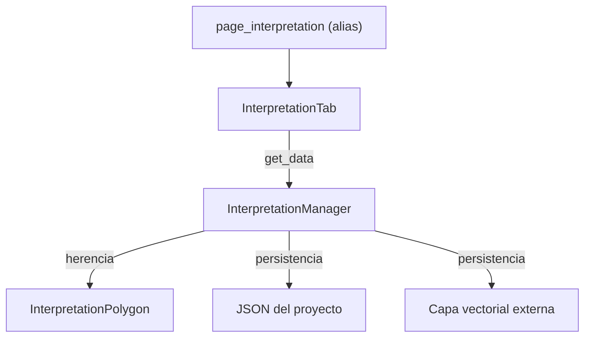

---
tags:
  - secinterp
  - code-walkthrough
  - gui
  - ui-pages
  - settings
  - interpretation
aliases:
  - interpretation_tab.py
  - InterpretationTab
cssclass: secinterp-note
---

# `gui/ui/pages/settings/interpretation_tab.py`

> [!abstract] Resumen en una línea
> Tab de **Settings** para configurar el almacenamiento de interpretaciones, los
> campos personalizados y la herencia de atributos desde geología y sondajes.

**Ruta**: `gui/ui/pages/settings/interpretation_tab.py`
**Clase principal**: `InterpretationTab`
**Capa**: GUI · Settings
**Tags**: #secinterp #gui #ui-pages #settings #interpretation

---

## 🎯 ¿Por qué existe?

La antigua `InterpretationPage` ocupaba una entrada del sidebar, pero su contenido
no es un flujo de trabajo: es configuración que se cambia una vez.

| Necesidad | Implementación |
|---|---|
| Elegir almacenamiento | `Project (Internal JSON)` o `Vector Layer (External)` |
| Sincronizar con la capa | `Auto-Sync on layer edits` |
| Campos de atributo propios | tabla `fields_table` (nombre/tipo/default) |
| Heredar geología/sondajes | `chk_inherit_geol`, `chk_inherit_drill` |
| Mantener consumidores | alias `MainWindow.page_interpretation` |

`InterpretationTab` vive dentro de `SettingsPage`:
`Default | Advanced | Symbology | Interpretation | Plugin Information`.

---

## 🔄 Flujo de datos

`dump()` persiste `interp_inherit_geol`, `interp_inherit_drill` e
`interp_custom_fields`; `load()` los restaura. Las claves no cambian respecto a la
página anterior, así que no hay migración de proyectos.

---

## ⚙️ API

| Método | Responsabilidad |
|---|---|
| `get_data()` | source, target layer, auto-sync, custom fields, herencia |
| `dump()` / `load()` | estado persistente del proyecto |
| `reset()` | herencia por defecto y tabla vacía |
| `validate()` | nombres vacíos o duplicados |
| `connect_signals()` / `disconnect_signals()` | botones y cambio de source |

---

## 🔗 Notas relacionadas

- [[settings_page]] — contenedor de tabs.
- [[gui_ui_pages_settings]] — hub de Settings.
- [[dialog_interpretation_manager]] — consumidor de `get_data()`.
- [[interpretation_persistence_mixin]] — persistencia dual.
- [[interpretation_inheritance_mixin]] — herencia de atributos.
