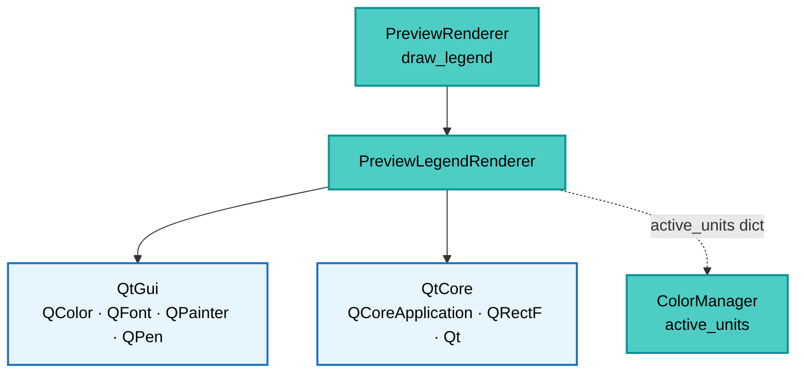

---
tags:
  - secinterp
  - code-walkthrough
  - gui
  - renderers
aliases:
  - preview_legend_renderer.py
  - PreviewLegendRenderer
cssclass: secinterp-note
---

# `gui/preview_legend_renderer.py`

> [!abstract] Resumen en una línea
> Dibuja la leyenda del preview sobre un `QPainter`: construye filas tipadas (capa, unidad,
> cabecera o interpretación), las mide, las coloca en una de cuatro esquinas y las pinta con
> tamaño de fuente y límite de ítems configurables.

**Ruta**: `gui/preview_legend_renderer.py` (279 líneas)
**Clase principal**: `PreviewLegendRenderer`
**Capa**: GUI (Present · Renderer de leyenda)
**Tags**: #secinterp #gui #renderers

---

## 🎯 ¿Por qué existe este archivo?

El canvas muestra capas temporales fuera de la leyenda del proyecto (se registran con
`addMapLayer(layer, False)`), así que el preview necesita su propia leyenda pintada:

| Problema | Solución |
|----------|----------|
| Las temporales no aparecen en la leyenda de QGIS | Leyenda pintada a mano con `QPainter` sobre el canvas |
| El número de unidades varía por preview | `_measure` mide cada texto con `fontMetrics` |
| Topografía y estructuras son opcionales | Flags `has_topography` / `has_structures` con salida temprana si todo vacío |
| Los literales deben traducirse | `QCoreApplication.translate("PreviewLegendRenderer", ...)` |
| El pintado debe aislarse del canvas | `painter.save()` / `restore()`: fuente y pens restaurados |

> [!important] Nota arquitectónica
> **Renderer inmediato stateless.** Todo `staticmethod`, sin constructor ni estado: entra
> `painter + rect + unidades + flags`, sale píxeles. [[preview_renderer]] solo reenvía.

---

## 🧬 Diagrama de relaciones



> [!tip] Cómo leer
> Flecha sólida = llama/importa; punteada = el diccionario `active_units` (nombre →
> `QColor`) se produce en el `ColorManager` y viaja vía factoría y renderer.

---

## 📦 Imports — lectura arquitectónica

```python
# gui/preview_legend_renderer.py
from typing import Any

from qgis.PyQt.QtCore import QCoreApplication, QRectF, Qt
from qgis.PyQt.QtGui import QColor, QFont, QPainter, QPen

from sec_interp.logger_config import get_logger
```

| # | Observación |
|---|-------------|
| ① | Cero `qgis.core`: la leyenda no toca capas ni geometrías, solo píxeles Qt. |
| ② | `QPainter` solo como tipo: el painter lo crea el canvas, el renderer solo pinta. |
| ③ | `QCoreApplication.translate` para "Topography"/"Structures" (i18n real). |
| ④ | `Qt.PenStyle / Qt.BrushStyle / Qt.AlignmentFlag` con enums namespaced (estilo QGIS 4/Qt6). |
| ⑤ | `Any` solo en el `config: dict[str, Any]` de layout. |
| ⑥ | `logger` definido pero sin llamadas: el pintado no registra (hot path de paint). |

---

## 🏗️ Inventario de estructura

**Clase:** `class PreviewLegendRenderer` — 10 `staticmethods`

- `draw_legend(painter, rect, active_units, has_topography=False, ..., layout=None, layer_colors=None)` — entrada de alto nivel
- `_build_rows(...)` — compone todas las filas
- `_layer_rows(...)` / `_unit_rows(...)` / `_interpretation_rows(...)` — filas por familia
- `draw_rows(painter, rect, rows, layout=None)` — layout + pintado
- `_position(rect, size, position, margin)` → `(x, y)`
- `_measure(painter, rows, config)` → `(QRectF, max_text_width)`
- `_draw_row(painter, x, y, kind, label, color, max_width, config)` → siguiente `y`
- `_draw_legend_background(painter, x, y, width, height)`

**Helpers de módulo:** `_translator()`, `_interpretation_label(interp)`,
`_interpretation_color(interp)`.

**Tipos de fila:** `_LINE` (línea), `_SWATCH` (cuadrado), `_HEADER` (cabecera en negrita).

**Layout** (dict opcional):
- `font_size` (6–16, default 8), `position` (`top-right`, `top-left`, `bottom-right`, `bottom-left`), `max_items` (0 = todos)
- `config` derivada: `padding = 6`, `item_height = max(12, font_size + 6)`, `symbol_size = max(8, font_size + 2)`, `line_width = 2`, `margin = 20`

---

## 📁 Archivos del paquete

| Archivo | Rol respecto a la leyenda |
|---|---|
| `gui/preview_renderer.py` | `draw_legend(painter, rect)` reenvía unidades + flags |
| `gui/preview_layer_factory.py` | `active_units` (vía `ColorManager`) alimenta las filas geológicas |
| `gui/renderers/color_manager.py` | Produce los `QColor` por unidad |
| `gui/ui/pages/preview_page.py` | Página/canvas que dispara el pintado (ver [[preview_page]]) |

---

## 📖 Recorrido método por método

### `draw_legend` — construir filas y delegar

```python
rows = PreviewLegendRenderer._build_rows(
    active_units=active_units, has_topography=has_topography,
    has_structures=has_structures, has_drillholes=has_drillholes,
    labels=labels or {}, drill_units=drill_units or {},
    interpretations=interpretations or [], layer_colors=layer_colors or {},
)
PreviewLegendRenderer.draw_rows(painter, rect, rows, layout)
```

La entrada pública ya no pinta: normaliza los opcionales (`or {}` / `or []`) y delega en
`_build_rows` + `draw_rows`. Eso permite testear la composición de filas sin `QPainter`.

### `_build_rows` — composición por familias

```python
rows.extend(self._layer_rows(has_topography, has_structures, has_drillholes,
                             layer_colors, tr))
rows.extend(self._unit_rows(active_units, drill_units, labels, tr))
rows.extend(self._interpretation_rows(interpretations, tr))
```

| Familia | Helper | Filas |
|---|---|---|
| Capas | `_layer_rows` | Topography, Structures, Drillhole traces |
| Unidades | `_unit_rows` | *Geology* + swatches, *Drillhole lithologies* + swatches |
| Interpretaciones | `_interpretation_rows` | *Interpretations* + una fila por interpretación |

Cada fila es una tupla `(kind, label, color)` con `kind` en `{_LINE, _SWATCH, _HEADER}`.

### `_layer_rows` — las tres capas opcionales

```python
if has_topography:
    color = layer_colors.get("topography") or QColor(0, 102, 204)
    rows.append((_LINE, tr("Topography"), color))
```

| Capa | Color por defecto |
|---|---|
| Topography | `#0066cc` |
| Structures | `#cc0000` |
| Drillhole traces | `#323232` |

`layer_colors` viene del estilo de Symbology, así que la leyenda usa el mismo color que las
capas (y el que el usuario haya elegido).

### `_unit_rows` — geología vs litologías de sondeo

```python
if not drill_units:
    return swatches
rows = [(_HEADER, tr("Geology"), None)]
rows.extend(swatches)
rows.append((_HEADER, tr("Drillhole lithologies"), None))
rows.extend(...)
```

Sin sondeos no se añade cabecera: la lista de geología va directa. Con sondeos se separan en
dos secciones con cabecera para que el usuario distinga ambas familias. Los alias salen de
`labels.get(name, name)`.

### `_interpretation_rows` — interpretaciones

```python
if not interpretations:
    return []
rows = [(_HEADER, tr("Interpretations"), None)]
for interp in interpretations:
    rows.append((_SWATCH, _interpretation_label(interp), _interpretation_color(interp)))
```

`_interpretation_label` usa `name`, luego `type`, luego `"?"`; `_interpretation_color` cae a
`#FF0000` si el color no es válido. Las interpretaciones ocultas ya vienen filtradas por el
llamador (`hidden_interp_ids`).

### `draw_rows` — layout y pintado

```python
font_size = int(layout.get("font_size") or 8)
position = layout.get("position") or "top-right"
if position not in _VALID_POSITIONS:
    position = "top-right"
max_items = int(layout.get("max_items") or 0)
```

Pasos:

1. **Normalizar layout**: fuente 6–16, posición válida (fallback `top-right`), máximo de ítems.
2. **Recortar**: si `max_items > 0` y hay más filas, se conservan las primeras y se añade
   `(_HEADER, "+N more", None)`.
3. **Medir** con la fuente ya aplicada (`_measure`).
4. **Posicionar** en la esquina pedida (`_position`).
5. **Fondo** blanco alfa 200 + borde gris (`_draw_legend_background`).
6. **Pintar** fila a fila con `_draw_row`, que devuelve el siguiente `y`.

`save()`/`restore()` envuelven todo el pintado: la fuente y el pen del canvas no se fugan.

### `_position` — cuatro esquinas

```python
x = rect.width() - size.width() - margin if position.endswith("right") else margin
y = rect.height() - size.height() - margin if position.startswith("bottom") else margin
```

Deriva la esquina del string (`top-left`, `bottom-right`, …) sin un `match` de cuatro ramas:
`endswith("right")` y `startswith("bottom")` cubren las cuatro combinaciones.

### `_measure` — medir antes de pintar

```python
for _kind, label, _color in rows:
    max_text_width = max(max_text_width, fm.boundingRect(label).width())
width = max_text_width + config["symbol_size"] + config["padding"] * 3
height = len(rows) * config["item_height"] + config["padding"] * 2
```

Mide con la fuente ya fijada para que el ancho sea real, incluidas las cadenas traducidas
(más largas en ES/FR que en EN). El `QRectF` vuelve con origen `(0, 0)`.

### `_draw_row` — tres tipos de fila

| `kind` | Dibujo | Avance |
|---|---|---|
| `_HEADER` | Texto en negrita (fuente temporal) | `+ item_height` |
| `_LINE` | `drawLine` de `symbol_size` con el color | `+ item_height` |
| `_SWATCH` | Cuadrado `symbol_size × symbol_size` | `+ item_height` |

El texto va en negro, alineado izquierda + centrado vertical, dentro de `max_text_width`.
La negrita se activa y se desactiva en la misma llamada para no contaminar las filas
siguientes.

### `_draw_legend_background` — caja semitransparente con borde

```python
painter.setBrush(QColor(255, 255, 255, 200))
painter.setPen(Qt.PenStyle.NoPen)
painter.drawRect(rect)
painter.setBrush(Qt.BrushStyle.NoBrush)
painter.setPen(QColor(100, 100, 100))
painter.drawRect(rect)
```

Doble pasada: relleno blanco alfa 200 sin borde + borde gris `(100,100,100)` sin relleno. La
alfa deja ver el perfil bajo la caja.

---

## 🔄 Flujo de datos

| Fase | Entrada | Transformación | Salida |
|------|---------|----------------|--------|
| Guarda | filas | lista vacía → `return` | sin pintado |
| Layout | `layout` | fuente, posición y `max_items` | config normalizada |
| Recorte | filas + `max_items` | prefijo + `"+N more"` | filas visibles |
| Medición | textos + `fontMetrics` | bounding rects | `(tamaño, max_text_width)` |
| Fondo | tamaño + posición | doble `drawRect` | caja en la esquina elegida |
| Filas | `(kind, label, color)` | `_draw_row` | 0–N filas |
| Restauración | `painter.restore()` | fuente/pens originales | canvas intacto |

---

## 🏛️ Patrones de diseño presentes

| Patrón | Dónde | Propósito |
|--------|-------|-----------|
| **Immediate-mode rendering** | todo `staticmethod` | Pintar sin escena ni items |
| **Row model** | `_build_rows` → tuplas `(kind, label, color)` | Composición testeable sin painter |
| **Measure-then-layout** | `_measure` + `_position` | Caja exacta en cualquier esquina |
| **Save/restore (RAII pictórico)** | `save()`/`restore()` | No fugar estado del painter |
| **Canonical colors** | azul topo / rojo struct | Convención visual estable |

---

## 🧾 Resumen de la API

| Símbolo | Firma | Uso típico |
|---------|-------|------------|
| `PreviewLegendRenderer` | sin estado | `PreviewRenderer.draw_legend` delega |
| `draw_legend` | `(painter, rect, active_units, has_*, labels, drill_units, interpretations, layout, layer_colors)` | Entrada de alto nivel |
| `_build_rows` | `(...)` → `list[tuple]` | Composición de filas |
| `draw_rows` | `(painter, rect, rows, layout)` | Layout + pintado |
| `_position` | `(rect, size, position, margin)` → `(x, y)` | Esquina |
| `_measure` | `(painter, rows, config)` → `(QRectF, width)` | Medición |
| `_draw_row` | `(painter, x, y, kind, label, color, max_width, config)` | Una fila |
| `_draw_legend_background` | `(painter, x, y, width, height)` | Caja |

---

## 🛡️ Manejo de errores

| Situación | Comportamiento |
|-----------|----------------|
| Leyenda vacía (`rows == []`) | retorno temprano, sin tocar el painter |
| `active_units` vacío pero con flags | solo filas de capas |
| Flags falsos con unidades | solo filas de unidades |
| `position` desconocida | fallback `top-right` |
| `max_items` mayor que las filas | no se recorta |
| Painter ajeno | `save/restore` garantiza no dejar fuente ni pen cambiados |

---

## 🧪 Tests asociados

- `tests/gui/test_preview_legend_renderer.py` — `TestPreviewLegendRenderer`: salida temprana vacía, caja y filas con `painter` mock y `fontMetrics` simulado.
- `tests/gui/test_preview_components.py` — `active_units` como puente factoría→leyenda.
- `tests/gui/renderers/test_renderers.py` — colores del `ColorManager` que la leyenda refleja.

---

## 👀 Observaciones y notas

> [!success] Fortalezas
> - Sin `qgis.core`: testeable con un `QPainter` mock, sin canvas.
> - Medición real con la fuente final: sin textos recortados en otros idiomas.
> - `save/restore` disciplinado en un hot path de pintado.

> [!warning] Puntos de atención
> - Familia de fuente hardcodeada (`Arial`): el tamaño sí es configurable (6–16).
> - La posición se elige entre 4 esquinas, pero no detecta colisiones con el perfil.
> - `logger` importado pero nunca usado (resto de un refactor).
> - `max_items` recorta y resume (`+N more`), pero no pagina: el resto no es visible.

> [!question] Preguntas abiertas
> - ¿Fuente desde `QgsSettings`/tema en vez de `Arial` fija?
> - ¿Permitir varias columnas cuando el número de ítems supera la altura?

---

## 🎨 Anatomía visual

Con topo + struct + dos unidades (`Arenisca`, `Lutita`), la caja queda así:

```text
┌────────────────────────────┐
│ ── Topography               │
│ ── Structures               │
│ ── Drillhole traces         │
│ Geology                     │
│ ■■ Arenisca                 │
│ ■■ Lutita                   │
│ Drillhole lithologies       │
│ ■■ Caliza                   │
│ Interpretations             │
│ ■■ Falla inferida           │
└────────────────────────────┘
```

| Pieza | Geometría | Color |
|-------|-----------|-------|
| Caja | `legend_size + margin`, esquina de `layout["position"]` | relleno blanco alfa 200 |
| Borde | mismo `QRectF`, segunda pasada | gris `(100,100,100)` |
| Línea topo | `drawLine(x+p, y+ih/2, ...)`, ancho 2 | azul `(0,102,204)` |
| Línea struct | idéntica, otro color | rojo `(204,0,0)` |
| Swatch | `symbol_size` (10 con fuente 8) | `QColor` del `ColorManager` |
| Texto | `max_text_width × ih`, negro | `AlignLeft + AlignVCenter` |

---

## 📏 Ejemplo de dimensionado

`fontMetrics` con `Arial 8` (layout por defecto) mide: "Topography" → 62 px, "Structures" → 58 px,
"Arenisca" → 48 px, "Formación Playa Larga" → 118 px:

| Paso | Cálculo | Valor |
|------|---------|-------|
| `max_text_width` | `max(62, 58, 48, 118)` | `118` |
| Ancho | `118 + 10 + 6×3` | `146` |
| Alto (4 filas) | `4×16 + 6×2` | `76` |
| Posición X | `rect.width() − 146 − 20` | depende del canvas |
| Posición Y | `margin` | `20` |

> [!tip] El nombre largo manda
> Una sola unidad con nombre largo ensancha toda la caja: la columna de texto es común
> (`max_text_width`) para alinear todas las filas.

---

## 🌐 Internacionalización y casos largos

| Aspecto | Detalle |
|---------|---------|
| Literales UI | "Topography"/"Structures" vía `translate` (se miden traducidos) |
| Datos | nombres de unidad sin traducir (son datos de la capa) |
| Caja elástica | crece con el idioma: el ES suele ser más ancho que el EN |
| Recorte | `max_items` deja las primeras N y resume el resto como `+N more` |

---

## 🧩 La leyenda en el pipeline

| Pregunta | Respuesta |
|----------|-----------|
| ¿Quién la llama? | `PreviewRenderer.draw_legend(painter, rect)` tras `render` |
| ¿De dónde salen las unidades? | `layer_factory.active_units` (registro del `ColorManager`) |
| ¿De dónde los flags? | `has_topography` / `has_structures` / `has_drillholes` del renderer |
| ¿Cuándo se resetea? | `_cleanup_layers` vacía `active_units` y los flags |
| ¿Pinta sobre capas? | Sí: painter del canvas, tras el `refresh`, en la esquina configurada |

> [!note] Pintado, no capa
> La leyenda no es un `QgsVectorLayer`: no entra en el extent, el Z-order ni la
> limpieza. Vive solo los milisegundos del paint.

---

## 🔗 Notas relacionadas

- [[Index]] — índice de la bóveda
- [[preview_renderer]] — `draw_legend` que delega aquí
- [[preview_layer_factory]] — provee `active_units`
- [[preview_page]] — canvas donde se pinta
- [[gui_renderers]] — `ColorManager` y simbología
- [[dialog_preview_manager]] — dueño del renderer

---

*Nota de la bóveda SecInterp Code Walkthrough v2 — v3.11.0*
