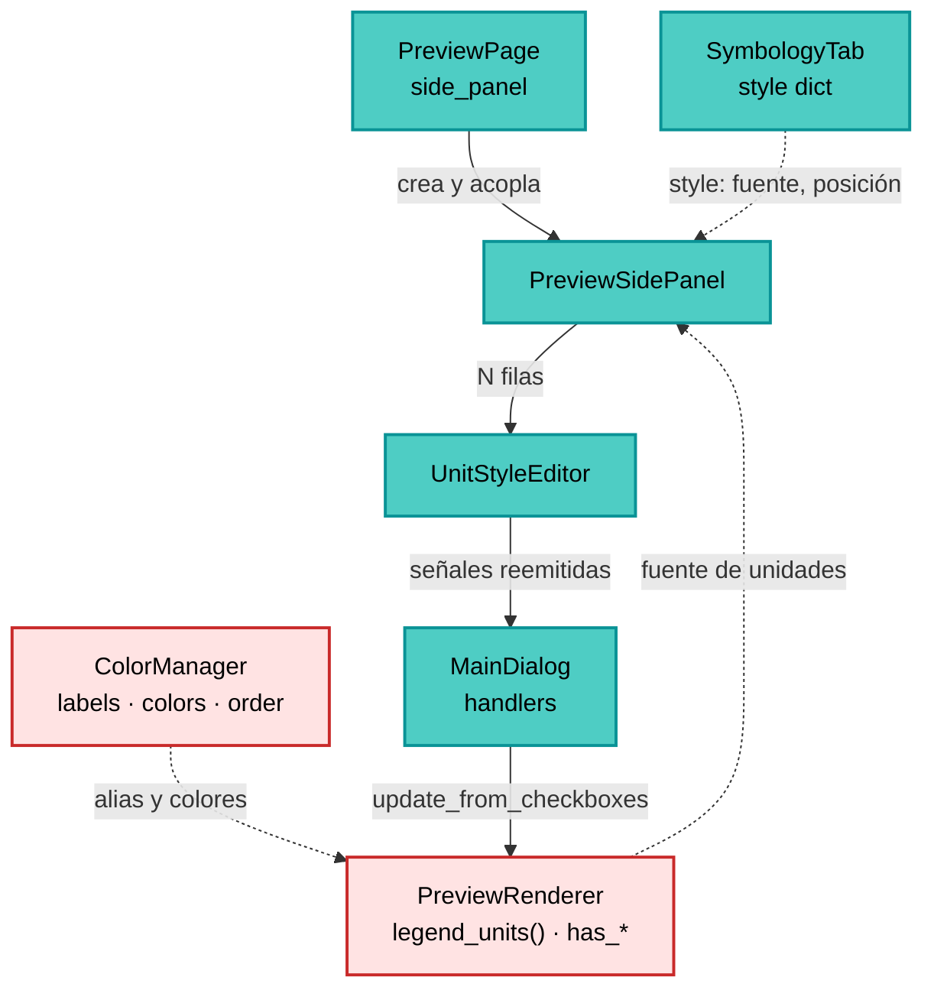
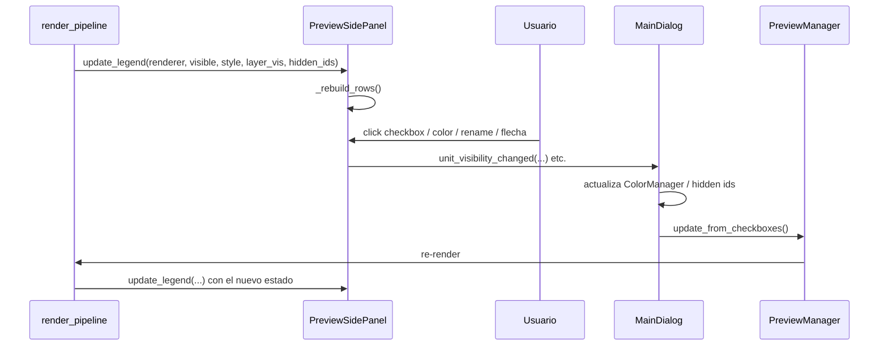

---
tags:
  - secinterp
  - code-walkthrough
  - gui
  - widgets
aliases:
  - preview_side_panel.py
  - PreviewSidePanel
  - UnitStyleEditor
cssclass: secinterp-note
---

# `gui/preview_side_panel.py`

> [!abstract] Resumen en una línea
> Panel lateral del preview: una lista scrolleable de filas (capas, unidades geológicas,
> litologías de sondeo e interpretaciones) donde cada fila permite ocultar, recolorear o
> renombrar su elemento, y que reemite cada gesto como señal para que el diálogo reconstruya
> el preview.

**Ruta**: `gui/preview_side_panel.py` (341 líneas)
**Clases principales**: `PreviewSidePanel`, `UnitStyleEditor`
**Capa**: GUI (Present · Widget de leyenda)
**Tags**: #secinterp #gui #widgets

---

## 🎯 ¿Por qué existe este archivo?

La leyenda dejó de pintarse como overlay sobre el canvas: tapaba el perfil y no permitía
interactuar con las unidades. Este módulo la convierte en un panel acoplado al lado del
canvas (dentro de un `QSplitter`) con filas editables de verdad.

| Problema | Solución |
|----------|----------|
| La leyenda overlay tapaba parte del perfil | Panel acoplado en un `QSplitter` (canvas 4 : panel 1) |
| No se podía ocultar/recolorear una unidad | `UnitStyleEditor` por fila con checkbox + botón de color |
| Las unidades y las litologías de sondeo se mezclaban | Dos secciones con cabecera: *Geology* y *Drillhole lithologies* |
| Las interpretaciones no aparecían en la leyenda | `update_interpretations()` + sección *Interpretations* |
| Reconstruir filas dejaba ventanas huérfanas | `removeWidget()` + `deleteLater()` en `_clear_legend_rows()` |
| El panel debía respetar el tamaño de fuente de la leyenda | `font-size: Npt` se aplica al contenedor en `_rebuild_rows()` |

> [!important] Nota arquitectónica
> **Widget compuesto y sin lógica de negocio.** El panel no calcula colores ni geometrías:
> recibe un `renderer` ya construido (`PreviewRenderer`) y un `style` (dict del tab de
> Symbology), pinta filas y reemite señales. Quien decide es `MainDialog`, que escucha y
> dispara `preview_manager.update_from_checkboxes()`.

---

## 🧬 Diagrama de relaciones



> [!tip] Cómo leer
> Sólido = construye/posee; punteado = dato inyectado. El `PreviewRenderer` es la fuente de
> verdad de *qué* hay en el preview; el panel solo lo representa y deja que el usuario lo
> edite. Las señales viajan de vuelta al diálogo, nunca directamente al renderer.

---

## 📦 Imports — lectura arquitectónica

```python
from __future__ import annotations

from typing import Any

from qgis.PyQt.QtCore import pyqtSignal
from qgis.PyQt.QtGui import QColor
from qgis.PyQt.QtWidgets import (
    QCheckBox, QGroupBox, QHBoxLayout, QLabel, QLineEdit,
    QScrollArea, QToolButton, QVBoxLayout, QWidget,
)

from sec_interp.logger_config import get_logger
```

| # | Observación |
|---|-------------|
| ① | Cero `qgis.core`: el panel no toca capas ni geometrías, solo widgets Qt. |
| ② | `pyqtSignal` en las dos clases: el panel es un **relay** de señales de fila. |
| ③ | `QScrollArea` + `QGroupBox`: la lista crece sin empujar el tamaño del diálogo. |
| ④ | `QLineEdit` solo se instancia cuando `with_rename=True` (editor de unidades). |
| ⑤ | `QToolButton` de 14×14 px como muestra de color clicable. |
| ⑥ | `logger` se declara pero no se usa: el panel no registra (UI pura). |
| ⑦ | `Any` aparece solo en `renderer` y `style`: el panel no importa el renderer (evita ciclo). |

---

## 🏗️ Inventario de estructura

**Clases:** `UnitStyleEditor` (4 señales, 2 métodos), `PreviewSidePanel` (6 señales, 14 métodos)
**Constantes:** `_SWATCH_STYLE = "border: 1px solid #888;"`
**Función auxiliar:** `_swatch_stylesheet(color)` → stylesheet de la muestra

### `UnitStyleEditor` — una fila

| Señal | Firma | Cuándo |
|---|---|---|
| `visibility_changed` | `(str, bool)` | Se marca/desmarca el checkbox |
| `color_requested` | `(str)` | Se pulsa la muestra de color |
| `label_changed` | `(str, str)` | Termina la edición del nombre (`editingFinished`) |
| `move_requested` | `(str, int)` | Se pulsa ▲ (-1) o ▼ (+1) |

Flags de construcción: `interactive`, `with_visibility`, `with_color`, `with_rename`,
`with_reorder`. El panel usa la fila en modo "solo ver/hide/color"; el tab de Symbology la
usa con rename y reorder.

### `PreviewSidePanel` — el panel

| Señal | Firma | Origen |
|---|---|---|
| `unit_visibility_changed` | `(str, bool)` | Filas de unidad |
| `unit_color_requested` | `(str)` | Filas de unidad |
| `layer_visibility_changed` | `(str, bool)` | Filas topography/structures/drillholes |
| `layer_color_requested` | `(str)` | Filas de capa |
| `interpretation_visibility_changed` | `(str, bool)` | Filas de interpretación |
| `interpretation_color_requested` | `(str)` | Filas de interpretación |

Estado interno: `_legend_rows` (widgets vivos), `_interpretations`, `_renderer`,
`_legend_style`, `_legend_visible`, `_layer_visibility`, `_hidden_interp_ids`.

---

## 📁 Archivos del paquete

| Archivo | Rol respecto al panel |
|---|---|
| `gui/ui/pages/preview_page.py` | Crea el panel y lo mete en el `QSplitter` (ver [[preview_page]]) |
| `gui/preview_renderer.py` | Expone `legend_units()` y los flags `has_*` (ver [[preview_renderer]]) |
| `gui/renderers/color_manager.py` | Fuente de alias, colores, orden y visibilidad (ver [[color_manager]]) |
| `gui/ui/pages/settings/symbology_tab.py` | Reutiliza `UnitStyleEditor` para el editor por unidad (ver [[symbology_tab]]) |
| `gui/main_dialog.py` | Conecta las señales del panel y actualiza el preview (ver [[main_dialog]]) |
| `plugin/render_pipeline.py` | Llama a `side_panel.update_legend(...)` tras renderizar (ver [[render_pipeline]]) |
| `tests/gui/test_preview_side_panel.py` | Suite específica del panel (165 líneas) |

---

## 📖 Recorrido método por método

### `UnitStyleEditor.__init__` — construir la fila

```python
self.unit_name = name
display = label or name
layout = QHBoxLayout(self)
```

El orden visual es fijo: **visibilidad → color → reordenar → nombre**. Cada bloque es
opcional y se activa con un flag, lo que permite reutilizar la misma fila en dos contextos:

1. **Panel de preview**: `interactive=True, with_visibility=True, with_color=True`,
   sin rename ni reorder.
2. **Editor de ajustes**: `interactive=True` + `with_rename=True, with_reorder=True`.

Cuando `interactive=False` la fila es de solo lectura: muestra un `QLabel` de 12×12 como
muestra y una etiqueta, sin checkbox ni botón.

Detalle importante: los `lambda` capturan `self.unit_name`, no el texto del widget. Así una
fila renombrada sigue emitiendo la **clave original** (`name`), que es la que entiende el
`ColorManager`.

### `UnitStyleEditor._reorder_button` — ▲ / ▼

Crea un `QToolButton` de 18 px de ancho y conecta `clicked` a
`move_requested.emit(self.unit_name, delta)`. El delta es `-1` para subir y `+1` para bajar;
la fila no reordena nada por sí misma (no conoce la lista completa).

### `PreviewSidePanel.__init__` — estado y construcción

Inicializa el estado *antes* de construir la UI y llama a `_setup_ui()`. El orden importa:
`_rebuild_rows()` asume que `legend_layout` ya existe.

```python
self._legend_rows: list[QWidget] = []
self._interpretations: list = []
self._renderer: Any = None
self._legend_style: dict = {}
self._legend_visible = True
self._layer_visibility: dict[str, bool] = {}
self._hidden_interp_ids: set[str] = set()
```

### `PreviewSidePanel._setup_ui` — grupo + scroll

```python
self.legend_group = QGroupBox(self.tr("Legend"))
self.legend_scroll = QScrollArea()
self.legend_scroll.setWidgetResizable(True)
self.legend_container = QWidget()
self.legend_layout = QVBoxLayout(self.legend_container)
```

El `QGroupBox` es lo que se oculta con `set_legend_visible()`; el `QScrollArea` es lo que
evita que una lista de 40 unidades estire el diálogo. Al final se añade un `stretch` para
que las filas queden arriba.

### `PreviewSidePanel.update_legend` — entrada principal

```python
def update_legend(self, renderer, visible=True, style=None,
                  layer_visibility=None, hidden_interp_ids=None) -> None:
```

Es el único punto de entrada desde `render_pipeline`. Guarda el renderer y el estilo, aplica
visibilidad y reconstruye. Los dos últimos parámetros son *opcionales con memoria*: si se
pasan `None` se conserva el estado anterior (así un re-render no pierde lo que el usuario
había ocultado).

### `PreviewSidePanel.update_interpretations` — lista viva

Se llama desde `MainDialog.__init__` (tras `load_interpretations`) y desde
`dialog_interpretation_manager` cada vez que se añade/borra una interpretación. Si todavía
no hay renderer, solo guarda la lista; la reconstrucción ocurrirá en el primer
`update_legend`.

### `PreviewSidePanel._rebuild_rows` — composición

```python
self._clear_legend_rows()
if not self._legend_visible or renderer is None:
    return
font_size = int(style.get("legend_font_size") or 0)
self.legend_container.setStyleSheet(f"font-size: {font_size}pt;" if font_size else "")
```

Después añade, en orden: capas (si `has_*`), *Geology*, *Drillhole lithologies* e
*Interpretations*. Cada bloque se auto-omite si está vacío, así que un preview sin sondeos
no muestra una cabecera huérfana.

### `PreviewSidePanel._topo_color` — color según el modo

| `color_mode` | Color devuelto |
|---|---|
| `"single"` | `style["single_color_hex"]` o `#1f77b4` |
| cualquier otro | `#0066cc` (extremo frío del gradiente) |

Es una aproximación deliberada: en modo gradiente la fila no puede mostrar el degradado
completo, así que usa el azul de referencia del renderer.

### `PreviewSidePanel._add_unit_group` — sección con cabecera

Recibe una lista de tuplas `(name, label, color, hidden, source)` y, si está vacía, retorna
sin pintar la cabecera. Por cada unidad crea una fila interactiva con su alias como etiqueta.

### `PreviewSidePanel._add_interpretation_group` — interpretaciones editables

```python
iid = str(getattr(interp, "id", "") or getattr(interp, "name", ""))
name = getattr(interp, "name", "") or getattr(interp, "type", "")
label = str(name) if name else self.tr("(unnamed)")
color = QColor(str(getattr(interp, "color", "") or "#FF0000"))
```

El identificador usado como clave es `id` (o `name` si no hay id); el color cae a rojo si la
interpretación no trae uno válido. El estado *oculto* vive en `_hidden_interp_ids`, un
`set` que el diálogo mantiene y reinyecta.

### `PreviewSidePanel._unit_entries` — adaptador tolerante

```python
if hasattr(renderer, "legend_units"):
    return list(renderer.legend_units())
units = getattr(renderer, "active_units", None) or {}
```

`legend_units()` devuelve las cinco columnas (nombre, alias, color, oculto, origen). Si el
renderer es antiguo o un mock sin ese método, se degrada a `active_units` como geología
(sin orden ni alias). Es el punto que permite testear el panel con dobles simples.

### `PreviewSidePanel._add_row` — cableado por tipo

```python
if kind == "layer":
    row.visibility_changed.connect(self.layer_visibility_changed.emit)
elif kind == "interpretation":
    row.visibility_changed.connect(self.interpretation_visibility_changed.emit)
elif interactive:
    row.visibility_changed.connect(self.unit_visibility_changed.emit)
```

La fila no sabe a qué "familia" pertenece; el panel decide a qué señal del panel se reemite.
La inserción usa `insertWidget(len(self._legend_rows), row)` para respetar el orden y
mantener las cabeceras en su sitio.

### `PreviewSidePanel._clear_legend_rows` — el detalle que evita fugas

```python
for row in self._legend_rows:
    self.legend_layout.removeWidget(row)
    row.deleteLater()
self._legend_rows = []
```

`removeWidget` **no** destruye el widget: lo deja sin padre y Qt lo promociona a ventana
de nivel superior. Sin `deleteLater()` cada re-render dejaría una ventana huérfana visible
(el bug que documenta el comentario del código).

### `PreviewSidePanel.set_legend_visible` — ocultar todo el grupo

`self.legend_group.setVisible(bool(visible))`. Se usa al arrancar (el checkbox de preview
ya no existe) y cuando el render pipeline informa `show_legend=False`.

---

## 🔄 Flujo de datos



1. El pipeline entrega el renderer y el estilo tras cada preview.
2. El usuario interactúa con una fila.
3. La fila emite su señal; el panel la reemite con la familia correcta.
4. `MainDialog` traduce el gesto a un cambio de estado (`ColorManager`, `_hidden_interp_ids`,
   checkbox de capa) y pide un re-render.
5. El pipeline vuelve a llamar a `update_legend`, que reconstruye las filas.

El bucle es intencionalmente **unidireccional**: el panel nunca muta el renderer ni el
`ColorManager`; solo describe lo que ve y notifica.

---

## 🏛️ Patrones de diseño presentes

| Patrón | Dónde | Por qué |
|---|---|---|
| **Composite widget** | `PreviewSidePanel` contiene `UnitStyleEditor` | Una fila reutilizable en panel y ajustes |
| **Signal relay** | 6 señales del panel | El consumidor no conoce las filas concretas |
| **Lazy rebuild** | `_rebuild_rows` | Reconstruir solo cuando hay renderer visible |
| **State injection** | `update_legend(...)` | El estado (visibilidad, ids ocultos) vive en el diálogo |
| **Graceful degradation** | `_unit_entries` | Compatibilidad con renderers/mocks sin `legend_units()` |
| **Deterministic teardown** | `deleteLater()` en `_clear_legend_rows` | Evita ventanas huérfanas |

> [!note] Sin lógica de negocio
> No hay cálculos geológicos ni de estilo aquí: los colores vienen ya resueltos por el
> `ColorManager`/renderer y el estilo por el tab de Symbology. Cumple la separación
> Extract-then-Compute: el panel es Present puro.

---

## 🧾 Resumen de la API

| Método | Entrada | Efecto |
|---|---|---|
| `update_legend` | renderer, visible, style, layer_visibility, hidden_interp_ids | Guarda estado y reconstruye filas |
| `update_interpretations` | lista de interpretaciones | Sustituye la lista y reconstruye si hay renderer |
| `set_legend_visible` | bool | Oculta/muestra el grupo completo |
| `_rebuild_rows` | — | Compone todas las secciones |
| `_topo_color` | style | Color de la fila de topografía |
| `_add_unit_group` | título, unidades | Cabecera + filas de una sección |
| `_add_interpretation_group` | — | Cabecera + filas de interpretaciones |
| `_unit_entries` | renderer | Tuplas de unidad normalizadas |
| `_add_row` | nombre, color, hidden, interactive, label, kind | Crea y cablea una fila |
| `_add_section_label` | texto | Cabecera en negrita |
| `_clear_legend_rows` | — | Destruye filas (`deleteLater`) |
| `UnitStyleEditor.__init__` | name, color, hidden, label, flags | Construye una fila |
| `UnitStyleEditor._reorder_button` | texto, delta | Botón ▲/▼ |

---

## 🛡️ Manejo de errores

- **Renderer ausente**: `_rebuild_rows` retorna tras limpiar; no se pinta nada.
- **Lista de interpretaciones vacía**: no se añade la cabecera *Interpretations*.
- **Unidad sin alias**: `labels.get(name, name)` cae al nombre original.
- **Color inválido**: `QColor(str(...))` produce un color no válido; Qt lo pinta negro, no
  lanza excepción.
- **Widgets ya destruidos**: el panel guarda solo referencias vivas en `_legend_rows` y las
  vacía tras `deleteLater()`.
- **Señales durante la reconstrucción**: las filas nuevas se crean después de limpiar, así
  que no hay dobles conexiones sobre la misma fila.

---

## 🧪 Tests asociados

| Test | Qué cubre |
|---|---|
| `tests/gui/test_preview_side_panel.py` | Construcción, filas por sección, señales, `deleteLater`, modo no interactivo |
| `tests/gui/test_preview_legend_renderer.py` | `draw_rows`, layout, "+N more" y colores |
| `tests/gui/test_color_manager.py` | Alias, orden, visibilidad y colores que consume el panel |
| `tests/gui/test_preview_page.py` | El panel está en el `QSplitter` del preview |

Los mocks de `QCheckBox`/`QToolButton` viven en `tests/mocks/qt_mocks.py`; el panel se testea
sin QGIS real (Mock-First).

---

## 👀 Observaciones y notas

1. **El panel no persiste nada.** El estado (alias, colores, orden, ocultos) vive en el
   `ColorManager` y en el diálogo; la persistencia la hace
   `dialog_settings_persistence` dentro del proyecto.
2. **Fuente de la leyenda**: `legend_font_size` se aplica como stylesheet al contenedor, no
   al `QPainter`. El mismo valor lo usa el renderer para el PNG exportado.
3. **Dos consumidores de `UnitStyleEditor`**: el panel (interacción rápida) y el editor de
   ajustes (rename/reorder). Mantener los flags evita dos widgets casi idénticos.
4. **`_hidden_interp_ids` es un `set` de strings**: el diálogo lo mantiene para que un
   re-render no "reviva" interpretaciones ocultas.
5. **Rendimiento**: reconstruir N filas en cada preview es barato (decenas de widgets); si
   el número de unidades creciera mucho, habría que pasar a un modelo/vista.
6. **Accesibilidad**: los tooltips (`Show/hide this layer`, `Change this color`, `Rename this
   unit`) son las únicas etiquetas de los controles; están traducidos con `self.tr`.

---

## 🎨 Anatomía visual

```text
┌─ Legend ────────────────────────────┐
│ ☑ ■ Topography                     │
│ ☑ ■ Structures                     │
│ ☑ ■ Drillhole traces               │
│ Geology                            │
│ ☑ ■ Granodiorita                   │
│ ☑ ■ Esquisto                       │
│ Drillhole lithologies              │
│ ☑ ■ Lutita                         │
│ Interpretations                    │
│ ☑ ■ Falla inferida                 │
└─────────────────────────────────────┘
```

Cada fila es `☑ (checkbox) + ■ (muestra 14×14) + etiqueta`; en el editor de ajustes se
insertan además `▲ ▼` y un `QLineEdit` para el alias.

---

## 🌐 Internacionalización

Los textos visibles pasan por `self.tr(...)` (contexto `QWidget`, clase del widget). Los
nombres de unidad y los alias **no** se traducen: son datos del usuario/geología. Las
cabeceras *Geology*, *Drillhole lithologies* e *Interpretations* sí.

---

## 🔗 Notas relacionadas

- [[Index]] — índice de la bóveda
- [[preview_page]] — crea el panel y lo acopla al canvas
- [[preview_renderer]] — fuente de `legend_units()` y `has_*`
- [[preview_legend_renderer]] — pinta la misma leyenda en el PNG exportado
- [[color_manager]] — alias, colores, orden y visibilidad
- [[symbology_tab]] — reutiliza `UnitStyleEditor` para renombrar/reordenar
- [[main_dialog]] — conecta las señales y re-renderiza
- [[render_pipeline]] — llama a `update_legend` tras cada preview

---

*Nota de la bóveda SecInterp Code Walkthrough v2 — v3.11.0*
