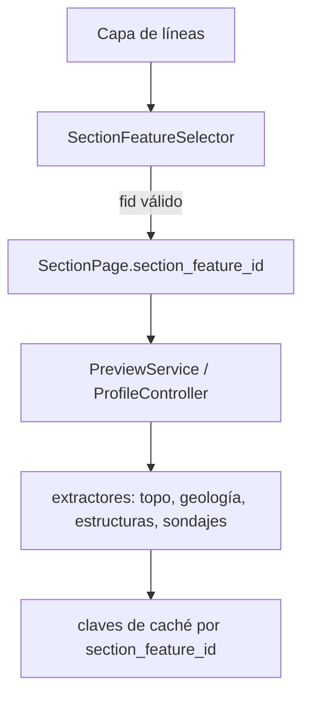

---
tags:
  - secinterp
  - code-walkthrough
  - gui
  - ui-pages
  - section
aliases:
  - section_feature_selector.py
  - SectionFeatureSelector
cssclass: secinterp-note
---

# `gui/ui/pages/section_feature_selector.py`

> [!abstract] Resumen en una línea
> Selector de la feature de sección para capas con varias líneas: lista solo
> líneas de una parte con **exactamente dos vértices** como `fid — label` y
> permite elegir el campo de etiqueta.

**Ruta**: `gui/ui/pages/section_feature_selector.py`
**Clase principal**: `SectionFeatureSelector`
**Capa**: GUI · widget de página
**Tags**: #secinterp #gui #ui-pages #section

---

## 🎯 ¿Por qué existe?

`SectionPage` solo tenía un combo de capa. `section_feature_id` existía en
`PreviewParams` y en las claves de caché, pero no había forma de elegir una línea
concreta ni de propagar el id a los extractores.

| Problema | Solución |
|---|---|
| Capa con varias secciones | combo `fid — label` |
| Líneas de 3+ puntos no son secciones válidas | filtro de exactamente 2 vértices |
| El usuario no sabe qué línea elige | etiqueta por `fid` + campo (`Auto` o atributo) |
| Selección ambigua si hay etiquetas repetidas | el `fid` siempre está presente |
| Persistencia entre proyectos | `section_feature_id` + `section_feature_label_field` |

---

## ⚙️ Comportamiento

- Multipart con más de una parte: se descarta.
- `vertices == 2`: se incluye.
- `vertices >= 3` o `< 2`: se descarta.
- Una sola feature válida: seleccionada y combo de feature deshabilitado.
- Sin features válidas: ambos combos vacíos/deshabilitados; `SectionPage.validate()`
  falla.
- `Auto` usa `displayExpression`, `displayField` o el `fid`, en ese orden.
- Un campo seleccionado usa su valor; nulo/vacío cae al `fid`.
- Cambiar solo el campo de etiqueta no cambia `section_feature_id`, el hash ni la
  caché.
- Cap de seguridad: 500 features válidas.

---

## 🔄 Flujo de datos

`SectionPage` repuebla el selector al cambiar de capa y emite `dataChanged` solo
cuando cambia la feature. El campo de etiqueta se persiste con el proyecto.

---

## 🧪 Tests

- `tests/gui/test_section_feature_selector.py`: filtro 2 vs 3+ vértices, labels,
  campo nulo, `select_feature` inválido, señales.
- `tests/gui/test_section_feature_page.py`: persistencia, fallback y `dataChanged`.
- `tests/core/test_profile_feature_id.py`: propagación a los cuatro procesadores.

---

## 🔗 Notas relacionadas

- [[section_page]] — integración y validación.
- [[preview_service]] — LOD y topografía del preview.
- [[profile_extractor]] — muestreo del DEM por `feature_id`.
- [[layer_gui_ui_pages]] — hub de páginas.
