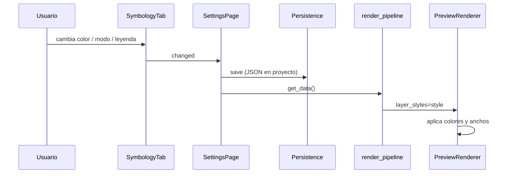

---
tags:
  - secinterp
  - code-walkthrough
  - gui
  - settings
aliases:
  - symbology_tab.py
  - SymbologyTab
cssclass: secinterp-note
---

# `gui/ui/pages/settings/symbology_tab.py`

> [!abstract] Resumen en una línea
> Pestaña **Symbology** de Settings: un formulario scrolleable con secciones colapsables que
> editan los estilos del preview (topografía, estructuras, sondeos, interpretaciones), las
> opciones de la leyenda y el editor por unidad, y que expone todo como un único `dict`
> persistido en el proyecto.

**Ruta**: `gui/ui/pages/settings/symbology_tab.py` (354 líneas)
**Clase principal**: `SymbologyTab` (hereda de `UnitsEditorMixin` y `QWidget`)
**Capa**: GUI (Settings · Formulario)
**Tags**: #secinterp #gui #settings

---

## 🎯 ¿Por qué existe este archivo?

Antes, el modo de color y el ancho de la topografía vivían en la página *Section Line* y el
resto de estilos no eran configurables: el preview usaba colores fijos. La v3.11.0 concentra
**todos** los estilos en un solo sitio, con vista previa en vivo y persistencia por proyecto.

| Problema | Solución |
|----------|----------|
| Estilos dispersos (topo en Section, resto fijo) | Un tab único con 6 secciones |
| El diálogo crecía al abrir Settings | Contenido en `QScrollArea` + grupos colapsables |
| Los colores no se podían cambiar | `QgsColorButton` por capa + `QgsColorRampButton` para el gradiente |
| La leyenda no era configurable | Sección *Legend*: exportar, posición, tamaño y máximo de ítems |
| Las unidades no se podían renombrar/reordenar | `UnitsEditorMixin` (módulo hermano) |
| Los cambios debían verse al instante | Señal `changed` → guardado + re-render del preview |

> [!important] Nota arquitectónica
> El tab **no aplica** estilos directamente a QGIS: solo produce un `dict` de configuración.
> `plugin/render_pipeline.py` lo inyecta en `PreviewParams.layer_styles` y
> `PreviewRenderer`/`PreviewLegendRenderer` lo consumen. Es el patrón *Extract* de la GUI:
> recoger la intención del usuario en tipos primitivos.

---

## 🧬 Diagrama de relaciones

```mermaid
graph TD
    SP["SettingsPage<br/>get_data / load"]
    ST["SymbologyTab"]
    UM["UnitsEditorMixin<br/>symbology_units.py"]
    USE["UnitStyleEditor<br/>(preview_side_panel.py)"]
    RP["render_pipeline.py"]
    PR["PreviewRenderer"]
    PLR["PreviewLegendRenderer"]
    CM["ColorManager"]
    DSP["dialog_settings_persistence<br/>JSON en proyecto"]

    SP -->|crea y embebe| ST
    ST -->|hereda| UM
    UM -->|crea filas| USE
    ST -->|changed| SP
    SP -->|get_data()| DSP
    SP -->|style dict| RP
    RP --> PR
    RP --> PLR
    ST -->|set_unit_manager| CM

    classDef gui fill:#4ecdc4,stroke:#0a9396,stroke-width:2px,color:#000
    class SP,ST,UM,USE,DSP gui
    classDef core fill:#ffe3e3,stroke:#c92a2a,stroke-width:2px,color:#000
    class RP,PR,PLR,CM core
```

> [!tip] Cómo leer
> El tab es la **entrada** del estilo; el `ColorManager` es la fuente de las unidades (por
> eso el mixin recibe el manager ya construido con `set_unit_manager`). El pipeline es el
> único que lee el `dict` y lo convierte en colores/rampas reales.

---

## 📦 Imports — lectura arquitectónica

```python
import contextlib
from typing import Any

from qgis.gui import (
    QgsCollapsibleGroupBox, QgsColorButton, QgsColorRampButton, QgsDoubleSpinBox,
)
from qgis.PyQt.QtCore import QCoreApplication, pyqtSignal
from qgis.PyQt.QtGui import QColor
from qgis.PyQt.QtWidgets import (
    QCheckBox, QComboBox, QGridLayout, QHBoxLayout, QLabel,
    QRadioButton, QScrollArea, QSizePolicy, QSpinBox, QVBoxLayout, QWidget,
)

from sec_interp.gui.main_dialog_config import DialogDefaults
from sec_interp.gui.preview_side_panel import UnitStyleEditor
from sec_interp.gui.ui.pages.settings.symbology_units import UnitsEditorMixin
from sec_interp.logger_config import get_logger
```

| # | Observación |
|---|-------------|
| ① | `qgis.gui` aporta los controles nativos de QGIS: color, rampa y grupo colapsable. |
| ② | `QgsCollapsibleGroupBox` es la pieza que mantiene el diálogo pequeño: secciones cerradas por defecto. |
| ③ | `pyqtSignal()` sin argumentos: `changed` es un simple "algo cambió". |
| ④ | `contextlib` solo para `suppress` en `disconnect_signals`. |
| ⑤ | `DialogDefaults` centraliza la rampa y el color por defecto (sin literales duplicados). |
| ⑥ | `UnitStyleEditor` se importa del panel de preview: **una sola fila** para dos contextos. |
| ⑦ | `_LEGEND_POSITIONS` se declara **antes** de los imports de la app (orden intencional del código original). |

---

## 🏗️ Inventario de estructura

**Clase:** `SymbologyTab(UnitsEditorMixin, QWidget)` — señal `changed`, 15 métodos propios.

### Grupos de la UI

| Grupo | Controles | Claves que produce |
|---|---|---|
| *Topography* | radios Gradient/Simple, rampa, color simple, ancho | `color_mode`, `ramp_name`, `single_color_hex`, `topo_line_width` |
| *Structures* | color, ancho | `struct_color`, `struct_width` |
| *Drillholes* | color de traza, ancho, "Show hole labels" | `drill_trace_color`, `drill_trace_width`, `drill_labels` |
| *Interpretations* | color por defecto | `interp_color` |
| *Legend* | exportar, posición, tamaño de fuente, máximo de ítems | `show_legend`, `legend_pos`, `legend_font_size`, `legend_max_items` |
| *Units* | filas editables + "Reset unit styles" | (delegado al `ColorManager`) |

### Orden de construcción

```text
_setup_ui()
  └── QScrollArea
        └── QVBoxLayout
              ├── QLabel("<b>Layer Symbology</b>")
              ├── QLabel("<i>Live styles ...</i>")
              ├── _build_topography_group()
              ├── _build_structures_group()
              ├── _build_drillholes_group()
              ├── _build_interpretations_group()
              ├── _build_legend_group()
              ├── _build_units_group()   # viene del mixin
              └── addStretch()
```

---

## 📁 Archivos del paquete

| Archivo | Rol respecto al tab |
|---|---|
| `gui/ui/pages/settings_page.py` | Crea el tab y agrega `get_data()`/`load()` (ver [[settings_page]]) |
| `gui/ui/pages/settings/symbology_units.py` | Mixin del editor por unidad (ver [[symbology_units]]) |
| `gui/ui/pages/settings/settings_persistence.py` | Persistencia base de la página |
| `gui/preview_side_panel.py` | Provee `UnitStyleEditor` (ver [[preview_side_panel]]) |
| `gui/dialog_settings_persistence.py` | Serializa el `dict` como JSON en el proyecto (ver [[dialog_settings_persistence]]) |
| `plugin/render_pipeline.py` | Consume el `dict` en cada preview (ver [[render_pipeline]]) |
| `gui/main_dialog_config.py` | `DialogDefaults` (rampa/color por defecto) (ver [[main_dialog_config]]) |
| `tests/gui/test_symbology_tab.py` | Suite del tab (136 líneas) |

---

## 📖 Recorrido método por método

### `SymbologyTab.__init__` — estado mínimo y tamaño acotado

```python
self._unit_manager: Any = None
self._unit_rows: list[UnitStyleEditor] = []
self._unit_signature: list[tuple] | None = None
self.setSizePolicy(QSizePolicy.Policy.Preferred, QSizePolicy.Policy.Preferred)
self._setup_ui()
```

`_unit_manager` es `None` hasta que `MainDialog` lo inyecta con `set_unit_manager(...)`.
`_unit_signature` implementa el *diffing* del mixin: evita reconstruir filas si nada cambió.
La `QSizePolicy` evita que el contenido dicte el tamaño del diálogo.

### `tr` — contexto de traducción propio

```python
def tr(self, message: str) -> str:
    return QCoreApplication.translate("SymbologyTab", message)
```

`QWidget.tr` usaría el nombre de la clase real; aquí se fuerza el contexto `SymbologyTab`
para que las traducciones existentes (`.ts`/`.qm`) sigan resolviendo aunque la clase cambie
de jerarquía (hereda de un mixin).

### `_setup_ui` — scroll + colapsables

```python
self.scroll = QScrollArea()
self.scroll.setWidgetResizable(True)
content = QWidget()
layout = QVBoxLayout(content)
```

El scroll es la clave del arreglo de tamaño: el diálogo tiene una altura máxima y el tab se
desplaza. Los grupos se crean con `_collapsible_group`, que los deja **cerrados** por
defecto (`setCollapsed(True)`), de modo que la vista inicial es compacta.

### `_build_topography_group` — modo y controles mutuamente excluyentes

```python
self.radio_gradient = QRadioButton(self.tr("Gradient"))
self.radio_single = QRadioButton(self.tr("Simple"))
self.radio_gradient.setChecked(True)
```

| Modo | Control visible | Clave |
|---|---|---|
| Gradient | `ramp_button` (QgsColorRampButton) | `ramp_name` |
| Simple | `topo_color_button` (QgsColorButton) | `single_color_hex` |

`_on_topo_mode_changed()` se llama al final para dejar visible solo el control del modo
activo. El ancho (`topo_width_spin`, 0.1–5.0, paso 0.1, 1 decimal) se comparte en ambos modos.

### `_build_structures_group` / `_build_drillholes_group`

Estructuras: color `#cc0000` + ancho `0.5`. Sondeos: color `(50, 50, 50)` + ancho `0.3` +
checkbox `Show hole labels` (por defecto activo). Los tres valores alimentan al renderer de
la capa correspondiente (`structure_renderer`, `drillhole_renderer`).

### `_build_interpretations_group`

Solo un `QgsColorButton` con `#FF0000`. Es el **color por defecto** de las interpretaciones
nuevas; cada interpretación puede luego sobrescribirlo desde la leyenda o el panel.

### `_build_legend_group` — las cuatro decisiones de la leyenda

```python
self.chk_export_legend = QCheckBox(self.tr("Show legend in the exported image"))
self.combo_legend_pos = QComboBox()   # 4 posiciones
self.spin_legend_font = QSpinBox()    # 6–16
self.spin_legend_max = QSpinBox()     # 0–200, 0 = todos
```

- `show_legend` afecta **solo** a la imagen exportada: la leyenda del preview vive en el panel
  lateral (por eso el tooltip lo aclara).
- `legend_pos` se mapea con `_LEGEND_POSITIONS[currentIndex]` → `"top-right"`, `"top-left"`,
  `"bottom-right"`, `"bottom-left"`.
- `legend_font_size` se usa tanto en el panel como en el PNG.
- `legend_max_items > 0` recorta filas y añade `"+N more"` en `PreviewLegendRenderer.draw_rows`.

### `_width_spin` — fábrica de anchos

```python
spin = QgsDoubleSpinBox()
spin.setRange(0.1, 5.0)
spin.setSingleStep(0.1)
spin.setDecimals(1)
```

Reutilizada por topografía, estructuras y sondeos para que los tres se comporten igual.

### `_on_topo_mode_changed` — alternancia

```python
single = self.radio_single.isChecked()
self.ramp_button.setVisible(not single)
self.topo_color_button.setVisible(single)
```

Se conecta a `toggled` de **ambos** radios (más simple y robusto que solo uno), y también se
invoca al cargar datos para sincronizar la visibilidad con el modo persistido.

### `get_data` — el contrato de salida

Devuelve un `dict` plano listo para JSON:

```python
{
  "color_mode": "single" | "gradient",
  "ramp_name": str,
  "single_color_hex": "#rrggbb",
  "topo_line_width": float,
  "struct_color": "#rrggbb", "struct_width": float,
  "drill_trace_color": "#rrggbb", "drill_trace_width": float,
  "drill_labels": bool,
  "interp_color": "#rrggbb",
  "show_legend": bool,
  "legend_pos": "top-right" | ...,
  "legend_font_size": int,
  "legend_max_items": int,
}
```

`SettingsPage.get_data()` hace `data.update(self.symbology_tab.get_data())`, así que estas
claves conviven con las del resto de páginas sin colisiones.

### `load` — restauración tolerante

```python
self._load_topography(data)
self._load_layer_styles(data)
self._load_legend(data)
self._on_topo_mode_changed()
```

Cada helper comprueba `is not None` antes de escribir: un proyecto antiguo (sin claves de
symbology) conserva los valores por defecto. `_set_color` solo aplica si el valor es truthy.

### `reset` — volver a los defaults

Restaura radios, rampa (`DialogDefaults.TOPO_RAMP_NAME`), color simple
(`DialogDefaults.TOPO_SINGLE_COLOR_HEX`), anchos (0.8/0.5/0.3), etiquetas, color de
interpretación, exportar leyenda, posición 0, fuente 8 y máximo 0.

### `connect_signals` / `disconnect_signals` — idempotencia

`connect_signals` conecta un `changed.emit` **por cada** control (tupla de señales) y delega
en `connect_unit_signals()` del mixin. `disconnect_signals` desconecta los radios de
`_on_topo_mode_changed` y desconecta `changed` con `contextlib.suppress(TypeError,
RuntimeError)`, porque `SignalManager.connect_all()` hace `disconnect_all()` antes de
reconectar y una desconexión doble lanzaría.

---

## 🔄 Flujo de datos



1. Cualquier control emite `changed`.
2. `SettingsPage._on_settings_changed` guarda (persistencia del proyecto) y avisa al diálogo.
3. En el siguiente preview, `render_pipeline` llama `get_data()` y lo pasa como
   `PreviewParams.layer_styles`.
4. El renderer y el generador de leyenda aplican las claves.

---

## 🏛️ Patrones de diseño presentes

| Patrón | Dónde | Por qué |
|---|---|---|
| **Form object / DTO** | `get_data()` | La UI produce un `dict` serializable |
| **Mixin composition** | `UnitsEditorMixin` | Mantiene este módulo bajo el límite de 400 líneas |
| **Factory methods** | `_collapsible_group`, `_width_spin` | Consistencia entre secciones |
| **Signal aggregation** | tupla de señales → `changed` | Un solo evento para el consumidor |
| **Defensive load** | `_load_*` con `is not None` | Compatibilidad con proyectos antiguos |
| **Idempotent connect** | `connect/disconnect_signals` | Encaja con `SignalManager` |

---

## 🧾 Resumen de la API

| Método | Efecto |
|---|---|
| `tr` | Traduce con contexto `SymbologyTab` |
| `_setup_ui` | Scroll + 6 secciones |
| `_collapsible_group` | Grupo cerrado por defecto |
| `_build_*_group` | Construye cada sección |
| `_width_spin` | Spinbox de ancho 0.1–5.0 |
| `_on_topo_mode_changed` | Alterna rampa/color |
| `get_data` | Devuelve el `dict` de estilo |
| `load` | Restaura desde el proyecto |
| `reset` | Vuelve a defaults |
| `connect_signals` | Cablea controles + filas |
| `disconnect_signals` | Desconecta de forma segura |

---

## 🛡️ Manejo de errores

- **Proyecto sin datos**: `load({})` deja los defaults; ningún helper escribe con `None`.
- **Posición inválida**: `_load_legend` solo aplica si `legend_pos` está en
  `_LEGEND_POSITIONS`; si no, conserva la posición actual.
- **Valores fuera de rango**: los `QSpinBox`/`QgsDoubleSpinBox` recortan al rango.
- **Desconexión no conectada**: `contextlib.suppress(TypeError, RuntimeError)`.
- **Manager de unidades ausente**: el mixin retorna sin hacer nada (`refresh_units`).
- **Color no válido**: `QColor` no lanza; el botón conserva el color anterior si no es válido.

---

## 🧪 Tests asociados

| Test | Qué cubre |
|---|---|
| `tests/gui/test_symbology_tab.py` | Defaults, `get_data`, `load`, `reset`, alternancia de modo, señales |
| `tests/gui/test_settings_page.py` | El tab se integra en Settings y aporta sus claves |
| `tests/gui/test_color_manager.py` | Alias/orden/visibilidad que usa el editor |
| `tests/gui/test_preview_side_panel.py` | `UnitStyleEditor` compartido |

---

## 👀 Observaciones y notas

1. **Un solo estilo, dos consumidores**: preview (`PreviewRenderer`) y leyenda exportada
   (`PreviewLegendRenderer`); por eso `show_legend` es independiente de la visibilidad del panel.
2. **Colapsado por defecto**: seis secciones abiertas harían el tab enorme; el usuario abre
   solo la que necesita.
3. **El diálogo no crece**: `QScrollArea` + `setSizePolicy` + altura máxima del panel de
   unidades (240–340 px) son las tres piezas del arreglo.
4. **Los radios se conectan dos veces**: cada uno alterna la visibilidad; al cargar se llama
   manualmente a `_on_topo_mode_changed`.
5. **`_LEGEND_POSITIONS` debe coincidir** con `_VALID_POSITIONS` de
   `preview_legend_renderer.py`; si se añade una posición hay que tocar ambos.
6. **Persistencia**: el `dict` completo se guarda como JSON bajo la clave `symbology` en el
   proyecto; no hay claves sueltas por control.

---

## 🔗 Notas relacionadas

- [[Index]] — índice de la bóveda
- [[settings_page]] — página que embebe el tab
- [[symbology_units]] — mixin del editor por unidad
- [[preview_side_panel]] — `UnitStyleEditor` compartido
- [[dialog_settings_persistence]] — persiste el JSON en el proyecto
- [[render_pipeline]] — consume `layer_styles`
- [[preview_renderer]] — aplica los estilos al preview
- [[preview_legend_renderer]] — usa posición, fuente y máximo de ítems
- [[color_manager]] — fuente de unidades y alias

---

*Nota de la bóveda SecInterp Code Walkthrough v2 — v3.11.0*
