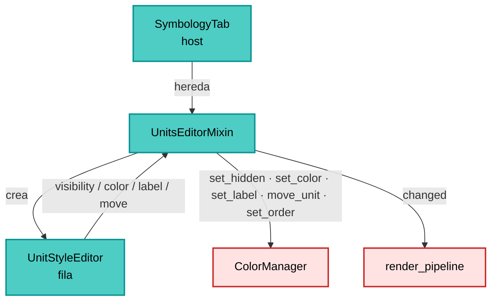
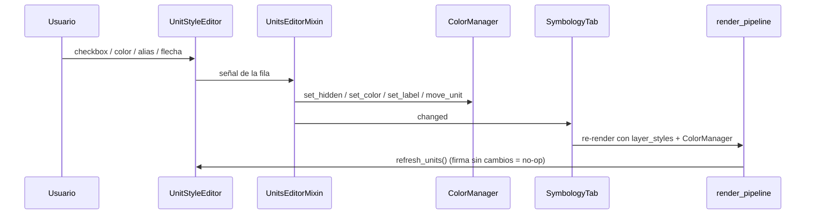

---
tags:
  - secinterp
  - code-walkthrough
  - gui
  - settings
aliases:
  - symbology_units.py
  - UnitsEditorMixin
cssclass: secinterp-note
---

# `gui/ui/pages/settings/symbology_units.py`

> [!abstract] Resumen en una línea
> Mixin del editor por unidad: construye la sección *Units* de Symbology (lista acotada de
> filas con visibilidad, color, alias y flechas de orden) y traduce cada gesto a una
> operación sobre el `ColorManager`, emitiendo `changed` para refrescar el preview.

**Ruta**: `gui/ui/pages/settings/symbology_units.py` (139 líneas)
**Clase principal**: `UnitsEditorMixin`
**Capa**: GUI (Settings · Mixin de editor)
**Tags**: #secinterp #gui #settings

---

## 🎯 ¿Por qué existe este archivo?

El editor por unidad era la parte más grande del tab de Symbology y hacía que
`symbology_tab.py` superara el límite de 400 líneas del `module_size_gate`. Se extrajo como
**mixin** para mantener el tab por debajo del umbral sin duplicar la fila de unidad.

| Problema | Solución |
|----------|----------|
| `symbology_tab.py` > 400 líneas | Editor extraído a un mixin de 139 líneas |
| Renombrar/reordenar no existía | `UnitStyleEditor` con `with_rename` y `with_reorder` |
| La lista podía crecer sin fin | `QScrollArea` con altura 240–340 px |
| Reconstruir filas en cada cambio era costoso | `_unit_signature` evita rebuild si nada cambió |
| "Reset" debía limpiar todo | `reset_units()` recorre `known_units()` |
| El editor no debe saber de QGIS | Solo habla con el `ColorManager` (interfaz de 10 métodos) |

> [!important] Nota arquitectónica
> Es un **mixin cooperativo**: no hereda de `QWidget` y asume un contrato con el host
> (`tr`, `changed`, `_collapsible_group`). Esa dependencia implícita es deliberada para
> poder partir el tab sin introducir otra clase con estado propio. El host es
> `SymbologyTab`.

---

## 🧬 Diagrama de relaciones



> [!tip] Cómo leer
> El mixin es el **traductor** entre la fila (eventos de UI) y el manager (estado de
> dominio). No guarda colores ni alias: los pregunta y los escribe en el `ColorManager`.

---

## 📦 Imports — lectura arquitectónica

```python
from __future__ import annotations

from typing import Any

from qgis.gui import QgsCollapsibleGroupBox
from qgis.PyQt.QtGui import QColor
from qgis.PyQt.QtWidgets import (
    QColorDialog, QHBoxLayout, QLabel, QPushButton,
    QScrollArea, QVBoxLayout, QWidget,
)

from sec_interp.gui.preview_side_panel import UnitStyleEditor
```

| # | Observación |
|---|-------------|
| ① | `QgsCollapsibleGroupBox` es el tipo de retorno del grupo (lo aporta el host). |
| ② | `QColorDialog` es el único diálogo modal del módulo. |
| ③ | `UnitStyleEditor` viene del panel de preview: **la misma fila**, no una copia. |
| ④ | Sin `qgis.core`: el mixin no toca capas ni geometrías. |
| ⑤ | `Any` para el manager (el mixin no importa `ColorManager`; evita acoplar capas). |
| ⑥ | Sin logger: no hay ramas de error que registrar. |

---

## 🏗️ Inventario de estructura

**Clase:** `UnitsEditorMixin` — 8 métodos, sin constructor ni señales propias.

### Contrato con el host (`SymbologyTab`)

| Miembro que usa | Tipo | Uso |
|---|---|---|
| `self.tr(msg)` | método | Traducir textos de la sección |
| `self.changed` | `pyqtSignal()` | Avisar de cualquier edición |
| `self._collapsible_group(title)` | método | Crear el grupo colapsable |

### Estado que el mixin espera en el host

| Atributo | Inicializado por | Uso |
|---|---|---|
| `_unit_manager` | `__init__` del host (`None`) | Manager inyectado |
| `_unit_rows` | `__init__` del host (`[]`) | Filas vivas |
| `_unit_signature` | `__init__` del host (`None`) | Detección de cambios |

---

## 📁 Archivos del paquete

| Archivo | Rol respecto al mixin |
|---|---|
| `gui/ui/pages/settings/symbology_tab.py` | Host: hereda el mixin y lo construye (ver [[symbology_tab]]) |
| `gui/preview_side_panel.py` | Provee `UnitStyleEditor` (ver [[preview_side_panel]]) |
| `gui/renderers/color_manager.py` | Estado real de las unidades (ver [[color_manager]]) |
| `gui/main_dialog.py` | Inyecta el manager (`set_unit_manager`) (ver [[main_dialog]]) |
| `gui/ui/pages/settings_page.py` | Contiene el tab y su ciclo de señales (ver [[settings_page]]) |
| `plugin/render_pipeline.py` | Re-renderiza tras `changed` (ver [[render_pipeline]]) |
| `tests/gui/test_symbology_tab.py` | Cubre el editor por unidad |

---

## 📖 Recorrido método por método

### `_build_units_group` — la sección acotada

```python
group = self._collapsible_group(self.tr("Units"))
layout = QVBoxLayout(group)
layout.addWidget(QLabel(self.tr("<i>Hide, recolor, rename or reorder ...</i>")))

self.units_scroll = QScrollArea()
self.units_scroll.setWidgetResizable(True)
self.units_scroll.setMinimumHeight(240)
self.units_scroll.setMaximumHeight(340)
```

Las dos alturas son la clave del arreglo de tamaño del diálogo: con 40 unidades la lista
scrollea dentro de 240–340 px en lugar de estirar la ventana. Después del scroll se añade el
botón `Reset unit styles` alineado a la derecha.

### `set_unit_manager` — inyección y primer refresco

```python
def set_unit_manager(self, manager: Any) -> None:
    self._unit_manager = manager
    self.refresh_units(force=True)
```

`MainDialog` lo llama al final de `__init__` con `self._unit_color_manager()`. El `force=True`
garantiza que las filas se pinten aunque la firma calculada coincida con `None` (primer uso).

### `refresh_units` — diffing por firma

```python
entries = [
    (name, manager.label(name), manager.get_color(name).name(), manager.is_hidden(name))
    for name in manager.ordered_units()
]
if not force and entries == self._unit_signature:
    return
self._unit_signature = entries
self._rebuild_unit_rows(manager, entries)
```

La firma es una lista de tuplas `(nombre, alias, hex, oculto)`. Si el preview re-renderiza y
nada cambió, no se destruyen/crean widgets. Es la diferencia entre un refresco barato y uno
que parpadea.

### `_rebuild_unit_rows` — filas editables

```python
row = UnitStyleEditor(
    name, QColor(color_hex), hidden=hidden, label=label,
    with_rename=True, with_reorder=True,
)
row.visibility_changed.connect(self._on_unit_visibility)
row.color_requested.connect(self._on_unit_color)
row.label_changed.connect(self._on_unit_label)
row.move_requested.connect(self._on_unit_move)
```

Antes de crear las nuevas, destruye las anteriores con `removeWidget` + `deleteLater()` (mismo
patrón que el panel). Las filas se insertan con `insertWidget(len(self._unit_rows), row)` para
respetar el orden actual del manager.

### `_on_unit_visibility` — ocultar/mostrar

```python
self._unit_manager.set_hidden(name, not visible)
self.changed.emit()
```

El checkbox dice "visible"; el manager guarda "hidden", de ahí la negación. Solo emite: el
re-render reconstruirá la leyenda y el preview sin esa unidad.

### `_on_unit_color` — selector modal

```python
current = self._unit_manager.get_color(name)
color = QColorDialog.getColor(current, self, self.tr("Select unit color"))
if color is not None and color.isValid():
    self._unit_manager.set_color(name, color)
    self.refresh_units(force=True)
    self.changed.emit()
```

`getColor` devuelve un `QColor` inválido si el usuario cancela; la comprobación
`isValid()` evita escribir basura. El refresco forzado actualiza la muestra de la fila.

### `_on_unit_label` — alias

```python
self._unit_manager.set_label(name, text)
self.changed.emit()
```

No refresca filas: el `QLineEdit` ya muestra el texto. Si se vacía, el `ColorManager`
interpreta "sin alias" y la leyenda vuelve al nombre original.

### `_on_unit_move` — reordenar

```python
self._unit_manager.move_unit(name, delta)
self.refresh_units(force=True)
self.changed.emit()
```

`move_unit(name, -1 | +1)` mueve una posición; el refresco forzado reordena los widgets para
que el orden visual coincida con el del manager (y con el de la leyenda exportada).

### `connect_unit_signals` — cableado idempotente

```python
def connect_unit_signals(self) -> None:
    self.btn_reset_units.clicked.connect(self.reset_units)
```

El host llama a este método desde su `connect_signals()`. Como `SignalManager.connect_all()`
desconecta todo antes de reconectar, el botón se vuelve a cablear en cada ciclo sin duplicar.

### `reset_units` — limpiar personalización

```python
for name in list(manager.known_units()):
    manager.set_hidden(name, False)
    manager.set_label(name, "")
manager.set_order([])
self.refresh_units(force=True)
self.changed.emit()
```

`known_units()` (no `ordered_units()`) para incluir también las unidades ocultas y las que ya
no están en el render actual. `set_order([])` devuelve el orden natural. No resetea colores:
`ColorManager` los calcula de forma determinista a partir del nombre.

---

## 🔄 Flujo de datos



1. La fila emite el gesto con la **clave** de la unidad (nunca el alias).
2. El mixin escribe en el `ColorManager`.
3. `changed` dispara el guardado y el re-render.
4. Al volver, `refresh_units` compara firmas y no reconstruye si no hace falta.

---

## 🏛️ Patrones de diseño presentes

| Patrón | Dónde | Por qué |
|---|---|---|
| **Mixin** | `UnitsEditorMixin` | Parte el tab sin otra clase con estado |
| **Inyección de dependencia** | `set_unit_manager` | El mixin no construye el manager |
| **Signature diffing** | `_unit_signature` | Evita rebuilds innecesarios |
| **Command → manager** | `_on_unit_*` | La UI no muta estado propio |
| **Deterministic teardown** | `deleteLater()` | Evita widgets huérfanos |
| **Idempotent wiring** | `connect_unit_signals` | Compatible con `SignalManager` |

> [!note] Contrato implícito
> El mixin no declara una `Protocol`/ABC para el host; usa `self.tr`, `self.changed` y
> `self._collapsible_group` directamente. Funciona porque el único host es `SymbologyTab`
> y ambos viven en el mismo paquete. Si se reutilizara en otro widget, convendría formalizar
> el contrato.

---

## 🧾 Resumen de la API

| Método | Entrada | Efecto |
|---|---|---|
| `_build_units_group` | — | Grupo colapsable + scroll 240–340 + botón reset |
| `set_unit_manager` | manager | Inyecta y refresca forzado |
| `refresh_units` | `force=False` | Rebuild solo si cambió la firma |
| `_rebuild_unit_rows` | manager, entries | Destruye y crea filas editables |
| `_on_unit_visibility` | name, visible | `set_hidden(name, not visible)` + `changed` |
| `_on_unit_color` | name | `QColorDialog` + `set_color` + rebuild |
| `_on_unit_label` | name, text | `set_label` + `changed` |
| `_on_unit_move` | name, delta | `move_unit` + rebuild + `changed` |
| `connect_unit_signals` | — | Conecta el botón de reset |
| `reset_units` | — | Limpia hidden/alias/orden |

---

## 🛡️ Manejo de errores

- **Manager ausente**: `refresh_units` y `reset_units` retornan sin hacer nada.
- **Cancelar el diálogo de color**: `QColorDialog.getColor` devuelve un color inválido;
  `isValid()` evita aplicarlo.
- **Alias vacío**: `set_label(name, "")` se interpreta como "sin alias".
- **Unidad desconocida**: el manager ignora nombres que no conoce.
- **Reconexión doble**: el botón se conecta en cada `connect_signals`, pero el host
  desconecta antes; no hay dobles emisiones.
- **Filas destruidas**: se eliminan del layout antes de `deleteLater()`.

---

## 🧪 Tests asociados

| Test | Qué cubre |
|---|---|
| `tests/gui/test_symbology_tab.py` | Sección Units, edición de alias/orden/color, reset |
| `tests/gui/test_color_manager.py` | `label`, `set_label`, `ordered_units`, `move_unit`, `set_order` |
| `tests/gui/test_preview_side_panel.py` | `UnitStyleEditor` con rename/reorder |

---

## 👀 Observaciones y notas

1. **Altura acotada**: 240 px mínimo / 340 px máximo; por debajo de 240 no caben 8 filas,
   por encima de 340 el diálogo vuelve a crecer.
2. **Reset no toca colores**: el color se deriva del nombre en `ColorManager`; solo se
   limpian alias, visibilidad y orden.
3. **Clave estable**: nombre original de la unidad; renombrar no rompe la persistencia.
4. **Dos refrescos**: `set_hidden`/`move_unit`/`set_color` reconstruyen filas; `set_label`
   no (el `QLineEdit` ya refleja el cambio).
5. **`_unit_rows` lo inicializa el host**, no el mixin; si se usa el mixin en otro widget hay
   que declarar ese atributo.
6. **Compatibilidad**: el mixin no importa `ColorManager`; cualquier objeto con
   `known_units/ordered_units/label/get_color/is_hidden/set_*`/`move_unit` sirve (útil en
   tests).

---

## 🎨 Anatomía visual de la sección

```text
┌─ Units (colapsable, cerrado por defecto) ───────────┐
│ Hide, recolor, rename or reorder the units.        │
│ ┌────────────────────────────────────────────────┐ │
│ │ ☑ ■ ▲ ▼ [Granodiorita________]                 │ │
│ │ ☑ ■ ▲ ▼ [Esquisto____________]                 │ │
│ │ ☐ ■ ▲ ▼ [Lutita (oculta)_____]                 │ │
│ │ ... (scroll 240–340 px)                        │ │
│ └────────────────────────────────────────────────┘ │
│                                 [Reset unit styles] │
└─────────────────────────────────────────────────────┘
```

Cada fila combina los cuatro controles del editor: visibility (☑), color (■), orden (▲ ▼) y
alias (`QLineEdit`). El alias es el único texto editable; el resto se aplica al instante.

---

## 🔗 Notas relacionadas

- [[Index]] — índice de la bóveda
- [[symbology_tab]] — host del mixin
- [[preview_side_panel]] — `UnitStyleEditor` compartido
- [[color_manager]] — estado de unidades, alias y orden
- [[main_dialog]] — inyecta el manager
- [[settings_page]] — ciclo de vida de la página
- [[render_pipeline]] — re-render tras cada cambio

---

*Nota de la bóveda SecInterp Code Walkthrough v2 — v3.11.0*
