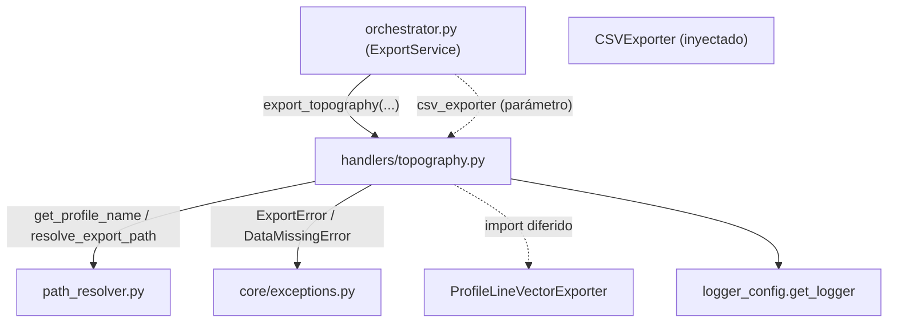

---
tags:
  - secinterp
  - code-walkthrough
  - core
  - export
  - handlers
aliases:
  - topography.py
  - export_topography
cssclass: secinterp-note
---

# `core/services/export/handlers/topography.py`

> [!abstract] Resumen en una línea
> Handler de exportación de **topografía**: vuelca el perfil topográfico a CSV (dist, elev) y a una capa vectorial de línea de perfil, como primer paso del pipeline de exportación.

**Ruta**: `core/services/export/handlers/topography.py` (114 líneas)
**Función principal**: `export_topography`
**Capa**: Core (QGIS-agnóstico)
**Tags**: #secinterp #core #export #handlers

---

## 🎯 ¿Por qué existe este archivo?

El perfil topográfico (`ProfileData`, lista de `(dist, elev)`) es el dataset base de
toda la sección: es la referencia vertical sobre la que se dibujan geología, estructuras
y sondajes. Exportarlo es, por tanto, el primer paso y el que **siempre** debe existir.

| Problema | Solución |
|----------|----------|
| Persistir el perfil topográfico en CSV y vectorial | Dos bloques de exportación encadenados |
| Es el dataset obligatorio de toda exportación | El orquestador valida su existencia antes de llamar |
| Reportar cada archivo generado | `msg.append(...)` tras cada exportación exitosa |

> [!important] Nota arquitectónica
> QGIS-agnóstico: `data` es `list[tuple]` (pares `(dist, elev)`) ya desacoplados. Es el
> **único** handler sin guard clause `if not data` — porque el orquestador ya lanza
> `DataMissingError` si `profile_data` está vacío (ver Observaciones).

---

## 🧬 Diagrama de relaciones



> [!tip] Cómo leer
> `csv_exporter` se inyecta; `ProfileLineVectorExporter` se importa diferido. El handler
> confía en que el orquestador ya validó que `data` no esté vacío.

---

## 📦 Imports — lectura arquitectónica

```python
# core/services/export/handlers/topography.py
from __future__ import annotations

from pathlib import Path
from typing import Any

from sec_interp.core.exceptions import DataMissingError, ExportError
from sec_interp.core.services.export.path_resolver import get_profile_name, resolve_export_path
from sec_interp.core.utils.sampling import smooth_profile_by_distance
from sec_interp.logger_config import get_logger
```

```python
# import diferido (dentro de export_topography)
from sec_interp.exporters import ProfileLineVectorExporter
```

| # | Observación |
|---|-------------|
| ① | `DataMissingError`/`ExportError` de la jerarquía propia; sin importación de `qgis.*`. |
| ② | `data: list[tuple]` es el tipo más "concreto" del paquete: pares `(dist, elev)`. |
| ③ | `ProfileLineVectorExporter` import diferido, tras el guard lógico del orquestador. |
| ④ | `csv_exporter` inyectado (compartido entre handlers por el orquestador). |
| ⑤ | `smooth_profile_by_distance` es **matemática pura** de core (media móvil por distancia). |
| ⑥ | El módulo no importa `QgsGeometry` ni `QgsCoordinateReferenceSystem`: `crs` es opaco. |

---

## 🏗️ Inventario de estructura

**Funciones/Métodos:**
- `export_topography(folder, data, crs, csv_exporter, msg, controller, settings, ext, options=None) -> None`
- `_export_profile_pair(folder, profile_name, pattern, stems, payloads, csv_exporter, vector_exporter, msg, ext) -> None`
- `_smoothed_topography(data, options) -> list[tuple] | None`
- `_record_written(msg, path, folder) -> None`

**Dependencias de dominio:**
- `ProfileData` (`list[tuple[float, float]]`) — pares distancia/elevación.
- `ProfileLineVectorExporter` (de `sec_interp.exporters`)
- `smooth_profile_by_distance` (de `sec_interp.core.utils.sampling`)

Una función pública + tres helpers privados. Desde v3.9.1 la firma incorpora `options`
(con `smooth` y `smooth_window`) para emitir opcionalmente el par suavizado.

---

## 📖 Recorrido método por método

### `export_topography`

```python
def export_topography(
    folder: Path,
    data: list[tuple],
    crs: Any,
    csv_exporter: Any,
    msg: list[str],
    controller: Any | None,
    settings: Any | None,
    ext: str,
) -> None:
    """Export topographic data (CSV + vector)."""
    from sec_interp.exporters import ProfileLineVectorExporter

    logger.info("✓ Saving topographic profile...")
```

**Sin guard clause**: la primera instrucción es el import diferido (no hay `if not
data`). La garantía de que `data` no esté vacío vive en el orquestador, que lanza
`DataMissingError` antes de invocar a los handlers.

```python
    try:
        profile_name = get_profile_name(controller)
        pattern = getattr(settings, "naming_pattern", None) if settings else None
        vector_exporter = ProfileLineVectorExporter({})

        _export_profile_pair(
            folder, profile_name, pattern,
            ("topo_profile", "profile_line"),
            ({"headers": ["dist", "elev"], "rows": data},
             {"profile_data": data, "crs": crs}),
            csv_exporter, vector_exporter, msg, ext,
        )

        smoothed = _smoothed_topography(data, options or {})
        if smoothed:
            _export_profile_pair(
                folder, profile_name, pattern,
                ("topo_profile_smoothed", "profile_line_smoothed"),
                ({"headers": ["dist", "elev"], "rows": smoothed},
                 {"profile_data": smoothed, "crs": crs}),
                csv_exporter, vector_exporter, msg, ext,
            )
```

El cuerpo público quedó reducido a **dos llamadas al mismo helper**: una con los datos
crudos y otra (opcional) con el perfil suavizado. Eso eliminó la duplicación de la lógica
"resolver ruta → exportar → registrar mensaje" que antes estaba escrita dos veces.

### `_export_profile_pair` — un CSV + un vectorial

```python
csv_path, csv_layer = resolve_export_path(folder, csv_stem, profile_name, pattern, ".csv")
if csv_exporter.export(csv_path, csv_payload, layer_name=csv_layer):
    _record_written(msg, csv_path, folder)
else:
    logger.warning(f"Failed to write CSV topography to {csv_path}")

vec_path, vec_layer = resolve_export_path(folder, vec_stem, profile_name, pattern, ext)
if vector_exporter.export(vec_path, vec_payload, layer_name=vec_layer):
    _record_written(msg, vec_path, folder)
else:
    logger.warning(f"Failed to write vector topography to {vec_path}")
```

Recibe `stems` y `payloads` como tuplas de dos elementos: el orden es siempre
`(CSV, vectorial)`. Un fallo de escritura **no lanza**: se registra un `warning` y se
continúa con el otro archivo (la exportación es best-effort por archivo; el error duro solo
llega si se rompe el flujo completo).

### `_smoothed_topography` — decidir la segunda pasada

```python
window = float(options.get("smooth_window", 0) or 0)
if options.get("smooth") and window > 0 and data:
    return smooth_profile_by_distance(data, window)
return None
```

| `smooth` | `smooth_window` | `data` | Resultado |
|---|---|---|---|
| `False` | cualquiera | cualquiera | `None` (sin segunda pasada) |
| `True` | `0` | no vacío | `None` (ventana inválida) |
| `True` | `> 0` | vacío | `None` |
| `True` | `> 0` | no vacío | lista suavizada |

La función es pura: no toca disco ni QGIS. `smooth_profile_by_distance` aplica una media
móvil por distancia (no por índice), de modo que un muestreo irregular no sesga el resultado.

### `_record_written` — una línea por archivo

```python
msg.append(f"  - {path.relative_to(folder)}")
```

El resumen que ve el usuario enumera rutas **relativas** a la carpeta de salida, para que el
mensaje no dependa de dónde se exportó.

### Archivos generados

| Condición | CSV | Vectorial |
|---|---|---|
| Siempre | `topo_profile.csv` | `profile_line.<ext>` |
| `smooth` + ventana > 0 | `topo_profile_smoothed.csv` | `profile_line_smoothed.<ext>` |

El sufijo y el patrón de nombres los resuelve `resolve_export_path` con
`get_profile_name(controller)` y `settings.naming_pattern`.

**Normalización**: doble `except` estándar → `ExportError` con causa: primero los errores
esperables (`OSError`, `ValueError`, `TypeError`, `DataMissingError`), después cualquier
`Exception` como "Critical error".

---

## 🔄 Flujo de datos

| Fase | Entrada | Transformación | Salida |
|------|---------|----------------|--------|
| CSV crudo | `data` (pares dist/elev) | passthrough como `rows` | `topo_profile.csv` + `msg` |
| Vector crudo | `data`, `crs` | `ProfileLineVectorExporter.export` | `profile_line.<ext>` + `msg` |
| Suavizado (opcional) | `data` + `options` | `smooth_profile_by_distance` | `topo_profile_smoothed.csv` / `profile_line_smoothed.<ext>` |
| Errores | excepción cruda | `except → ExportError` | excepción de dominio |

---

## 🏛️ Patrones de diseño presentes

| Patrón | Dónde | Propósito |
|--------|-------|-----------|
| **Lazy import (deferred)** | `ProfileLineVectorExporter` | ahorrar carga sin necesidad |
| **Dependency injection** | `csv_exporter` como parámetro | compartir el exporter |
| **Facade** | `export_topography` | ocultar 2–4 archivos tras una firma |
| **Extract helper** | `_export_profile_pair` | una sola copia del par CSV+vector |
| **Pure function** | `_smoothed_topography` / `smooth_profile_by_distance` | testear el suavizado sin I/O |
| **Exception translation** | `except → ExportError` | normalizar fallos |

---

## 🧾 Resumen de la API

| Símbolo | Firma / Hereda | Uso típico |
|---------|----------------|------------|
| `export_topography` | `(folder, data, crs, csv_exporter, msg, controller, settings, ext, options=None) -> None` | Exportar perfil topográfico (crudo y opcionalmente suavizado) |
| `_export_profile_pair` | `(folder, profile_name, pattern, stems, payloads, csv_exporter, vector_exporter, msg, ext) -> None` | Escribir un par CSV+vectorial |
| `_smoothed_topography` | `(data, options) -> list[tuple] \| None` | Decidir y calcular el perfil suavizado |
| `_record_written` | `(msg, path, folder) -> None` | Añadir una línea al resumen |
| `ProfileLineVectorExporter` | `BaseExporter` (import diferido) | Escribir la línea de perfil |

---

## 📐 Contrato de firma del handler

Nueve parámetros (el último opcional), con `csv_exporter` inyectado:

| Parámetro | Tipo | Rol |
|-----------|------|-----|
| `folder` | `Path` | Directorio base de salida |
| `data` | `list[tuple]` | `ProfileData` (pares `(dist, elev)`) desacoplado |
| `crs` | `Any` | CRS de la sección |
| `csv_exporter` | `Any` | `CSVExporter` inyectado por el orquestador |
| `msg` | `list[str]` | Acumulador de mensajes |
| `controller` | `Any \| None` | Fuente del nombre de perfil |
| `settings` | `Any \| None` | Ajustes (`naming_pattern`) |
| `ext` | `str` | Extensión de salida |
| `options` | `dict \| None` | `smooth` y `smooth_window` (segunda pasada opcional) |

> [!note] `data` no se transforma
> A diferencia de `geology.py` (aplanado) o `structures.py` (extracción de campos), la
> topografía ya llega en la forma exacta que el CSV necesita: `rows = data` sin mapeo.

## 🔁 Invocación desde el orquestador

El orquestador agrupa topografía y ejes en un solo handler compuesto:

```python
def topo_handler(settings=export_settings, ext=format_ext) -> None:
    topo_h.export_topography(
        folder, profile_data, line_crs, csv_exporter, msg,
        self.controller, settings, ext, options,
    )
    axes_h.export_axes(
        folder, profile_data, line_crs, msg,
        self.controller, settings, ext,
    )

handlers = {"exp_topo": topo_handler, ...}
```

El `profile_data` proviene del parámetro directo de `export_data` (no de un DTO), y es
el mismo `ProfileData` que consume `export_axes`.

---

## 🛡️ Manejo de errores

| Tipo capturado | Acción | Resultado |
|----------------|--------|-----------|
| `OSError`, `ValueError`, `TypeError`, `DataMissingError` | `logger.exception` + `raise ExportError(...) from e` | error de dominio |
| `Exception` (resto) | `logger.exception` + `raise ExportError(...) from e` | error crítico |

> [!note] La validación de datos vacíos vive en el orquestador
> `ExportService.export_data` lanza `DataMissingError` si `profile_data` está vacío
> **antes** de delegar. Por eso este handler prescinde del `if not data: return`.

---

## 🧪 Tests asociados

- `tests/core/test_export_service.py::test_export_data_minimal` — topografía como caso
  mínimo de exportación (solo topo + ejes).
- `tests/core/test_export_service.py::test_export_topography_error` — fallo del
  exporter → `ExportError`.
- `tests/core/test_export_service.py::test_export_data_missing_profile` — el
  orquestador lanza `DataMissingError` sin perfil.
- `tests/core/test_profile_exporters.py::test_profile_line_exporter_success` — lógica
  real de `ProfileLineVectorExporter`.
- `tests/integration/test_export_service_e2e.py::test_export_topography_creates_csv` —
  exportación real de CSV.

---

## 👀 Observaciones y notas

> [!success] Fortalezas
> - Firma clara y estable: un dataset obligatorio + opciones de presentación.
> - `data` se pasa tal cual al CSV (sin transformación), cero fricción.
> - El suavizado es una función pura reutilizable y testeable.
> - Contrato de errores uniforme con `ExportError`.

> [!warning] Puntos de atención
> - La ausencia de guard clause acopla el handler al contrato del orquestador (frágil si
>   se llama directamente).
> - `data: list[tuple]` no especifica la forma del par (debería ser `list[tuple[float, float]]`).
> - Un fallo de escritura de un archivo solo deja un `warning`: el resumen puede listar un
>   par incompleto sin marcar el error.

> [!question] Preguntas abiertas
> - ¿Añadir `if not data: return` defensivo por si el handler se reutiliza fuera del
>   orquestador?
> - ¿Tipar `data` como `ProfileData` (alias ya definido en `entities.py`)?

---

## 🧭 Ejemplo de resumen de exportación

Con `smooth=True` y `smooth_window=25`, el `msg` acumulado queda así:

```text
  - topo_profile.csv
  - profile_line.gpkg
  - topo_profile_smoothed.csv
  - profile_line_smoothed.gpkg
```

Sin suavizado solo aparecen las dos primeras líneas. El orden refleja el de las llamadas:
primero el par crudo y después el suavizado, que es también el orden en que el usuario los
verá en el resumen del diálogo.

| Situación | `msg` |
|---|---|
| Exportación completa | 2 líneas (o 4 con suavizado) |
| CSV falla, vector OK | 1 línea (o 3) + `warning` en el log |
| Vector falla, CSV OK | 1 línea (o 3) + `warning` en el log |
| Excepción de flujo | `ExportError` (no se devuelve resumen parcial) |

---

## 🔗 Notas relacionadas

- [[Index]] — índice de la bóveda
- [[core_services_export_handlers]] — paquete `handlers/` al que pertenece
- [[orchestrator]] — delega en `export_topography` y `export_axes` bajo `exp_topo`
- [[path_resolver]] — `get_profile_name` / `resolve_export_path`
- [[compat]] — `_export_topography` wrapper de compatibilidad
- [[preview_service]] — produce el perfil topográfico (`ProfileData`) que se exporta
- [[entities]] — `ProfileData` (`list[tuple[float, float]]`)

---

*Nota de la bóveda SecInterp Code Walkthrough v2 — v3.11.0*
